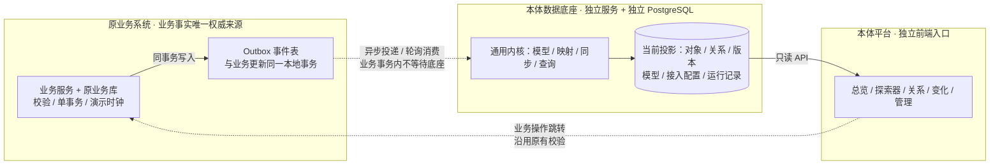
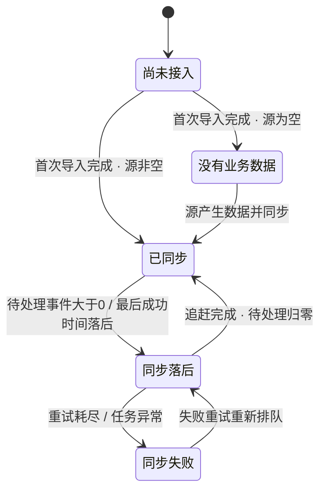
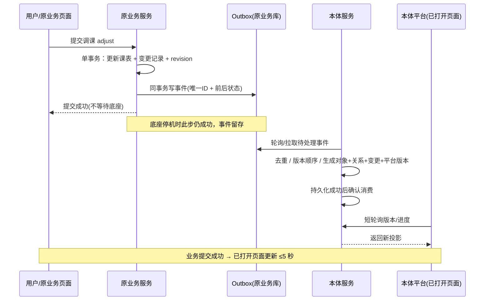

# 增量 PRD：本体数据底座与本体平台

> 角色/作者：产品经理 许清楚（Xu）｜版本 v1.0｜依据上游 [`00-原始需求.md`](./00-原始需求.md)（用户 2026-11-15 请求）
> 项目目录：`school-panorama-demo`（增量改造，不新建仓库）

---

## 0. 文档定位与边界

| 项 | 说明 |
| --- | --- |
| 文档性质 | **增量 PRD**，唯一权威需求来源为 `00-原始需求.md`；本文件是对其的产品化拆解与验收口径定义 |
| 只描述 | 「要什么 / 为什么 / 怎么验收」——产品目标、用户价值、需求池、可复现验收标准、状态语义、扩展边界 |
| **不描述** | 架构设计、文件清单、模块划分、任务分解、接口字段定义（由架构师与实现方产出） |
| 不改动的既有资产 | 现有源码、`AGENTS.md`、现有 `docs/API-CONTRACT.md`（前后端唯一契约，本轮不修改、不污染） |
| 技术基线 | 沿用现有 Java 21 + Spring Boot 3 + MyBatis Plus、Vue 3 + TS + Vite + Element Plus、PostgreSQL 17；本轮不切换语言/框架 |

**术语约定**（避免歧义）：

| 术语 | 含义 |
| --- | --- |
| 原业务系统 | 现有学校全景演示系统（业务库 `lesson_sessions`/`change_records`/`demo_state`/`system_revision` 等），业务事实**唯一权威来源** |
| 本体数据底座 | 新增的独立服务 + 独立 PostgreSQL，保存模型、接入配置、**当前投影**、运行记录的**可重建投影层** |
| 本体平台 | 新增的独立前端入口，只通过本体服务 API 读取投影，提供查询/关系/变化/管理界面 |
| 当前投影 | 底座中的对象实例、关系实例、来源引用、对象版本，可由原业务数据重建 |
| 审计历史 | 变更历史、同步任务、消费进度、错误记录；与「当前投影」生命周期分离 |
| 演示业务时间 | `demoTime`（原业务统一演示时钟），用于「当前课程/下一节课」等动态计算 |
| 同步处理时间 | 事件入库、消费成功、最后成功同步等真实处理时钟，用于衡量新鲜度 |

---

## 1. 项目信息

| 字段 | 值 |
| --- | --- |
| Language | 简体中文（界面文案、文档、注释） |
| Programming Language | 沿用现有栈：Java 21 / Spring Boot 3 / MyBatis Plus；Vue 3 / TS / Vite / Element Plus；PostgreSQL 17（+ JSONB）；Docker Compose |
| Project Name | `school_ontology_increment`（增量标识，非新建目录） |
| 原始需求复述 | 在**已有业务系统之外**，新增独立的本体数据底座与本体平台，将原系统数据映射为统一业务对象与关系，提供跨对象查询、关系探索、变化追踪、全景展示，并形成真实可恢复的数据同步闭环；本轮用 PostgreSQL 验证，达梦与其他 Java 系统仅列适配边界 |

---

## 2. 产品目标与边界

### 2.1 产品目标（3 个正交目标）

| # | 目标 | 为什么（用户价值） | 可度量信号 |
| --- | --- | --- | --- |
| G1 | **建立独立、可重建的本体数据底座**，作为原业务事实的统一投影 | 跨对象查询不再散落在各业务页面；底座可在原业务停机时独立服务，且不产生第二套竞争事实源 | 底座可清空重建且身份/属性/关系一致；原业务停机期间写入不失败 |
| G2 | **模型驱动的通用内核**，定义真正驱动接入、实例生成、查询与前端展示 | 新增业务对象/领域无需改通用内核与通用前端，具备继续接入其他业务领域的能力 | 教室类型仅通过定义+映射+适配接入，通用查询内核与前端零专用分支 |
| G3 | **不破坏原业务的前提下，形成可观测、可恢复的真实同步闭环** | 让用户信任「原业务改一处、平台处处一致」，且能区分数据状态、追溯来源、定位失败 | 六类验收全部实际执行并落盘；≤5 秒跨系统更新；失败可重试/对账修复 |

### 2.2 三者职责（唯一职责表）

| 职责 | 原业务系统 | 本体数据底座 | 本体平台 |
| --- | --- | --- | --- |
| 业务操作/校验/事务 | **负责**（唯一权威） | 不负责 | 不负责（只跳转） |
| 业务事实权威来源 | **负责**（原业务库） | 不是（仅投影） | 不是 |
| 事件记录/异步投递 | **负责**（本地事务内写 Outbox） | 不负责投递 | 不负责 |
| 模型/映射/接入配置 | 不负责 | **负责** | 只查看 |
| 当前对象/关系投影 | 不负责 | **负责**（可重建） | 只读 |
| 变更历史/同步任务/进度/错误 | 不新增事实（原有 change_records 保留） | **负责** | 只展示 |
| 查询/关系/变化/总览 API | 保留原有（不改动契约） | **负责**（本体 API） | 只调用底座 API |
| 业务操作按钮 | 执行 | 不接受直接写 | **跳转**原业务页面/接口，沿用校验 |

### 2.3 职责与依赖方向（示意图）

> 关键：**依赖是单向、异步的**。原业务 → 底座只有「异步事件」，底座/平台 → 原业务只有「跳转」，不存在原业务对底座的同步调用。

### 2.4 不可逾越的边界（MUST / MUST NOT）

| 类型 | 约束 |
| --- | --- |
| MUST | 底座中的当前对象与关系是**可重建的数据投影**，不得形成另一套相互竞争的业务事实源 |
| MUST | 原业务更新与事件写入**同一本地事务**；业务处理**不得同步依赖**本体平台可用 |
| MUST | 原业务停止服务时，本体平台仍能查询已同步数据，并明确显示数据新鲜度 |
| MUST NOT | 平台不得通过直接修改底座投影来**冒充业务操作成功**；平台不写入原业务库 |
| MUST NOT | 底座停机、消费失败、事件积压**不得**导致原业务写入失败或事务回滚 |
| MUST NOT | 通用内核/通用前端不得通过不断增加业务类型 `switch/if` 扩展功能；学校领域代码集中在映射/适配模块 |
| MUST | 业务库迁移必须适用于**已有数据卷**，不依赖删除原业务数据重新初始化；保护现有数据与其他项目 |

### 2.5 现有写入口基线（读码事实，用于「覆盖全部写入口」验收）

> 来源：`ApiController.java` / `AdjustService.java` / `DemoClockService.java` / `01_schema.sql`。这是**本轮 Outbox 必须覆盖的写入口事实基线**。

| 写入口 | 单事务内改动 | 递增 `system_revision` | 备注 |
| --- | --- | --- | --- |
| `POST /api/schedule/{id}/adjust` | `lesson_sessions`（教师/教室/日期/起止/version+1）、`change_records` 新增 | 是 | 主调课闭环 |
| `POST /api/demo/clock` | `demo_state`（demo_at / running / anchor） | 是 | 改演示时间，影响动态结果 |
| `POST /api/demo/clock/sync-today` | `lesson_sessions` 日期平移、`lesson_session_seed`、`change_records` 时间与 JSONB 日期、`demo_state` | 是 | **批量改写**课表 |
| `POST /api/demo/reset` | `lesson_sessions` 从 seed 恢复、`change_records` 删非种子+归位、`demo_state` | 是 | **批量改写**课表 |
| `POST /api/schedule/{id}/preview` | 不写入（仅校验） | 否 | 无需接入事件 |

> 事实：契约与控制器中**未见独立「批量调整」接口**；README 中「一键填入推荐调课方案」为前端填充单个 `adjust` 表单。见 §8 Q1。

---

## 3. 用户故事

> 格式：作为 [角色]，我希望 [能力]，以便 [价值]。覆盖上游要求的全部场景关键词。

| # | 用户故事 | 覆盖关键词 |
| --- | --- | --- |
| US-01 | 作为查询者，我希望在总览页用一个搜索框**直达任意具体对象**（无需沿学校→班级→学生逐级进入），以便快速定位 | 全局直达搜索 |
| US-02 | 作为查询者，我希望任一类型都由**同一套通用对象详情**动态渲染，展示当前属性、动态计算结果、正/反向关联、最近变化、来源系统/来源记录/映射信息与「返回原业务对象」入口，以便一致地理解对象 | 通用对象详情 |
| US-03 | 作为分析者，我希望同时用**关系列表和关系图**以一个对象为中心展开 1~2 层关系，并能点击一条关系看清它来自哪个字段、关联查询或计算规则，以便理解关系成因 | 关系探索与图 |
| US-04 | 作为审计者，我希望从**旧对象与新对象两侧都能查到同一次关系变化**（如老师替换后旧老师历史仍保留），以便双侧追溯 | 变化与影响双侧可查 |
| US-05 | 作为审计者，我希望界面明确区分「本身发生变化的对象」与「按规则计算出的相关对象」并显示判断依据，避免把邻接对象都误标成业务状态已改变 | 变化影响判定 |
| US-06 | 作为平台管理员，我希望查看对象类型/属性/关系类型/数据源/映射定义与版本，并有**全量导入、对账、同步任务、失败重试**入口，以便管理接入 | 模型与接入管理 |
| US-07 | 作为运维者，我希望首次导入、手动重跑、进度查看与失败重试都可操作且结果可核对，以便在异常后恢复数据 | 全量导入/对账/重试 |
| US-08 | 作为查询者，我希望**原业务服务停止后**仍能查询已同步对象，并看到「来源不可用」与「最后成功同步时间」，以便判断数据还能不能用 | 原业务停止后仍可查 / 新鲜度 |
| US-09 | 作为平台建设者，我希望**教室类型后接入**时只增加定义、映射及必要适配器，通用搜索/详情/关系探索无需新增教室专用页面，以便证明内核通用性 | 教室类型后接入 |
| US-10 | 作为业务用户，我希望平台上的业务操作按钮**跳转原业务页面/接口并沿用原有校验**，而不是在平台里改数据，以便保证业务正确性 | 原业务操作跳转 |
| US-11 | 作为查询者，我希望「当前课程/下一节课」随**演示业务时间**跨过上课边界自动变化（即使无任何数据库写入），以便看到真实动态结果 | 时间驱动的动态结果 |
| US-12 | 作为审计者，我希望抽查任一属性/关系都能追溯到原记录与映射依据，且重建当前投影后身份/属性/关系不变、历史保留，以便信任平台数据 | 来源追溯与可重建 |

---

## 4. 需求池（P0 / P1 / P2，逐条给验收口径）

> 优先级定义：**P0 = Must have（本轮必须真实落地的闭环）**；**P1 = Should have（增强，不阻塞核心验证）**；**P2 = Nice to have / 未来扩展（仅列适配边界，不宣称实现）**。
> 「验收口径」= 能被观测/复现的结果，不是实现手段。

### A. 架构与边界（对应上游第二章、第八章）

| 编号 | 需求（要求语言） | 优先级 | 验收口径（可观测结果） |
| --- | --- | --- | --- |
| A1 | 系统 **must** 新增独立本体服务、独立 PostgreSQL 库、独立连接/持久化与独立访问入口；**must** 保留原业务入口并新增本体平台入口 | P0 | Compose 一键启动后存在独立容器、独立库、独立端口；两个入口分别可进入且原业务页面功能不变 |
| A2 | 底座 **must** 至少保存四类数据：本体模型、接入配置、当前数据（对象/关系/来源引用/版本）、运行记录（变更历史/同步任务/消费进度/错误） | P0 | 四类数据均可查询且来自真实运行，不是硬编码；界面可查看定义与运行记录 |
| A3 | 当前投影 **must** 可重建、**must not** 成为第二业务事实源；重建 **must not** 删除审计历史 | P0 | 清空当前投影后由原业务重建：对象身份/当前属性/关系与重建前一致；审计历史条数不减少 |
| A4 | 业务处理 **must not** 同步依赖底座；底座停机期间原业务 **must** 仍能完成多次合法修改 | P0 | 停本体服务后连续执行 adjust/时钟/reset 全部成功且单事务完整，事件留存在本地、不丢 |
| A5 | 平台 **must** 只读底座；业务操作 **must** 跳转原业务或调原接口沿用校验，**must not** 改投影冒充成功 | P0 | 平台点业务按钮落到原业务；在同步完成前底座投影不变；原业务库无来自平台/底座的写入 |
| A6 | 业务库迁移 **must** 适用于已有数据卷，不依赖删卷重建 | P0 | 在已有 `school-panorama_dbdata` 卷上 `up --build` 后，原调课结果、变更记录、revision 仍在 |

### B. 模型真正驱动运行时（对应上游第三章）

| 编号 | 需求（要求语言） | 优先级 | 验收口径（可观测结果） |
| --- | --- | --- | --- |
| B1 | 对象类型定义 **must** 含：标识/显示名/说明、稳定身份规则、属性名/类型/展示名/校验、默认标题/列表字段/可搜索可筛选字段、来源映射、派生属性或计算器引用；**must** 支持校验、加载、版本记录 | P0 | 定义以 YAML/JSON/Java 注册方式加载并带版本；非法定义加载报错；改定义能改变前端类型列表/列表列/详情字段/可搜索项 |
| B2 | 关系类型定义 **must** 含：标识/名称/起止类型/正反展示名/方向/基数/业务有效时间/生成规则/来源映射；关系实例 **must** 说明两端对象、存在原因、来源原始记录、映射版本 | P0 | 关系列表/图按定义生成；点任一关系可查到两端、生成依据、来源记录 ID 与映射版本 |
| B3 | 对象全局 ID 与来源主键 **must** 分开；不同数据源相同主键/相同名称 **must not** 自动合并 | P0 | 构造两个来源的同主键/同名记录，平台呈现为两个不同全局 ID；重建后全局 ID 稳定不变 |
| B4 | 来源映射 **must** 支持：①一张表→一种对象 ②字段映射/简单转换/稳定 ID ③外键生成关系 ④联表或明确规则生成派生属性与关系 ⑤Java Provider/Resolver 承载复杂逻辑 | P0 | 学校首批对象全部由映射定义产出（非专用分支）；至少各有 1 处派生属性、联表关系与 Provider/Resolver 的真实样例可查 |
| B5 | 接入、实例生成、查询、前端展示 **must** 实际使用定义，**must not** 只建元数据表而逻辑仍散落在专用分支 | P0 | 停用/改动某定义后，对应对象/列表/详情/关系结果随之变化；无「只建表不用」的空壳 |
| B6 | 学校领域代码 **must** 集中在映射/适配模块；通用内核与通用前端 **must not** 靠增加业务类型 `switch/if` 扩展 | P0 | 见验收四：接入教室时通用查询内核与通用前端零教室专用分支（由验收报告的文件差异佐证） |

### C. 学校数据接入（对应上游第四章）

| 编号 | 需求（要求语言） | 优先级 | 验收口径（可观测结果） |
| --- | --- | --- | --- |
| C1 | 首批 **must** 接入学校/班级/学生/老师/课程 + **「具体授课安排」作为独立对象**（承载日期、时间、课程、老师、班级等关系） | P0 | 类型列表含 6 类 + 授课安排对象；授课安排详情含「哪一天/哪节课/什么角色」，不因直连师生而丢失信息 |
| C2 | **must** 明确区分：来源直接存在的属性/关系、映射或计算得到的属性/关系、依赖查询时间的动态结果 | P0 | 定义与详情中三类可辨识；「下一节课」在**无任何写入**情况下，跨过上课边界（如 10:45）结果变化 |
| C3 | 动态计算 **must** 通过明确的领域扩展接口接入并展示计算依据，**must not** 散落多页面重复实现 | P0 | 各处展示的当前/下一节课结果一致，且附带可读的计算依据；无重复实现 |
| C4 | **must** 预留原库已有的教室类型，核心平台完成后通过增加定义/映射/必要适配器接入，证明通用搜索/详情/关系探索**无需教室专用页面** | P0 | 见验收四：教室可被全局搜索、打开通用详情、展开关系图，且未新增教室专用页面 |
| C5 | 完整可视化建模器 **could** 提供（首版界面可先查看定义，不强制） | P2 | 本轮不作为验收项；仅在 §5 列为未来扩展 |

### D. 真实数据同步闭环（对应上游第五章）

| 编号 | 需求（要求语言） | 优先级 | 验收口径（可观测结果） |
| --- | --- | --- | --- |
| D1 | 全量导入 **must** 支持首次/手动重跑/进度查看/失败重试；重复导入 **must not** 产生重复对象与关系 | P0 | 连续两次全量导入：对象数、关系数、全局 ID 均不变；进度与失败重试结果可见 |
| D2 | **must** 设计快照与增量衔接策略：导入期间的业务修改不遗漏、不被旧快照覆盖 | P0 | 导入进行中发起一次 adjust，导入结束后平台最终状态 = 最新业务状态，该变化记录不丢 |
| D3 | **must** 支持从原业务数据重建当前投影；重建 **must not** 顺手删除审计历史 | P0 | 重建前后对象身份/属性/关系一致；变更历史、同步任务、错误记录按明确策略保留 |
| D4 | 增量同步 **must** 优先采用事务 Outbox：业务更新与事件同本地事务、异步投递、底座持久化成功后才确认、事件唯一 ID 且携带前后状态或等价信息、**must** 处理去重/重试/版本顺序/删除/失败恢复、一次变化的对象+关系+变更记录+平台版本一致 | P0 | 见验收三 6 种情况逐一可复现通过；单次 adjust 后对象、关系、变更记录、平台版本四者一致 |
| D5 | **must** 覆盖当前已有的全部相关写入口（见 §2.5），**must not** 只接通某一个按钮 | P0 | adjust、演示时钟变更、sync-today、reset 分别执行后，底座都能观察到对应的正确变化；preview 不产生事件 |
| D6 | **must not** 引入 Kafka；**must** 用数据库轮询/轻量异步投递，并**说明且测试**如何避免漏事件、重复事件、旧事件覆盖新状态 | P0 | 有可复现测试证明漏/重/乱序三类问题均被处理（非仅文档声明）；无消息集群组件 |
| D7 | 对账 **must** 可重复执行、识别原业务与投影不一致；绕过业务服务直接改库 **must** 能发现当前差异；未捕获历史 **must not** 伪造操作人/发生时间/中间过程 | P0 | 手动直改库后对账列出差异并可修复当前投影；修复后与源一致；历史中不出现伪造的操作人与时间 |
| D8 | **must** 清晰展示数据源状态、最后成功同步时间、处理进度、待处理数量、错误及重试结果；同步处理时间 **must** 与演示业务时间分开记录 | P0 | 界面/接口能分别读到两类时间且语义不混用；停底座 10 分钟后恢复，「最后成功同步时间」反映真实追赶时刻 |

### E. 平台界面（对应上游第六章）

| 编号 | 需求（要求语言） | 优先级 | 验收口径（可观测结果） |
| --- | --- | --- | --- |
| E1 | 全景总览 **must** 显示对象/关系规模、数据源状态、同步状态、近期变化及影响摘要，并提供全局搜索入口 | P0 | 各项可见且有真实数值；从总览搜索可直达具体对象（不必逐级进入） |
| E2 | 通用对象探索器 **must** 按类型定义动态生成类型列表/对象列表/详情；详情 **must** 含当前属性+动态结果、正/反向关联、最近变化、来源系统/记录/映射、返回原业务入口；**must** 支持筛选、分页、保留查询上下文 | P0 | 任一类型均由同一套通用视图渲染；详情字段随定义变化；筛选/分页后返回仍保留上下文 |
| E3 | 关系探索 **must** 同时提供列表与图；**must** 支持以对象为中心展开 1~2 层、设置分页/节点上限；点关系 **must** 解释来自哪个字段/关联查询/计算规则；关系变化 **must** 看到旧关系结束、新关系建立及相关对象 | P0 | 每项操作可观测；老师替换后可看到旧关系结束与新关系建立及两端对象 |
| E4 | 变化与影响 **must** 展示属性前后差异、关系增减、来源事件及时间；**must** 从原对象和新对象两侧都能查到同一次关系变化；**must** 区分「本身变化」与「按规则计算的相关对象」并显示判断依据 | P0 | 老师替换后旧老师历史仍保留该变更；邻接对象不被全部标为业务状态已改变 |
| E5 | 模型与接入管理 **must** 可查看对象类型/属性/关系类型/数据源/映射定义与版本，并提供全量导入、对账、同步任务查看、失败重试入口 | P0 | 定义与版本可查；四个入口可操作且产生真实结果（非假按钮） |
| E6 | 使用者 **must** 能区分「没有业务数据 / 尚未接入 / 同步落后 / 同步失败」，并在原业务停止时显示来源不可用与最后同步时间（状态定义见 §6） | P0 | 四种状态各有明确不同呈现、可构造复现；停原业务服务后平台仍可查已同步数据并显示相应标记 |
| E7 | 平台界面 **must** 全中文、五部分齐全，与现有界面「演示数据/演示时间」标注一致 | P0 | 五个部分（总览/探索器/关系/变化/管理）均可进入；文案全中文 |
| E8 | 界面 **should** 具备响应式（桌面与手机宽度可操作） | P1 | 390px 宽度下搜索、详情、关系图不溢出（增强项，不阻塞核心验收） |

### F. 验收交付与回归（对应上游第七、八章）

| 编号 | 需求（要求语言） | 优先级 | 验收口径（可观测结果） |
| --- | --- | --- | --- |
| F1 | 六类验收 **must** 全部**实际执行**并落盘结果（场景与标准见 §7），**must** 记录测试条件与环境 | P0 | 每类验收有可复现步骤、实测结果、耗时/条件记录；非「文档声明支持」 |
| F2 | 跨系统变化 **must** 在本地无故障环境下 ≤5 秒；页面刷新失败 **must** 重试，**must not** 因提前记住新版本号而永久停留旧数据 | P0 | 见验收一：多个已打开视角自动更新并计时；注入刷新失败后仍能恢复到最新 |
| F3 | **must** 提供 Docker Compose 一键启动（原业务、本体服务、两个数据库、前端），**must** 在已有数据卷上平滑升级 | P0 | `up -d --build` 后全部服务 healthy；原数据与调课结果不丢（与 A6 联验） |
| F4 | **must** 提供分开的原业务 API 与本体 API 契约；现有 `docs/API-CONTRACT.md` **must not** 被改动 | P0 | 存在独立本体 API 契约文档；原契约内容逐字未变、原前端联调不退化 |
| F5 | **must** 交付 8 项成果（代码+Compose、架构说明、定义/映射/扩展接口样例、导入/同步/恢复/重建说明、双契约、编译/集成/浏览器验收结果、可照做的演示路径、原业务改动与适配清单） | P0 | 逐项可核对；演示路径「原业务修改→底座同步→对象/关系变化→历史与来源追溯」可照做成功 |
| F6 | 原业务回归 **must** 通过：原有入口、调课校验、事务、演示功能继续可用；业务时钟变化后动态结果正确（**不依赖数据变更事件**） | P0 | 见验收六：现有接口/浏览器/持久化回归不退化；四个时间边界动态结果正确 |
| F7 | **must not** 用静态假数据、仅前端联动或固定学校页面代替上述闭环 | P0 | 所有展示数值来自底座真实投影；断开源/停服务后的行为与真实同步一致 |
| F8 | 图数据库、搜索集群、复杂消息集群、完整权限治理、达梦数据库、其他 Java 系统接入 **could** 作为未来扩展 | P2 | 本轮不实现、不验收；仅在 §5 列适配边界与待验证项 |

**优先级统计**

| 优先级 | 条目数 | 本轮定位 |
| --- | --- | --- |
| **P0** | **38**（A6+B6+C4+D8+E7+F7） | 必须真实落地并形成闭环，全部映射 §7 验收 |
| P1 | 1 | 响应式增强（E8） |
| P2 | 2 | 可视化建模器（C5）、范围外基础设施与适配（F8，含 §5 扩展项） |

---

## 5. 已实现能力与未来扩展项：划分原则

### 5.1 三分法判定原则（必须用于最终汇报，避免夸大）

| 类别 | 判定原则（三者全满足才归入） | 本轮允许的措辞 |
| --- | --- | --- |
| **已实现且已验证** | ① 有真实运行代码 ② 有真实测试执行 ③ 有落盘结果记录 | 「已实现并验证」 |
| **已实现但待验证** | 有代码路径，但缺少实测或结果记录 | 「已实现，待验证」，不得写成已验证 |
| **未来扩展（仅边界）** | 只有适配接口/设计说明，无实现、无测试 | 「仅列适配边界与待验证项」 |

> 硬性措辞约束：**本轮只用 PostgreSQL 验证**。达梦数据库、其他 Java 业务系统接入 **不得宣称「已支持 / 已完成 / 已兼容」**，只能写「适配边界已定义，待验证」。首版真实接通的数据源**只有一个**（现有学校业务库）。

### 5.2 本轮明确「已实现范围」（用于对比，不是承诺清单）

| 维度 | 本轮结论 |
| --- | --- |
| 数据库 | 独立 **PostgreSQL** 关系表 + JSONB + 必要索引（已实现并验证） |
| 数据源 | 现有学校业务系统 **1 个**（已实现并验证） |
| 通用内核扩展方式 | 新增来源的适配接口已定义；学校领域集中在映射/适配模块（本轮以教室后接入验证） |
| 明确不引入 | 图数据库、搜索集群、复杂消息集群、完整权限治理平台 |

### 5.3 未来扩展：适配边界与待验证项（**不得宣称已支持**）

**达梦数据库适配待验证项**

| # | 待验证项 | 说明 |
| --- | --- | --- |
| 1 | SQL 方言与 DDL 差异 | `CREATE TABLE IF NOT EXISTS`、`BIGSERIAL`/序列、幂等初始化脚本 |
| 2 | JSONB 替代方案 | 达梦的 JSON/大字段类型、JSON 函数与索引能力差异 |
| 3 | UPSERT / `ON CONFLICT` | 幂等写入与去重语法差异 |
| 4 | 事务级咨询锁 | `pg_advisory_xact_lock` 的等价机制（原业务并发调课已使用） |
| 5 | Outbox 轮询与隔离级别 | 轮询查询、锁、可见性与顺序保证在达梦下的行为 |
| 6 | 时间/日期函数 | `now()`、日期平移、时间戳格式与演示时间语义 |
| 7 | 驱动与连接配置 | JDBC 驱动、URL、连接池、端口隔离 |
| 8 | 大小写/保留字/标识符 | 表名列名大小写、保留字冲突 |

**其他 Java 业务系统接入待验证项**

| # | 待验证项 | 说明 |
| --- | --- | --- |
| 1 | 来源表结构与主键 | 稳定 ID 生成规则、复合主键、软删除识别 |
| 2 | 事务与 Outbox 植入 | 如何在目标系统单事务内写事件、不侵入业务校验 |
| 3 | 字段映射与类型转换 | 类型体系、枚举、空值、编码差异 |
| 4 | Provider / Resolver SPI | 复杂业务逻辑以明确接口承载的契约与加载机制 |
| 5 | 前后状态捕获 | 事件携带足以还原变化的信息、删除事件表达 |
| 6 | 多数据源身份隔离 | 不同来源相同主键/同名不合并（B3 的跨系统验证） |
| 7 | 业务时间语义 | 目标系统是否有可对照的「演示业务时间」，动态计算如何定义 |

---

## 6. 数据新鲜度与状态语义

### 6.1 四种（+ 基准）状态定义

> 上游要求区分的四种是**非正常/空状态**；为可判定，额外给出基准态「已同步（新鲜）」作为对照。

| 状态 | 含义 | 触发/判定条件 | 界面呈现要求 | 可复现构造方式 |
| --- | --- | --- | --- | --- |
| 已同步（新鲜，基准） | 投影与原业务当前一致 | 有最后成功同步时间，且待处理数 = 0、无未恢复失败 | 显示「已同步」+ 最后成功同步时间 | 正常启动并完成一次同步 |
| **没有业务数据** | 源为空，不是「没接上」 | 已配置数据源且有成功导入记录，但源表/对象数为 0 | 明确提示「源中暂无业务数据」，与「尚未接入」不同 | 用空数据源或清空源数据后导入 |
| **尚未接入** | 有数据源配置但从未成功导入 / 无映射版本 | 无成功导入记录、无映射版本生效 | 明确提示「尚未接入」，引导全量导入 | 只建数据源配置、不执行导入 |
| **同步落后** | 投影落后于源 | 待处理事件 > 0 或最后成功同步时间早于源最新变更 | 显示待处理数量、落后程度、处理进度 | 停本体服务期间在原业务多次写入后恢复前观察 |
| **同步失败** | 最近任务/事件失败且未恢复 | 存在失败事件、重试耗尽或任务异常 | 显示错误原因、重试结果、失败重试入口 | 人为制造消费失败/重试耗尽 |
| 来源不可用（标记，非第五态） | 原业务服务不可达 | 健康检查/连接探测失败 | 叠加在以上状态之上，显示「来源不可用」+ 最后成功同步时间 | 停止原业务服务 |

### 6.2 两类时间必须分开（不得混用）

| 维度 | 演示业务时间 `demoTime` | 同步处理时间 |
| --- | --- | --- |
| 本质 | 原业务的**统一演示时钟**（业务事实的一部分） | 真实的**处理/运维时钟**（运行记录的一部分） |
| 现有存储 | `demo_state.demo_at`、`change_records.occurred_at` | 事件入库时间、消费成功时间、最后成功同步时间、同步任务时间 |
| 特性 | 可设置/偏移/跟随真实时间/回拨/重置；用于计算「当前课程/下一节课」 | 单调递增，反映真实处理进度，不可回拨 |
| 展示位置 | 页面顶部「演示时间」、变更记录的「发生时间」 | 接入管理页「最后成功同步时间/处理进度/错误与重试」 |
| 用途约束 | **不得**用于衡量同步快慢或作为新鲜度依据 | **不得**用于计算业务动态结果、不得伪造成业务发生时间 |
| 验收口径 | 把时钟从 10:15 调到 10:45，「下一节课」变化，而同步处理时间不变 | 停底座 10 分钟后恢复，最后成功同步时间反映真实追赶时刻，而非演示时间 |

> 强约束：**同步处理时间不得写入 `change_records.occurred_at` 冒充业务发生时间；未捕获的历史不得伪造操作人、发生时间与中间过程**（对应 D7、验收三第 6 项）。

### 6.3 同步逻辑时序（示意，用于界定 ≤5 秒与「不等待」验收边界）

> 该图为**验收语义示意**，用于界定「业务提交即返回」与「≤5 秒可见」的边界；具体轮询周期、投递机制由架构师定义。

---

## 7. 六类验收 → 可复现测试场景与通过标准

> 通用要求（适用于全部六类）：**实际执行**、结果落盘、记录测试条件与环境；禁止静态假数据/仅前端联动；每条给出「可复现步骤 + 可观测通过标准」。演示数据引用 `docs/API-CONTRACT.md` 速查表（LS-003、TCH-005 陈思琪、ROM-06、第七节 15:30–16:15 等）。

### 验收一：跨系统变化（≤5 秒）

| 项 | 内容 |
| --- | --- |
| 场景 | ① 在本体平台同时打开同一对象的「详情 / 关系列表 / 关系图 / 变化记录」多个视角；② 在原业务页面对 `LS-003` 完成一次成功调课（教师→陈思琪 TCH-005、教室→ROM-06、时间→15:30–16:15、填写原因）；③ 从提交成功开始计时；④ 额外注入一次「页面刷新失败」后恢复 |
| 通过标准 | ① 所有已打开视角自动更新，**实测耗时 ≤5 秒**（记录耗时、机器/网络/轮询条件）；② 旧老师张明远与新老师陈思琪**两侧**都能查到同一次关系变化历史；③ 关系图可见旧关系结束、新关系建立；④ 刷新失败后能重试恢复到最新，**不因提前记住新版本号而永久停留旧数据** |
| 关联需求 | F2、A4、D4、E3、E4 |

### 验收二：独立运行与恢复

| 项 | 内容 |
| --- | --- |
| 场景 A | 停止本体服务 → 在原业务连续完成 ≥2 次合法调课 + 演示时钟变更 → 恢复本体服务 → 观察自动追赶 |
| 场景 B | 停止原业务服务 → 在本体平台查询已同步对象 |
| 通过标准 | A：期间原业务每次写入都成功且单事务完整（课表+变更记录+revision），Outbox 事件不丢；恢复后**最终状态与变化记录与逐次操作一致**（无漏事件、无旧覆盖）；B：平台仍可查看已同步对象，并显示「来源不可用」+「最后成功同步时间」 |
| 关联需求 | A1、A4、D4、D6、E6 |

### 验收三：同步正确性（6 种情况，逐条可复现）

| # | 情况 | 可复现步骤要点 | 通过标准 |
| --- | --- | --- | --- |
| 1 | 同一事件重复投递 | 复制/重放同一事件 ID 多次 | 对象、关系、变更记录**均不重复**，结果幂等 |
| 2 | 较旧事件晚于新事件到达 | 人为让低版本事件后到达 | 最终状态 = **较新事件**，不被旧事件覆盖（版本顺序生效） |
| 3 | 同步中途失败和重启 | 消费处理到一半强制终止服务后重启 | 重启后从断点续处理，最终一致，无重复、无遗漏 |
| 4 | 全量导入期间发生业务修改 | 导入进行中执行一次 adjust | 修改**不遗漏**、**不被旧快照覆盖**，最终 = 最新业务状态 |
| 5 | 对象删除后的有效关系清理 | 删除某对象（含其来源记录消失的场景） | 其关联关系不再有效/被清理，无悬挂关系，变化记录可解释 |
| 6 | 对账发现遗漏变更并修复当前投影 | 绕过业务服务**直接改库**，再执行对账 | 对账列出当前差异并修复投影；修复后与源一致；**未捕获历史不伪造操作人/发生时间/中间过程** |
| 关联需求 | D1、D2、D4、D6、D7、A3 | | 结果均可复现、非文档声明 |

### 验收四：新增对象类型（教室后接入）

| 项 | 内容 |
| --- | --- |
| 场景 | 核心平台完成后，**仅通过增加定义、映射及必要适配器**接入原库已存在的 `classrooms` 类型及其关系 |
| 通过标准 | ① 验收报告**列出此次新增类型实际修改的文件**，证明主要修改集中在定义/映射/适配模块；② 通用查询内核与通用前端**没有增加教室专用分支/页面**；③ 教室可被全局搜索、打开通用对象详情、在关系图中展开，无需任何教室专用页面 |
| 关联需求 | B5、B6、C4、G2 |

### 验收五：来源追溯与可重建

| 项 | 内容 |
| --- | --- |
| 场景 | ① 抽查若干对象属性与关系，逐项追溯；② 执行一次「从原业务重建当前投影」；③ 对比重建前后 |
| 通过标准 | ① 抽查项均可追溯到**原记录**及**映射依据/版本**（含生成原因）；② 重建后**对象身份（全局 ID）、当前属性、关系与重建前一致**；③ 审计历史按明确策略**保留**（条数不减少、不伪造） |
| 关联需求 | A3、B2、B3、B4、D3、D7 |

### 验收六：原业务回归

| 项 | 内容 |
| --- | --- |
| 场景 | ① 执行现有接口自动化验收（51 项）、浏览器验收（42 项）、容器重启持久化校验；② 依次把演示时间调到 07:30 / 10:15 / 10:45 / 17:00 观察动态结果 |
| 通过标准 | ① 原有业务入口、调课校验（6 类冲突）、单事务、演示功能**全部继续可用，回归项不退化**；② 「当前课程/下一节课」随**业务时钟**变化正确，17:00 后显示空状态，**不能只依赖数据变更事件更新**（即无写入也应变化） |
| 关联需求 | F6、C2、C3、F4 |

---

## 8. 待确认问题与默认建议

> 原则：每条给出**主理人可直接采用的默认建议**，避免阻塞架构设计与实现；仅标注「需拍板」的才需要决策，其余按默认执行即可。

| # | 问题 | 背景（读码事实） | 默认建议（可直接采用） | 是否需拍板 |
| --- | --- | --- | --- | --- |
| Q1 | 上游提到的「批量调整」写入口是否存在？ | `ApiController` 与 `API-CONTRACT.md` 中**未见独立批量调课接口**；只有 `POST /api/schedule/{id}/adjust` 与前端「一键填入推荐方案」（填充单个表单）；`sync-today`/`reset` 属批量改写课表 | 以 **§2.5 实际存在的 4 个写入口**为 Outbox 覆盖基线，不虚构批量接口；若确认为规划中接口，则同等纳入 D5。若主理人确认「批量调整」= `sync-today`/`reset`，按默认口径执行 | **需确认**（事实核对） |
| Q2 | `sync-today` / `reset` 会批量改写课表与变更记录，事件如何表达？ | 二者在单事务内大批量改动 `lesson_sessions`、`change_records` | PRD 只定**验收口径**：重置/平移后底座投影与源一致、历史按策略保留、不产生重复；逐条事件 vs 全量快照标记由架构师定，不阻塞本 PRD | 否（交架构师） |
| Q3 | 本体服务/库/前端的独立端口与 Compose 命名 | 已占用 5432/8080/5173/8083；本项目已用 5180/18080/55432 | 新增服务使用**未占用的独立端口**、独立命名卷，不改动现有端口与卷；具体值由架构师定 | 否 |
| Q4 | 本体平台「全局直达搜索」覆盖哪些类型 | 原业务 `/api/search` 仅支持 `student\|teacher` | 覆盖**所有已接入类型**（含授课安排、后接入教室），按模型定义的「可搜索字段」；至少支持姓名/编号/名称 | 否（采用默认） |
| Q5 | 关系图展开层数与节点上限默认值 | 上游要求 1~2 层、分页或上限 | 默认支持 1 层/2 层切换，节点上限可配置（如 ≤50）并分页 | 否（采用默认） |
| Q6 | 重建当前投影时的审计历史保留策略 | 上游要求「不能顺手删除已有审计历史」 | 默认：**仅重建当前对象与关系**，变更历史/同步任务/消费进度/错误记录**全部保留**；重建过程本身记一条可追溯的运行记录 | 否（采用默认） |
| Q7 | 教室后接入是否本轮必做 | 上游验收四明确要求 | 默认：**是**，作为证明通用内核的必做验收项（排期由主理人在批次 3+4 安排） | 否（已由上游明确） |
| Q8 | 达梦 / 其他 Java 系统是否本轮实现 | 上游明确「不宣称已支持」 | 默认：**否**，仅在 §5 列适配边界与待验证项 | 否（已由上游明确） |

**给主理人的一句话**：本 PRD 已把上游八大节拆为 **38 条 P0** 可验收条目、六类验收逐条映射了场景与通过标准；除 **Q1（批量调整接口的事实核对）** 外，其余均有可直接采用的默认建议，不阻塞架构设计阶段。
