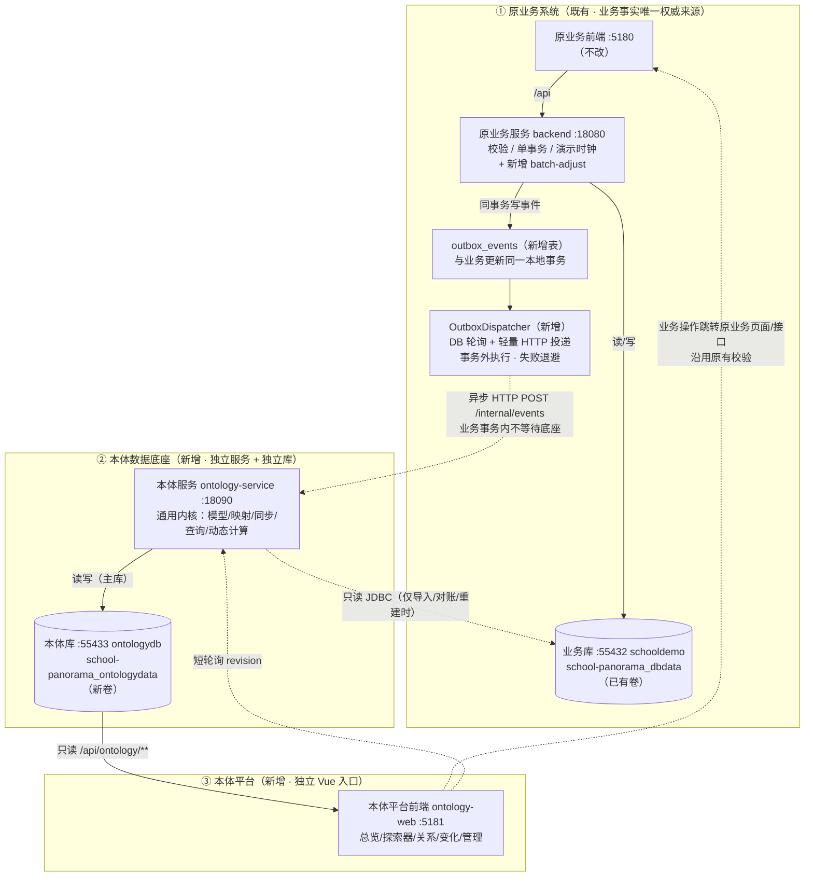
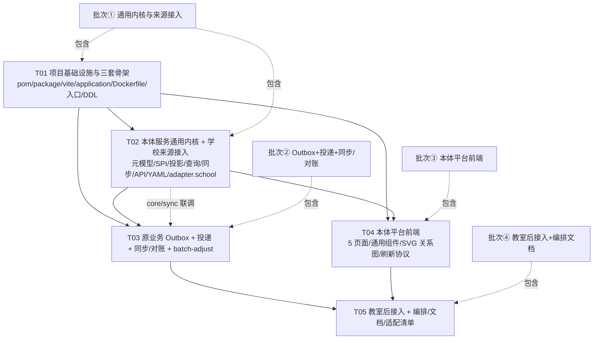

# 02 架构设计：本体数据底座与本体平台（增量）

> 角色/作者：架构师 高见远（Gao）｜版本 v1.0｜阶段：增量开发 SOP 第二阶段
> 唯一权威需求来源：[`00-原始需求.md`](./00-原始需求.md) → 产品化拆解 [`01-增量PRD.md`](./01-增量PRD.md)（415 行 / 38 条 P0 / 六类验收 / Q1–Q8）
> 上游已读：`AGENTS.md`、`docs/API-CONTRACT.md`、`docker-compose.yml`、`db/init/01_schema.sql`、`db/init/02_seed.sql`、`ApiController.java`、`AdjustService.java`、`DemoClockService.java`、`BusinessQueryService.java`、`SystemRevisionMapper.java`、`LessonSessionMapper.java`、`SchoolPanoramaApplication.java`、`application.yml`、`pom.xml`、`backend/Dockerfile`、`frontend/{router.ts,App.vue,api.ts,nginx.conf,package.json,vite.config.ts,Dockerfile}`

---

## 0. 文档定位、输入基线与边界

### 0.1 本设计要解决的本质问题

在**不改动原业务契约、不删除原业务数据卷**的前提下，于原业务系统之外新增一套「独立服务 + 独立库 + 独立入口」的本体底座与平台，并做到：

1. **投影而非第二事实源**：底座当前对象/关系可由原业务数据重建，重建不删审计历史；
2. **模型真正驱动运行时**：对象类型/属性/关系/来源映射的定义决定接入、实例生成、查询、前端渲染，学校领域代码集中在适配层，通用内核与通用前端不靠 `switch/if` 扩类型；
3. **真实、可恢复、可观测的同步闭环**：事务 Outbox → 异步投递 → 幂等消费 → 全量导入与增量衔接 → 对账 → 重建；≤5 秒跨系统可见；
4. **时间驱动的动态结果**：「当前课程/下一节课」依赖查询时间，无写入也随演示时钟变化。

### 0.2 主理人已拍板决策（必须纳入）

| 编号 | 决策 | 本设计落点 |
| --- | --- | --- |
| **Q1** | 读码事实：原系统**没有**独立「批量调整」接口（仅 `adjust`/`clock`/`sync-today`/`reset`）。本轮**新增一个真实批量调课接口** `POST /api/schedule/batch-adjust`（单事务、复用 `AdjustService` 同一套校验、产生批次 Outbox 事件），并明确标注「本轮新增，非原有」 | §6.1、§4.1、文件清单 `BatchAdjustService.java` |
| **Q1 覆盖基线** | Outbox 覆盖 = 原有 4 个写入口 + 新增批量接口；`preview` 不产生事件 | §4.1 事件矩阵 |
| **Q2** | 重建**只重建当前投影**，审计历史**全保留** | §3.1 表级策略、§4.6 |
| **Q5** | 关系图 1/2 层 + 节点上限（默认 ≤50）可配、可分页 | §7.4 |
| **Q7** | 教室类型**本轮必做**，作为证明通用内核的后接入验收项 | §2.3 预留、§10.3 批次④ |
| **Q8 / Q2–Q6 其余** | 采用 PRD 默认建议；达梦 / 其他 Java 系统**只在文档列适配边界与待验证项，不宣称已支持** | §8 |

### 0.3 环境事实与资源分配（设计必须适配）

| 项 | 值 | 说明 |
| --- | --- | --- |
| 现有端口 | 前端 `5180` / 业务 API `18080` / 业务库 `55432` | **不变** |
| 已探测空闲端口 | 本体 API `18090` / 本体库 `55433` / 本体平台前端 `5181` | 本设计采用，最终由主理人集成确认 |
| Compose 项目名 | `school-panorama` | 不变 |
| 业务卷 | `school-panorama_dbdata`（**已有数据且在运行**：2 校 / 14 教师 / 32 学生 / 24 节课 / 3 变更 / revision=84） | **绝不删卷重建** |
| 本体卷（新增） | `school-panorama_ontologydata`（命名卷，独立） | §1.3 |
| `db/init/*.sql` | **仅空卷时**由镜像执行 | Outbox 表必须走另一条幂等迁移（§4.2） |
| 现有三容器 | healthy | 增量服务并行追加 |
| 工具链 | Java 21 / Maven 3.9 / Node 22 / Compose v5；本地镜像 `postgres:17`、`node:22-alpine`、`maven:3.9.11-eclipse-temurin-21`、`eclipse-temurin:21-jre`、`nginx:alpine` 均已具备 | 不引入新镜像 |
| 技术栈（读码事实） | 后端 Spring Boot 3.4.5 + MyBatis Plus 3.5.7（**全注解式 Mapper**，`@MapperScan("com.school.panorama.mapper")`）；前端 Vue 3.5 + Vite 6 + vue-router 4 + Element Plus 2.9（`fetch` 同源 `/api`，nginx 反代） | 新增服务/前端**沿用同栈**，降低集成成本 |

### 0.4 本设计边界（我方只产出设计，不改实现）

- ✅ 产出：`docs/ontology/02-架构设计.md`（本文件）、`docs/ontology/03-本体API契约.md`。
- ❌ 不写实现代码；❌ 不修改任何现有源码；❌ **不修改** `docker-compose.yml`、`AGENTS.md`、`docs/API-CONTRACT.md`（原契约逐字保留）、`db/init/01_schema.sql`、`db/init/02_seed.sql`（其内容只在空卷生效，且属原业务资产）。
- 上述编排类改动以**「增量建议文本」**形式在 §9.4 给出，由主理人汇编。
- 所有 Mermaid 图（类图 / 时序图 / 任务依赖图 / 架构图）**内嵌于本文档**并附「图索引」（§12），便于主理人汇编与 QA 引用。

---

# Part A · 系统设计

## 1. 总体架构（三层 + 依赖方向 + 两库隔离）

### 1.1 三层架构图



> **依赖关系三条铁律**
> 1. 原业务 → 底座 **只有异步事件**（Outbox + HTTP 投递）；业务提交路径上**不存在**对底座的同步调用。
> 2. 底座 → 原业务库 **只有只读 JDBC**，且仅在「全量导入 / 对账 / 重建」运维期使用，不构成业务事务依赖，业务服务对此无感知。
> 3. 平台 → 原业务 **只有跳转**（沿用原校验）；平台**只读**底座投影，**绝不写**底座来冒充业务成功。

### 1.2 「业务不依赖底座」的四个具体落点

| 落点 | 实现约束 | 验收对应 |
| --- | --- | --- |
| L1 写入路径 | `adjust`/`batch-adjust`/`clock`/`sync-today`/`reset` 在**原业务本地单事务**内完成业务更新 + `system_revision` bump + Outbox 写入，事务**只连业务库** | A4、D4 |
| L2 无网络等待 | 业务响应在事务提交后立即返回；投递器是**独立调度线程**，不在 Controller/Service 调用链内发 HTTP | A4、§4.3 |
| L3 底座停机无感 | 底座不可达时投递失败只影响 Outbox 状态（PENDING→退避/DEAD），**不影响**业务事务提交与响应 | 验收二 A |
| L4 平台侧只读 | 平台业务按钮 `window.location` 跳转到 `:5180` 原业务页面或调用原业务 `/api`，底座库无来自平台/底座对业务库的写 | A5、E6 |

### 1.3 两个数据库、两套连接配置的隔离

| 维度 | 业务库 | 本体库 |
| --- | --- | --- |
| 容器 / 端口（宿主） | `school-panorama-db` / `55432` | `school-panorama-ontology-db` / `55433`（新增） |
| 库名 / 卷 | `schooldemo` / `school-panorama_dbdata`（**已有卷，保留**） | `ontologydb` / `school-panorama_ontologydata`（新增命名卷） |
| 拥有者 | 原业务服务（唯一写者） | 本体服务（唯一写者） |
| 结构来源 | `db/init/01,02_schema/seed`（空卷）+ **启动幂等迁移器**（已有卷，§4.2） | `db/ontology/01_schema.sql`（新卷，空卷由镜像执行）+ 本体服务启动幂等迁移器 |
| 谁连接 | 原业务服务（读写）；**本体服务只读**（运维期） | **仅本体服务**（读写） |
| 连接配置前缀 | 业务服务：`SPRING_DATASOURCE_*` | 本体服务：`ONTOLOGY_DB_*`（主库）、`SOURCE_DB_*`（业务库只读） |

**本体服务双数据源（关键隔离设计）**：

```yaml
# ontology-service/src/main/resources/application.yml（节选，示意）
server:
  port: 8080                       # 容器内；宿主映射 18090
spring:
  datasource:                      # 主数据源：本体库（读写，唯一写者）
    url: ${ONTOLOGY_DB_URL:jdbc:postgresql://ontology-db:5432/ontologydb}
    username: ${ONTOLOGY_DB_USER:onto}
    password: ${ONTOLOGY_DB_PASSWORD:onto123456}
    driver-class-name: org.postgresql.Driver
source-db:                         # 只读数据源：业务库（仅 SourceAdapter 导入/对账/重建用）
  url: ${SOURCE_DB_URL:jdbc:postgresql://db:5432/schooldemo}
  username: ${SOURCE_DB_USER:demo_ro}       # 建议只读账号，见 §11 待确认 Q-A
  password: ${SOURCE_DB_PASSWORD:demo123456}
  read-only: true
  hikari:
    maximum-pool-size: 4          # 与主池物理隔离，互不挤占
```

> 隔离要点：① 业务服务配置里**没有**任何本体库信息，本体服务配置里**没有**业务库写权限；② 两个 Hikari 池独立；③ 只读数据源用 `@DS("source")` / 独立 `JdbcTemplate` Bean + `setReadOnly(true)` 强制，事务里禁止对其写；④ 全量导入/对账的读不影响业务库事务（PostgreSQL MVCC 快照读）。

### 1.4 框架选型、架构模式与难点对策

| 难点 | 对策 | 选型/理由 |
| --- | --- | --- |
| 不侵入原业务 | 原业务只加「同事务事件写入 + 启动迁移器 + 投递器 + 批量接口」，不改校验规则、不改原契约返回结构 | Spring `@Transactional` + 注解 Mapper（与现有代码同风格） |
| 已有卷加表 | 启动幂等迁移器 `CREATE TABLE IF NOT EXISTS`（不依赖 `db/init`） | `ApplicationRunner` + 注解 DDL，天然幂等，随服务健康 |
| 不漏/不重/不乱序/旧不覆盖新 | Outbox 唯一 `event_id` + `processed_event` 去重表 + 每对象 `applied_revision` 版本比较 + 条件 UPSERT | PostgreSQL `ON CONFLICT ... WHERE excluded.rev >= 当前.rev` |
| 导入期间业务修改 | `system_revision` 作快照水位 `W0` + 导入末尾 `catchUp(W0)` 重放 + 版本水位防覆盖 | §4.4 算法（本设计核心） |
| 直改库差异 | 对账通过只读数据源**直读业务库当前状态**，不依赖事件 | §4.6 |
| 模型驱动、零 switch | YAML 定义 + 策略表注册（Spring 收集接口实现按 key 入 Map）+ 反射/DTO 动态渲染 | 不引入规则引擎/图数据库/搜索集群，符合 PRD 范围 |
| 动态结果随查询时间 | `DynamicResolver` SPI 每次调用基于 `queryTime` 实时算，结果不落库、附计算依据 | §5 |
| ≤5 秒可见 | 投递轮询 1s + 消费单事务 + 前端 1s 短轮询，最坏链路 ≈2.5s | §4.7 |
| 独立前端入口 | 新建 `ontology-web/` 复用 Vue3+Vite+Element Plus，nginx 反代 `/ontology-api` → 本体服务 | 不引入 d3/echarts 等重型依赖，关系图用轻量 SVG |

**架构模式**：原业务保持现有「Controller → Service → Mapper」分层；本体服务采用「**分层 + 策略/注册**」——`controller`（API）→ `service`（通用内核：模型、投影、同步、查询、动态）→ `spi`（扩展点接口）→ `adapter/school`（学校领域实现）→ `repository`（双数据源）。前端采用「**模型驱动的通用组件 + 容器页面**」。

---

## 2. 本体元模型、数据结构与通用内核扩展点

### 2.1 定义文件组织与映射版本

```
ontology-service/src/main/resources/ontology/
  model/
    object-types.yaml          # 对象类型定义（6 类 + classroom 预留）
    relation-types.yaml        # 关系类型定义
  mapping/
    school-source.yaml         # 数据源 + 来源映射（表→对象、字段、关系、派生、Provider 引用）
    school-provider.yaml       # Java Provider / Resolver 注册清单
```

- 加载器 `ModelDefinitionLoader`（`@PostConstruct`）：读 YAML → 强校验（类型引用存在、起止类型存在、身份规则合法、字段类型枚举内、`searchable ⊆ attributes`）→ 失败则**启动报错**（B1「非法定义加载报错」）。
- **映射版本记录**：每次加载落 `ont_mapping_version`：`mappingVersion = sourceId + ":" + sha256(所有定义文件内容拼接)[:12]`，同时记 `definitionHash`、`activatedAt`、`status`。定义变更 → 新版本；对象实例、关系实例、来源引用均带 `mapping_version`，可追溯「由哪个映射版本生成」（B2）。
- 前端「模型与接入管理」页读 `GET /api/ontology/model/types` 与 `/model/mappings`，定义改变即改变类型列表/列/详情字段/可搜索项（B1、B5）。

### 2.2 稳定全局 ID 规则（B3 硬性）

```
globalId = "gid:" + sourceId + ":" + objectType + ":" + sourcePk
```

| 组成 | 取值 | 说明 |
| --- | --- | --- |
| `sourceId` | 数据源标识，如 `school-panorama`（配置于 `school-source.yaml`） | **跨源隔离的根本**：不同源即使主键/名称相同也落在不同 `globalId` |
| `objectType` | 对象类型标识，如 `student` | 与来源主键分开 |
| `sourcePk` | **来源表主键值字符串化**（如 `students.id=1` → `"1"`），非 code、非 name | 稳定、不受改名影响；code/name 另存 `attributes` 与 `ont_source_ref.source_code` 供展示 |

- 例：`gid:school-panorama:student:1`、`gid:school-panorama:lessonSession:3`。
- **禁止跨源按名称合并**：全局 ID 不含 name；`ont_object` 唯一键为 `(source_id, object_type, source_pk)`，不同源同主键是两行；重建后按同一规则重算，全局 ID **稳定不变**（验收五）。
- `sourcePk` 不可变前提：来源主键稳定；若未来系统用复合主键，规则扩展为 `pk1|pk2`（见 §8 待验证项），本轮单主键即可。

### 2.3 对象类型定义 YAML（学校领域全部 6 类 + 教室预留）

```yaml
# ontology/model/object-types.yaml
version: 1
# 字段覆盖 B1：标识/显示名/说明 · 稳定身份规则 · 属性(名/类型/展示名/校验) ·
# 默认标题/列表字段/可搜索/可筛选字段 · 来源映射 · 派生属性/计算器引用
objectTypes:
  - id: school
    displayName: 学校
    description: 原业务 schools 表映射的基础组织对象
    identity:
      sourceId: school-panorama
      sourceTable: schools
      sourcePk: id
      globalIdRule: "gid:{sourceId}:{objectType}:{sourcePk}"
    titleTemplate: "{name}"
    listFields: [code, name, address, phone]
    searchableFields: [code, name]          # 全局直达搜索命中字段
    filterableFields: [id]
    attributes:
      - { name: code,        type: string,  displayName: 编号,   required: true, unique: true }
      - { name: name,        type: string,  displayName: 名称,   required: true }
      - { name: address,     type: string,  displayName: 地址 }
      - { name: phone,       type: string,  displayName: 联系电话 }
      - { name: slogan,      type: string,  displayName: 校训 }
    derivedProperties:
      - { name: classCount,  type: int, displayName: 班级数, provider: schoolCountProvider }
      - { name: teacherCount,type: int, displayName: 教师数, provider: schoolCountProvider }
    dynamicResolvers: []
    sourceMappingRef: school-source.yaml#school

  - id: class
    displayName: 班级
    description: 原业务 classes 表；承载年级、班主任、所属学校
    identity: { sourceId: school-panorama, sourceTable: classes, sourcePk: id,
                globalIdRule: "gid:{sourceId}:{objectType}:{sourcePk}" }
    titleTemplate: "{name}"
    listFields: [code, name, grade, schoolName]
    searchableFields: [code, name]
    filterableFields: [schoolId, grade]
    attributes:
      - { name: code,       type: string, displayName: 编号, required: true, unique: true }
      - { name: name,       type: string, displayName: 名称, required: true }
      - { name: grade,      type: string, displayName: 年级 }
      - { name: schoolName, type: string, displayName: 所属学校, from: "school_id.name" }
      - { name: headTeacherName, type: string, displayName: 班主任, from: "head_teacher_id.name" }
    derivedProperties:
      - { name: studentCount, type: int, displayName: 学生人数, provider: classStudentCountProvider }
    dynamicResolvers: [currentLesson, nextLesson]     # 班级课表动态结果
    sourceMappingRef: school-source.yaml#class

  - id: student
    displayName: 学生
    description: 原业务 students 表；通过 class_id 继承班级课表，不建立学生-课程关联表
    identity: { sourceId: school-panorama, sourceTable: students, sourcePk: id,
                globalIdRule: "gid:{sourceId}:{objectType}:{sourcePk}" }
    titleTemplate: "{name}"
    listFields: [code, name, gender, className, schoolName]
    searchableFields: [code, name, studentNo]
    filterableFields: [schoolId, classId, gender]
    attributes:
      - { name: code,        type: string, displayName: 学号编号, required: true, unique: true }
      - { name: name,        type: string, displayName: 姓名, required: true }
      - { name: gender,      type: string, displayName: 性别 }
      - { name: studentNo,   type: string, displayName: 学号 }
      - { name: guardianPhone,type: string, displayName: 监护人电话 }
      - { name: enrollDate,  type: date,   displayName: 入学日期 }
      - { name: className,   type: string, displayName: 所在班级, from: "class_id.name" }
      - { name: schoolName,  type: string, displayName: 所在学校, from: "class_id.school_id.name" }
    derivedProperties:
      - { name: className,   type: string, displayName: 所在班级(联表), provider: classLookupProvider }
    dynamicResolvers: [currentLesson, nextLesson]     # 继承班级课表，按查询时间计算
    sourceMappingRef: school-source.yaml#student

  - id: teacher
    displayName: 教师
    description: 原业务 teachers 表；所属学校、授课科目、是否可代课
    identity: { sourceId: school-panorama, sourceTable: teachers, sourcePk: id,
                globalIdRule: "gid:{sourceId}:{objectType}:{sourcePk}" }
    titleTemplate: "{name}"
    listFields: [code, name, subject, schoolName, title]
    searchableFields: [code, name]
    filterableFields: [schoolId, subject]
    attributes:
      - { name: code,       type: string,  displayName: 编号, required: true, unique: true }
      - { name: name,       type: string,  displayName: 姓名, required: true }
      - { name: subject,    type: string,  displayName: 授课科目, required: true }
      - { name: title,      type: string,  displayName: 职称 }
      - { name: phone,      type: string,  displayName: 联系电话 }
      - { name: substituteAvailable, type: boolean, displayName: 可代课 }
      - { name: schoolName, type: string,  displayName: 所属学校, from: "school_id.name" }
    derivedProperties:
      - { name: teachingClassNames, type: string[], displayName: 任教班级(课表推断), provider: teacherClassProvider }
    dynamicResolvers: [currentLesson, nextLesson]
    sourceMappingRef: school-source.yaml#teacher

  - id: course
    displayName: 课程
    description: 原业务 courses 表
    identity: { sourceId: school-panorama, sourceTable: courses, sourcePk: id,
                globalIdRule: "gid:{sourceId}:{objectType}:{sourcePk}" }
    titleTemplate: "{name}"
    listFields: [code, name, subject, credit, category]
    searchableFields: [code, name]
    filterableFields: [subject, category]
    attributes:
      - { name: code,     type: string, displayName: 编号, required: true, unique: true }
      - { name: name,     type: string, displayName: 名称, required: true }
      - { name: subject,  type: string, displayName: 科目, required: true }
      - { name: credit,   type: decimal,displayName: 学分 }
      - { name: category, type: string, displayName: 类别 }
    dynamicResolvers: []
    sourceMappingRef: school-source.yaml#course

  - id: lessonSession
    displayName: 具体授课安排
    description: >
      原业务 lesson_sessions 表；作为独立对象，承载「哪一天 / 哪节课 / 什么角色」，
      避免师生直连丢失时间与角色信息（C1）。是动态计算与关系变化的核心聚合。
    identity: { sourceId: school-panorama, sourceTable: lesson_sessions, sourcePk: id,
                globalIdRule: "gid:{sourceId}:{objectType}:{sourcePk}" }
    titleTemplate: "{code} · {courseName} · {className}"
    listFields: [code, lessonDate, periodName, startTime, endTime, courseName, className, teacherName, classroomName]
    searchableFields: [code, courseName, className, teacherName]
    filterableFields: [schoolId, classId, teacherId, lessonDate]
    attributes:
      - { name: code,          type: string, displayName: 安排编号, required: true, unique: true }
      - { name: lessonDate,    type: date,   displayName: 上课日期, required: true }
      - { name: startTime,     type: time,   displayName: 开始时间, required: true }
      - { name: endTime,       type: time,   displayName: 结束时间, required: true, validate: "endTime > startTime" }
      - { name: periodName,    type: string, displayName: 节次 }
      - { name: courseName,    type: string, displayName: 课程, from: "course_id.name" }
      - { name: className,     type: string, displayName: 班级, from: "class_id.name" }
      - { name: teacherName,   type: string, displayName: 授课教师, from: "teacher_id.name" }
      - { name: classroomName, type: string, displayName: 教室, from: "classroom_id.name" }
      - { name: version,       type: int,    displayName: 业务版本 }
    derivedProperties:
      - { name: status,        type: string, displayName: 状态(按查询时间), resolver: lessonStatusResolver }
      - { name: studentCount,  type: int,    displayName: 班级人数, provider: classStudentCountProvider }
    dynamicResolvers: [currentLesson, nextLesson]
    sourceMappingRef: school-source.yaml#lessonSession

  # ── 教室类型：本轮「预留」，批次④ 通过新增定义 + 映射接入（Q7 必做）──
  # 预留方式：本文件在批次①②③ 阶段保持下方条目注释状态；批次④ 解除注释即生效，
  # 通用内核与通用前端零改动。见 §10.3 批次④ 的「实际修改文件」清单。
  # - id: classroom
  #   displayName: 教室
  #   description: 原业务 classrooms 表（已存在），后接入证明内核通用性
  #   identity: { sourceId: school-panorama, sourceTable: classrooms, sourcePk: id,
  #               globalIdRule: "gid:{sourceId}:{objectType}:{sourcePk}" }
  #   titleTemplate: "{name}"
  #   listFields: [code, name, building, capacity, roomType, schoolName]
  #   searchableFields: [code, name]
  #   filterableFields: [schoolId, roomType]
  #   attributes:
  #     - { name: code,      type: string, displayName: 编号, required: true, unique: true }
  #     - { name: name,      type: string, displayName: 名称, required: true }
  #     - { name: building,  type: string, displayName: 楼栋 }
  #     - { name: capacity,  type: int,    displayName: 容量 }
  #     - { name: roomType,  type: string, displayName: 类型 }
  #     - { name: schoolName,type: string, displayName: 所属学校, from: "school_id.name" }
  #   dynamicResolvers: []
  #   sourceMappingRef: school-source.yaml#classroom
```

> 三类信息可辨识（C2）：`attributes` 中带 `from` 的是**来源直接存在的属性（外键解引用）**；`derivedProperties` 是**映射/计算得到的属性**（`provider` 为 Java Provider，`resolver` 为按查询时间的 Resolver）；`dynamicResolvers` 是**依赖查询时间的动态结果**。

### 2.4 关系类型定义 YAML（覆盖 B2）

```yaml
# ontology/model/relation-types.yaml
version: 1
# 字段覆盖 B2：标识/名称/起止类型/正反展示名/方向/基数/业务有效时间/生成规则/来源映射
relationTypes:
  - id: student_in_class
    displayName: 学生所在班级
    fromType: student
    toType: class
    forwardName: 所在班级
    reverseName: 本班学生
    direction: OUT
    cardinality: "N:1"
    businessEffectiveTime: false           # 长期有效；变化时靠 valid_from/valid_to 记录
    generation:
      kind: FOREIGN_KEY                    # 外键生成关系
      sourceTable: students
      fkColumn: class_id
      targetTable: classes
    sourceMappingRef: school-source.yaml#student

  - id: class_in_school
    displayName: 班级所属学校
    fromType: class
    toType: school
    forwardName: 所属学校
    reverseName: 下属班级
    direction: OUT
    cardinality: "N:1"
    businessEffectiveTime: false
    generation: { kind: FOREIGN_KEY, sourceTable: classes, fkColumn: school_id, targetTable: schools }
    sourceMappingRef: school-source.yaml#class

  - id: class_head_teacher
    displayName: 班级班主任
    fromType: class
    toType: teacher
    forwardName: 班主任
    reverseName: 所带班级
    direction: OUT
    cardinality: "N:1"
    businessEffectiveTime: false
    generation: { kind: FOREIGN_KEY, sourceTable: classes, fkColumn: head_teacher_id, targetTable: teachers }
    sourceMappingRef: school-source.yaml#class

  - id: teacher_in_school
    displayName: 教师所属学校
    fromType: teacher
    toType: school
    forwardName: 所属学校
    reverseName: 在校教师
    direction: OUT
    cardinality: "N:1"
    businessEffectiveTime: false
    generation: { kind: FOREIGN_KEY, sourceTable: teachers, fkColumn: school_id, targetTable: schools }
    sourceMappingRef: school-source.yaml#teacher

  - id: session_of_class
    displayName: 授课安排-班级
    fromType: lessonSession
    toType: class
    forwardName: 授课班级
    reverseName: 班级课表
    direction: OUT
    cardinality: "N:1"
    businessEffectiveTime: true            # 关系的业务有效时间 = 上课日期/时段
    generation: { kind: FOREIGN_KEY, sourceTable: lesson_sessions, fkColumn: class_id, targetTable: classes }
    sourceMappingRef: school-source.yaml#lessonSession

  - id: session_of_course
    displayName: 授课安排-课程
    fromType: lessonSession
    toType: course
    forwardName: 授课课程
    reverseName: 课程安排
    direction: OUT
    cardinality: "N:1"
    businessEffectiveTime: true
    generation: { kind: FOREIGN_KEY, sourceTable: lesson_sessions, fkColumn: course_id, targetTable: courses }
    sourceMappingRef: school-source.yaml#lessonSession

  - id: session_taught_by            # ★ 老师替换事件的核心关系：旧关系结束 / 新关系建立
    displayName: 授课安排-授课教师
    fromType: lessonSession
    toType: teacher
    forwardName: 授课教师
    reverseName: 授课安排
    direction: OUT
    cardinality: "N:1"
    businessEffectiveTime: true
    generation: { kind: FOREIGN_KEY, sourceTable: lesson_sessions, fkColumn: teacher_id, targetTable: teachers }
    sourceMappingRef: school-source.yaml#lessonSession

  - id: session_in_classroom
    displayName: 授课安排-教室
    fromType: lessonSession
    toType: classroom                     # 批次④ 前该关系的 toType 尚未注册时，加载器校验会报错；
                                          # 因此批次①②③ 该关系与 classroom 定义一并注释，批次④ 同时解除
    forwardName: 上课教室
    reverseName: 教室使用安排
    direction: OUT
    cardinality: "N:1"
    businessEffectiveTime: true
    generation: { kind: FOREIGN_KEY, sourceTable: lesson_sessions, fkColumn: classroom_id, targetTable: classrooms }
    sourceMappingRef: school-source.yaml#lessonSession

  - id: student_taught_by            # 派生关系（联表/明确规则），非外键直连
    displayName: 学生-当日任课教师
    fromType: student
    toType: teacher
    forwardName: 当日任课教师
    reverseName: 授课学生
    direction: OUT
    cardinality: "N:M"
    businessEffectiveTime: true            # 只在上课当天/时段有效
    generation:
      kind: JOIN_RULE
      rule: "student.class_id == lessonSession.class_id → lessonSession.teacher_id"
      distinct: true
    sourceMappingRef: school-source.yaml#studentJoiN
```

> **关系实例必须说明**：两端对象（`from_global_id`/`to_global_id`）、存在原因（`reason`：来自哪个字段/联表/计算规则）、来源原始记录（`source_table + source_pk + source_record_hash`）、映射版本（`mapping_version`）——全部落在 `ont_relation` 与 `ont_source_ref`（§3.2）。点关系可解释成因（E3）。

> **教室批次联动说明**：为避免批次①②③ 加载器因 `classroom` 未注册而启动失败，`session_in_classroom` 与 `student_taught_by` 中涉及教室的映射在批次①②③ 用一个「仅存于 `lessonSession.attributes.classroomName`、不建关系」的降级配置；批次④ 解除注释、注册 `classroom` 对象类型与 3 条教室关系。**这是批次④ 唯一需要动的模型/映射文件**，通用内核与通用前端零改动（验收四）。

### 2.5 来源映射定义 YAML（覆盖 B4）

```yaml
# ontology/mapping/school-source.yaml
version: 1
dataSource:
  id: school-panorama
  displayName: 学校全景演示业务库
  type: JDBC_POSTGRESQL
  jdbcRef: source-db                      # 只读数据源（§1.3）
  watermark:
    kind: SYSTEM_REVISION                # 快照水位：业务库 system_revision.revision
    table: system_revision
    column: revision
  healthCheckSql: "SELECT 1"
  # 演示业务时间来源（动态计算用），随 clock 事件同步进底座 ont_data_source.demo_time
  businessTimeSql: "SELECT demo_at, running, anchor_real_at FROM demo_state WHERE id = 1"

# 一张来源表 → 一种对象；字段映射 / 简单转换 / 稳定 ID / 外键关系 / 联表派生 / Provider
objectMappings:
  school:
    sourceTable: schools
    pk: id
    fieldMappings:
      - { target: code,    source: code }
      - { target: name,    source: name }
      - { target: address, source: address }
      - { target: phone,   source: phone }
      - { target: slogan,  source: slogan }
    stableId: { rule: "gid:{sourceId}:{objectType}:{sourcePk}" }
    relationRules: []
  class:
    sourceTable: classes
    pk: id
    fieldMappings:
      - { target: code,    source: code }
      - { target: name,    source: name }
      - { target: grade,   source: grade }
      - { target: schoolName, source: school_id, transform: LOOKUP_NAME, lookup: { table: schools, nameColumn: name } }
      - { target: headTeacherName, source: head_teacher_id, transform: LOOKUP_NAME, lookup: { table: teachers, nameColumn: name } }
    stableId: { rule: "gid:{sourceId}:{objectType}:{sourcePk}" }
    relationRules:
      - { relationType: class_in_school,    fk: school_id,        targetObjectType: school }
      - { relationType: class_head_teacher, fk: head_teacher_id,  targetObjectType: teacher }
    derivedProperties:
      - { name: studentCount, provider: classStudentCountProvider, inputs: [id] }
  student:
    sourceTable: students
    pk: id
    fieldMappings:
      - { target: code, source: code }
      - { target: name, source: name }
      - { target: gender, source: gender }
      - { target: studentNo, source: student_no }
      - { target: guardianPhone, source: guardian_phone }
      - { target: enrollDate, source: enroll_date, transform: DATE_yyyyMMdd }
      - { target: className,  source: class_id, transform: LOOKUP_NAME, lookup: { table: classes, nameColumn: name } }
      - { target: schoolName, source: class_id, transform: NESTED_LOOKUP_NAME,
          lookup: { table: classes, joinColumn: school_id, nameTable: schools, nameColumn: name } }
    stableId: { rule: "gid:{sourceId}:{objectType}:{sourcePk}" }
    relationRules:
      - { relationType: student_in_class, fk: class_id, targetObjectType: class }
    derivedProperties:
      - { name: className, provider: classLookupProvider, inputs: [class_id] }
    joinRelationRules:
      - { relationType: student_taught_by, rule: "class_id → lesson_sessions(class_id).teacher_id", distinct: true }
  teacher:
    sourceTable: teachers
    pk: id
    fieldMappings:
      - { target: code, source: code }
      - { target: name, source: name }
      - { target: subject, source: subject }
      - { target: title, source: title }
      - { target: phone, source: phone }
      - { target: substituteAvailable, source: substitute_available }
      - { target: schoolName, source: school_id, transform: LOOKUP_NAME, lookup: { table: schools, nameColumn: name } }
    stableId: { rule: "gid:{sourceId}:{objectType}:{sourcePk}" }
    relationRules:
      - { relationType: teacher_in_school, fk: school_id, targetObjectType: school }
    derivedProperties:
      - { name: teachingClassNames, provider: teacherClassProvider, inputs: [id] }
  course:
    sourceTable: courses
    pk: id
    fieldMappings:
      - { target: code, source: code }
      - { target: name, source: name }
      - { target: subject, source: subject }
      - { target: credit, source: credit }
      - { target: category, source: category }
    stableId: { rule: "gid:{sourceId}:{objectType}:{sourcePk}" }
    relationRules: []
  lessonSession:
    sourceTable: lesson_sessions
    pk: id
    fieldMappings:
      - { target: code, source: code }
      - { target: lessonDate, source: lesson_date, transform: DATE_yyyyMMdd }
      - { target: startTime,  source: start_time,  transform: TIME_HHmm }
      - { target: endTime,    source: end_time,    transform: TIME_HHmm }
      - { target: periodName, source: period_name }
      - { target: version,    source: version }
      - { target: courseName,    source: course_id,    transform: LOOKUP_NAME, lookup: { table: courses,    nameColumn: name } }
      - { target: className,     source: class_id,     transform: LOOKUP_NAME, lookup: { table: classes,    nameColumn: name } }
      - { target: teacherName,   source: teacher_id,   transform: LOOKUP_NAME, lookup: { table: teachers,   nameColumn: name } }
      - { target: classroomName, source: classroom_id, transform: LOOKUP_NAME, lookup: { table: classrooms, nameColumn: name } }
    stableId: { rule: "gid:{sourceId}:{objectType}:{sourcePk}" }
    relationRules:
      - { relationType: session_of_class,     fk: class_id,     targetObjectType: class }
      - { relationType: session_of_course,    fk: course_id,    targetObjectType: course }
      - { relationType: session_taught_by,    fk: teacher_id,   targetObjectType: teacher }
      - { relationType: session_in_classroom, fk: classroom_id, targetObjectType: classroom, enabledAfterBatch: 4 }
    derivedProperties:
      - { name: studentCount, provider: classStudentCountProvider, inputs: [class_id] }
      - { name: status,       resolver: lessonStatusResolver,      inputs: [lessonDate, startTime, endTime, queryTime] }
  # 批次④ 解除：classroom 对象映射 + 3 条教室关系，见 §10.3
  # classroom:
  #   sourceTable: classrooms
  #   pk: id
  #   fieldMappings: [ ... code/name/building/capacity/room_type/schoolName ... ]
  #   relationRules:
  #     - { relationType: classroom_in_school, fk: school_id, targetObjectType: school }
  #     - { relationType: class_home_room,     fk: home_room_id(反向, 来自 classes), targetObjectType: class }
  #     - { relationType: session_in_classroom 反向展示: 教室使用安排 }

# Java Provider / Resolver 注册清单（策略表，见 §2.7）
providers:
  - { key: classStudentCountProvider, impl: com.school.ontology.adapter.school.provider.ClassStudentCountProvider }
  - { key: classLookupProvider,       impl: com.school.ontology.adapter.school.provider.ClassLookupProvider }
  - { key: teacherClassProvider,      impl: com.school.ontology.adapter.school.provider.TeacherClassProvider }
  - { key: schoolCountProvider,       impl: com.school.ontology.adapter.school.provider.SchoolCountProvider }
resolvers:
  - { key: currentLesson, impl: com.school.ontology.adapter.school.resolver.SchoolLessonResolver }
  - { key: nextLesson,    impl: com.school.ontology.adapter.school.resolver.SchoolLessonResolver }
  - { key: lessonStatusResolver, impl: com.school.ontology.adapter.school.resolver.LessonStatusResolver }
```

### 2.6 数据结构与接口（类图）

```mermaid
classDiagram
    direction TB

    class ObjectTypeDef {
        +String id
        +String displayName
        +String description
        +IdentityRule identity
        +String titleTemplate
        +List~String~ listFields
        +List~String~ searchableFields
        +List~String~ filterableFields
        +List~AttributeDef~ attributes
        +List~DerivedPropertyDef~ derivedProperties
        +List~String~ dynamicResolvers
        +String sourceMappingRef
    }
    class AttributeDef {
        +String name
        +String type
        +String displayName
        +boolean required
        +boolean unique
        +String validate
        +String from
    }
    class RelationTypeDef {
        +String id
        +String displayName
        +String fromType
        +String toType
        +String forwardName
        +String reverseName
        +String direction
        +String cardinality
        +boolean businessEffectiveTime
        +GenerationRule generation
        +String sourceMappingRef
    }
    class ObjectMappingDef {
        +String sourceTable
        +String pk
        +List~FieldMapping~ fieldMappings
        +StableIdRule stableId
        +List~RelationRuleDef~ relationRules
        +List~JoinRelationRule~ joinRelationRules
    }
    class MappingVersion {
        +String sourceId
        +String mappingVersion
        +String definitionHash
        +LocalDateTime activatedAt
    }

    class ModelDefinitionLoader {
        +load() ModelRegistry
        +validate() List~String~
        +computeVersion() String
    }
    class ModelRegistry {
        +Map~String,ObjectTypeDef~ objectTypes
        +Map~String,RelationTypeDef~ relationTypes
        +Map~String,ObjectMappingDef~ objectMappings
        +ObjectTypeDef typeOf(String)
        +RelationTypeDef relationOf(String)
    }

    class SourceAdapter {
        <<interface>>
        +String sourceId()
        +boolean healthCheck()
        +long currentWatermark()
        +List~SourceRecord~ scan(SourceQuery q)
        +BusinessTime currentBusinessTime()
    }
    class FieldMapping {
        <<interface>>
        +String key()
        +Object map(SourceRecord rec, AttributeDef def, MappingContext ctx)
    }
    class RelationRule {
        <<interface>>
        +String relationType()
        +List~RelationInstance~ derive(SourceRecord rec, RelationTypeDef def, MappingContext ctx)
    }
    class DerivedPropertyProvider {
        <<interface>>
        +String key()
        +Object compute(SourceRecord rec, DerivedPropertyDef def, MappingContext ctx)
    }
    class DynamicResolver {
        <<interface>>
        +String key()
        +List~String~ supportedTypes()
        +DynamicResult resolve(ResolveContext ctx)
    }
    class SpiRegistry {
        +Map~String,FieldMapping~ fieldMappings
        +Map~String,RelationRule~ relationRules
        +Map~String,DerivedPropertyProvider~ providers
        +Map~String,DynamicResolver~ resolvers
        +registerAll(List~Object~ beans)
    }

    class ProjectionWriter {
        +applySnapshot(SnapshotBatch batch, long watermark)
        +applyEvent(OutboxEvent e) ConsumeResult
        +compareAndUpsert(String globalId, long revision, Map attrs)
        +tombstone(String globalId, long revision)
    }
    class OntologyQueryService {
        +listTypes() List~TypeView~
        +listObjects(ObjectQuery q) Page~ObjectView~
        +detail(String globalId, LocalDateTime queryTime) ObjectDetail
        +relations(String globalId, int depth, int limit) GraphView
        +changes(String globalId, ChangeQuery q) Page~ChangeView~
        +search(String q) List~ObjectView~
    }
    class DynamicResolverDispatcher {
        +List~DynamicResult~ resolveAll(String globalId, String type, LocalDateTime queryTime)
    }
    class SyncTaskService {
        +fullImport() long taskId
        +catchUp(long fromRevision) int
        +reconcile() long runId
        +rebuild() long taskId
        +retry(String eventId) boolean
    }
    class EventConsumer {
        +consume(OutboxEvent e) Ack
    }

    class OutboxEvent {
        +UUID eventId
        +String aggregateType
        +String aggregateId
        +String changeKind
        +long revision
        +JsonNode payload
        +LocalDateTime businessTime
        +LocalDateTime occurredAt
        +String status
        +int attempts
    }
    class SourceRecord {
        +String table
        +String pk
        +Map~String,Object~ columns
        +String recordHash
    }
    class DynamicResult {
        +String key
        +Object value
        +String basis
        +List~String~ inputs
        +LocalDateTime queryTime
    }

    ObjectTypeDef "1" *-- "many" AttributeDef : 属性定义(B1)
    ObjectTypeDef "1" *-- "many" DerivedPropertyDef : 派生/计算器引用
    RelationTypeDef "1" *-- "1" GenerationRule : 生成规则(B2)
    ModelRegistry o-- ObjectTypeDef : 注册
    ModelRegistry o-- RelationTypeDef : 注册
    ModelRegistry o-- ObjectMappingDef : 注册
    ModelDefinitionLoader ..> ModelRegistry : 加载/校验/产出版本
    ModelDefinitionLoader ..> MappingVersion : 记录映射版本
    SpiRegistry o-- FieldMapping : 策略表
    SpiRegistry o-- RelationRule : 策略表
    SpiRegistry o-- DerivedPropertyProvider : 策略表
    SpiRegistry o-- DynamicResolver : 策略表
    SourceAdapter ..> SourceRecord : scan 产出
    ProjectionWriter ..> FieldMapping : 按 key 查表(无 switch)
    ProjectionWriter ..> RelationRule : 按 key 查表
    ProjectionWriter ..> DerivedPropertyProvider : 按 key 查表
    ProjectionWriter ..> ModelRegistry : 读定义
    OntologyQueryService ..> DynamicResolverDispatcher : 统一调用动态计算
    DynamicResolverDispatcher ..> SpiRegistry : 按 key 取 Resolver
    SyncTaskService ..> SourceAdapter : 快照/水位/健康检查(只读业务库)
    SyncTaskService ..> ProjectionWriter : 导入/对账/重建
    EventConsumer ..> ProjectionWriter : 单事务投影落库
    EventConsumer ..> OutboxEvent : 消费
    OntologyQueryService ..> ModelRegistry : 列表/列/详情字段来自定义
```



> 图中 `SourceAdapter`/`FieldMapping`/`RelationRule`/`DerivedPropertyProvider`/`DynamicResolver`/`SpiRegistry`/`ModelRegistry`/`ProjectionWriter`/`OntologyQueryService`/`SyncTaskService`/`EventConsumer` 属**通用内核**；所有 `impl: ...adapter.school...` 的具体实现属**学校领域适配**（§2.7、§9 文件清单标注）。

### 2.7 通用内核扩展点：接口签名与职责

> 包路径约定：通用内核 `com.school.ontology.core.*`；学校适配 `com.school.ontology.adapter.school.*`。所有接口方法签名给出，工程师可直接照此实现。

```java
// ── core/spi/SourceAdapter.java ── 接入一个新数据源的唯一必改接口（其余靠定义）
public interface SourceAdapter {
    String sourceId();                                   // 稳定源标识，参与全局 ID
    boolean healthCheck();                               // 来源可用性探测（E6「来源不可用」）
    long currentWatermark();                             // 读 system_revision.revision（快照水位）
    List<SourceRecord> scan(SourceQuery query);          // 全量快照：按 type 分页读来源表（只读事务/MVCC）
    BusinessTime currentBusinessTime();                  // demo_at/running/anchor，供动态计算与新鲜度
}

// ── core/spi/FieldMapping.java ── 字段映射/简单转换（复杂转换才写 Java，简单走 YAML transform）
public interface FieldMapping {
    String key();                                        // 如 LOOKUP_NAME / NESTED_LOOKUP_NAME / DATE_yyyyMMdd
    Object map(SourceRecord rec, AttributeDef def, MappingContext ctx);
}

// ── core/spi/RelationRule.java ── 外键/联表/规则生成关系
public interface RelationRule {
    String relationType();                               // 对应 relation-types.yaml 的 id
    List<RelationInstance> derive(SourceRecord rec, RelationTypeDef def, MappingContext ctx);
}

// ── core/spi/DerivedPropertyProvider.java ── 派生属性（联表/聚合计算）
public interface DerivedPropertyProvider {
    String key();                                        // 对应 object-types.yaml 的 provider
    Object compute(SourceRecord rec, DerivedPropertyDef def, MappingContext ctx);
}

// ── core/spi/DynamicResolver.java ── 依赖查询时间的动态计算（§5）
public interface DynamicResolver {
    String key();                                        // currentLesson / nextLesson / lessonStatusResolver
    List<String> supportedTypes();                      // 可按对象类型声明支持范围（仍是数据，不是 switch）
    DynamicResult resolve(ResolveContext ctx);           // ctx.queryTime 为唯一时间源
}

// ── core/spi/SpiRegistry.java ── 注册中心：Spring 收集所有实现，按 key 入 Map
public class SpiRegistry {
    private final Map<String, FieldMapping> fieldMappings = new HashMap<>();
    private final Map<String, RelationRule> relationRules = new HashMap<>();
    private final Map<String, DerivedPropertyProvider> providers = new HashMap<>();
    private final Map<String, DynamicResolver> resolvers = new HashMap<>();
    // @PostConstruct：注入 List<FieldMapping>/List<RelationRule>/... 逐个 put(key, bean)
    public void registerAll(List<?>... beanLists) { /* 按接口类型分组注册，重复 key 启动报错 */ }
    public DynamicResolver resolver(String key) { return resolvers.get(key); }
    // 关键：内核里只有 registry.get(key)，没有 if (type.equals("student")) 之类分支
}
```

**职责与「新增类型零改内核」机制（B5/B6 硬性）**：

| 扩展点 | 谁实现 | 何时被内核调用 | 新增类型时是否改内核 |
| --- | --- | --- | --- |
| `SourceAdapter` | 每个数据源 1 个（`adapter/school/SchoolJdbcSourceAdapter`） | 全量导入 / 对账 / 重建 / 健康检查 | 否（新数据源加 1 个实现类 + YAML） |
| `FieldMapping` | 通用转换在 `core/mapping/*`（如 `LookupNameMapping`）；特殊才在 `adapter/school` | 投影写入每条属性时按 `transform key` 查表 | 否 |
| `RelationRule` | 通用 `FkRelationRule`/`JoinRelationRule` 在 `core`；学校特有在 `adapter/school` | 生成关系时按 `relationType` 查表 | 否 |
| `DerivedPropertyProvider` | **学校领域集中** `adapter/school/provider/*` | 计算派生属性时按 `key` 查表 | 否 |
| `DynamicResolver` | **学校领域集中** `adapter/school/resolver/*` | 详情/搜索/总览统一由 `DynamicResolverDispatcher` 调用 | 否 |

- **注册式 + 策略表**：`SpiRegistry` 用 `Map<key, 接口实现>`；`ModelRegistry` 用 `Map<typeId, 定义>`；内核所有分派都是 `map.get(key)`，**禁止按业务类型写 `switch/if`**。
- **前端同理**：`ObjectList` / `ObjectDetail` / `SearchBox` 只读 `GET /api/ontology/model/types` 返回的 `listFields`/`detailFields`/`searchableFields`/`filterableFields`，用 `v-for` 动态渲染，无 `type === 'classroom'` 分支。
- **教室后接入（验收四）实际改动文件**只有：① `object-types.yaml`（解除 `classroom` 注释）② `relation-types.yaml`（解除教室关系注释）③ `school-source.yaml`（解除 `classroom` 映射注释）④ 可选 `adapter/school/provider/ClassroomUsageProvider.java`。通用内核 `.java` 与 `ontology-web/src/**` **零改动**（§10.3 批次④ 给出可核对清单）。

---

## 3. 底座数据库表设计

> 库 `ontologydb`（PostgreSQL 17），表前缀 `ont_`。DDL 落在 `db/ontology/01_schema.sql`（新卷空卷由镜像执行）+ 本体服务 `OntologySchemaMigrator`（`CREATE TABLE IF NOT EXISTS`，幂等，兼容卷已存在）。全部脚本幂等，符合 `AGENTS.md`。

### 3.1 表清单与「当前投影可重建 / 审计历史保留」的表级策略

| # | 表 | 职责 | 生命周期类别 | 重建时处理 |
| --- | --- | --- | --- | --- |
| 1 | `ont_model_def` | 对象/关系类型定义（JSONB 存原文 + version） | 模型定义（保留） | **保留** |
| 2 | `ont_mapping_version` | 映射版本记录（sourceId / version / hash / activatedAt） | 接入配置（保留） | **保留** |
| 3 | `ont_data_source` | 接入配置：源、状态、`last_success_sync_at`、快照水位、demoTime 投影、待处理数 | 接入配置（保留） | **保留**（刷新水位/时间，不清配置） |
| 4 | `ont_object` | **对象实例**（global_id / attributes JSONB / mapping_version / applied_revision / deleted 墓碑） | **当前投影** | **覆盖重建** |
| 5 | `ont_relation` | **关系实例**（两端 / reason / source_ref / mapping_version / valid_from·valid_to / active / applied_revision） | **当前投影** | **覆盖重建** |
| 6 | `ont_source_ref` | **来源引用**（global_id ↔ source_table/pk/hash/mapping_version/last_seen_revision） | **当前投影** | **覆盖重建** |
| 7 | `ont_object_version` | **对象版本**（global_id / revision / snapshot JSONB / event_id / recorded_at） | **当前投影**（PRD §0 归入当前数据） | **覆盖重建** |
| 8 | `ont_change_history` | **变更历史**（属性前后差异 / 关系增减 / 事件 / 时间 / origin） | **审计历史** | **全保留** |
| 9 | `ont_change_impact` | 变更影响（change_id ↔ global_id ↔ role: `SELF_CHANGED`/`DERIVED_RELATED` + 依据） | **审计历史** | **全保留** |
| 10 | `ont_sync_task` | 同步任务（`FULL_IMPORT`/`REBUILD`/`CATCHUP`/`RECONCILE`、进度、状态、重试） | **审计历史** | **全保留**（重建追加 1 条 `REBUILD` 运行记录） |
| 11 | `ont_processed_event` | **消费进度/去重**（event_id PK / revision / processed_at） | **审计历史** | **全保留**（去重依据不因重建丢失） |
| 12 | `ont_error_log` | **错误记录**（event_id/task_id / 阶段 / 原因 / 重试结果 / 时间） | **审计历史** | **全保留** |
| 13 | `ont_platform_revision` | 平台版本（单调递增，前端短轮询感知） | 运行记录（保留） | **保留且不回退**，重建 bump 到新值 |
| 14 | `ont_reconcile_run` | 对账运行记录（差异清单 / 修复结果 / 时间） | **审计历史** | **全保留** |

> **Q2 决策落点**：重建 = 覆盖表 4–7（当前投影）+ bump 表 13 + 追加 1 条 `ont_sync_task(REBUILD)`；表 1–3、8–12、14 **一律保留**，审计历史条数不减少（A3、D3、验收五）。`ont_processed_event` 保留尤其重要：重建后重放历史事件仍能去重。

### 3.2 关键 DDL、索引与 JSONB 用法

```sql
-- db/ontology/01_schema.sql（节选；全部 IF NOT EXISTS，幂等）
CREATE TABLE IF NOT EXISTS ont_object (
    global_id        VARCHAR(256) PRIMARY KEY,          -- gid:{sourceId}:{type}:{pk}
    source_id        VARCHAR(64)  NOT NULL,
    object_type      VARCHAR(64)  NOT NULL,
    source_pk        VARCHAR(128) NOT NULL,
    title            VARCHAR(256),
    attributes       JSONB        NOT NULL DEFAULT '{}'::jsonb,  -- 异构属性，按定义动态
    mapping_version  VARCHAR(64)  NOT NULL,
    applied_revision BIGINT       NOT NULL DEFAULT 0,    -- 版本水位：旧事件/旧快照不覆盖新状态
    deleted          BOOLEAN      NOT NULL DEFAULT FALSE, -- 墓碑（删除不物理删审计）
    created_at       TIMESTAMP    NOT NULL DEFAULT now(),
    updated_at       TIMESTAMP    NOT NULL DEFAULT now(),
    CONSTRAINT uq_object_source UNIQUE (source_id, object_type, source_pk)
);
CREATE INDEX IF NOT EXISTS idx_obj_type      ON ont_object (object_type) WHERE deleted = FALSE;
CREATE INDEX IF NOT EXISTS idx_obj_rev       ON ont_object (applied_revision);
-- 可搜索字段（姓名/编号/名称）用表达式索引 + GIN，配合定义里的 searchableFields
CREATE INDEX IF NOT EXISTS idx_obj_attr_gin  ON ont_object USING GIN (attributes jsonb_path_ops);
CREATE INDEX IF NOT EXISTS idx_obj_name      ON ont_object ((attributes->>'name')) WHERE deleted = FALSE;
CREATE INDEX IF NOT EXISTS idx_obj_code      ON ont_object ((attributes->>'code')) WHERE deleted = FALSE;

CREATE TABLE IF NOT EXISTS ont_relation (
    relation_id      VARCHAR(256) PRIMARY KEY,          -- 稳定：{relationType}:{from}:{to}:{validFrom}
    relation_type    VARCHAR(64)  NOT NULL,
    from_global_id   VARCHAR(256) NOT NULL,
    to_global_id     VARCHAR(256) NOT NULL,
    reason           TEXT         NOT NULL,             -- 存在原因：外键/联表/计算规则（点关系可解释）
    source_table     VARCHAR(64),
    source_pk        VARCHAR(128),
    source_hash      VARCHAR(64),
    mapping_version  VARCHAR(64)  NOT NULL,
    valid_from       TIMESTAMP,                        -- 业务有效时间（如上课日期时段）
    valid_to         TIMESTAMP,                        -- 关系结束时置值（旧关系结束）
    active           BOOLEAN      NOT NULL DEFAULT TRUE,
    applied_revision BIGINT       NOT NULL DEFAULT 0,
    CONSTRAINT uq_relation UNIQUE (relation_type, from_global_id, to_global_id, valid_from)
);
CREATE INDEX IF NOT EXISTS idx_rel_from ON ont_relation (from_global_id, active);
CREATE INDEX IF NOT EXISTS idx_rel_to   ON ont_relation (to_global_id,   active);
CREATE INDEX IF NOT EXISTS idx_rel_type ON ont_relation (relation_type, active);

CREATE TABLE IF NOT EXISTS ont_source_ref (
    global_id        VARCHAR(256) NOT NULL,
    source_id        VARCHAR(64)  NOT NULL,
    source_table     VARCHAR(64)  NOT NULL,
    source_pk        VARCHAR(128) NOT NULL,
    source_code      VARCHAR(64),                      -- 便于展示的来源编号（LS-003/TCH-005）
    source_hash      VARCHAR(64),
    mapping_version  VARCHAR(64)  NOT NULL,
    last_seen_revision BIGINT,
    PRIMARY KEY (global_id, source_id)
);
CREATE INDEX IF NOT EXISTS idx_srcref_pk ON ont_source_ref (source_table, source_pk);

CREATE TABLE IF NOT EXISTS ont_change_history (
    change_id        BIGSERIAL PRIMARY KEY,
    event_id         VARCHAR(64),                      -- 关联 Outbox 事件；对账修复可为 NULL
    global_id        VARCHAR(256) NOT NULL,            -- 本身发生变化的对象
    change_kind      VARCHAR(32)  NOT NULL,            -- ATTR_CHANGE/REL_ADD/REL_REMOVE/TOMBSTONE/BATCH/CLOCK/RESET
    origin           VARCHAR(16)  NOT NULL,            -- EVENT/RECONCILE/REBUILD（区分是否业务事件）
    before_json      JSONB,
    after_json       JSONB,
    diff_json        JSONB,                           -- 属性前后差异
    relations_added  JSONB,
    relations_removed JSONB,
    reason           TEXT,                            -- 业务原因（EVENT 才有）
    operator         VARCHAR(64),                     -- 对账/重建修复：NULL，不伪造操作人（D7）
    business_time    TIMESTAMP,                       -- 演示业务时间（仅 EVENT；对账不伪造发生时间）
    processed_at     TIMESTAMP    NOT NULL DEFAULT now(), -- 同步处理时间（真实、单调）
    mapping_version  VARCHAR(64)
);
CREATE INDEX IF NOT EXISTS idx_chg_obj  ON ont_change_history (global_id, processed_at DESC);
CREATE INDEX IF NOT EXISTS idx_chg_evt ON ont_change_history (event_id);

CREATE TABLE IF NOT EXISTS ont_change_impact (          -- 双侧可查 + 影响判定（E4）
    change_id   BIGINT NOT NULL,
    global_id   VARCHAR(256) NOT NULL,
    role        VARCHAR(24) NOT NULL,                   -- SELF_CHANGED / DERIVED_RELATED
    basis       TEXT,                                   -- 影响判断依据（邻接 but 未变化 ≠ 业务状态改变）
    PRIMARY KEY (change_id, global_id)
);
CREATE INDEX IF NOT EXISTS idx_impact_obj ON ont_change_impact (global_id);

CREATE TABLE IF NOT EXISTS ont_processed_event (        -- 去重 + 消费进度
    event_id     VARCHAR(64) PRIMARY KEY,
    revision     BIGINT NOT NULL,
    processed_at TIMESTAMP NOT NULL DEFAULT now()
);

CREATE TABLE IF NOT EXISTS ont_platform_revision (
    id        INTEGER PRIMARY KEY DEFAULT 1,
    revision  BIGINT NOT NULL DEFAULT 0,
    updated_at TIMESTAMP NOT NULL DEFAULT now()
);
-- 其余 ont_model_def / ont_mapping_version / ont_data_source / ont_object_version /
-- ont_sync_task / ont_error_log / ont_reconcile_run 同理（JSONB 存清单/进度，均带时间戳与状态列）。
```

**JSONB 用法约定**：
- `ont_object.attributes`：异构属性；查询按 `attributes->>'field'`，可搜索字段建表达式索引；`applied_revision` 是**条件 UPSERT 的比较键**（§4.5）。
- `before_json/after_json/diff_json/relations_added/relations_removed`：变化前后与关系增减的结构化快照。
- `ont_sync_task.progress_json` / `ont_reconcile_run.diff_json`：进度与差异清单。
- 所有 JSONB 写入前经 Jackson 序列化为字符串（与现有 `AdjustService.json()` 同风格），DAO 用 `?::jsonb` 绑定。

### 3.3 表级策略落地方式（重建实现要点）

```
rebuild():
  BEGIN（本体库单事务）
  1. 记 ont_sync_task(type=REBUILD, status=RUNNING)
  2. TRUNCATE ont_object, ont_relation, ont_source_ref, ont_object_version  -- 仅这 4 张
  3. 用 fullImport 同一套「快照 + 稳定 ID」逻辑从只读业务库重建投影（不写 ont_change_history 的业务历史）
  4. ont_platform_revision bump（只增不减）
  5. ont_sync_task 置 SUCCESS；追加 1 条可追溯运行记录
  COMMIT
  审计历史(8,9,10,11,12,14) 与模型/配置(1,2,3,13) 全程不动
```
> 重建前后 `global_id`、当前属性、关系完全一致（验收五），因为稳定 ID 规则与映射版本不变；`ont_change_impact` 里旧 `global_id` 仍有效，历史仍可双侧追溯。

---

## 4. 同步闭环设计

### 4.1 业务库 Outbox 表结构与事件契约

```sql
-- backend 启动迁移器执行的 DDL（同时写入 db/init/03_outbox.sql 供未来空卷，幂等）
CREATE TABLE IF NOT EXISTS outbox_events (
    event_id       VARCHAR(64) PRIMARY KEY,          -- 唯一 ID：UUID（应用层生成，事务内写入）
    batch_id       VARCHAR(64),                      -- 批量接口产生的批次 ID
    aggregate_type VARCHAR(32) NOT NULL,             -- LESSON_SESSION / DEMO_STATE / BATCH / SNAPSHOT
    aggregate_id   VARCHAR(64),                      -- 业务主键或 'ALL' / 'demo_state'
    change_kind    VARCHAR(24) NOT NULL,             -- ADJUST/BATCH_ADJUST/CLOCK/SYNC_TODAY/RESET/DELETE
    revision       BIGINT      NOT NULL,             -- 业务提交时的 system_revision（版本顺序/水位）
    payload        JSONB       NOT NULL,             -- 前后状态/等价信息（见下）
    business_time  TIMESTAMP,                       -- 演示业务时间 demoTime（业务事实，可回拨）
    occurred_at    TIMESTAMP   NOT NULL DEFAULT now(), -- 事件入库真实处理时间（单调，不回拨）
    status         VARCHAR(16) NOT NULL DEFAULT 'PENDING', -- PENDING/DELIVERED/FAILED/DEAD
    attempts       INT         NOT NULL DEFAULT 0,
    next_retry_at  TIMESTAMP,
    last_error     TEXT,
    delivered_at   TIMESTAMP,
    created_at     TIMESTAMP   NOT NULL DEFAULT now()
);
CREATE INDEX IF NOT EXISTS idx_outbox_pending
    ON outbox_events (status, next_retry_at, revision);
CREATE INDEX IF NOT EXISTS idx_outbox_rev ON outbox_events (revision);
```

**payload 契约**（前后状态或等价信息，D4）：

```jsonc
// 单条 adjust 事件（change_kind=ADJUST, aggregate_type=LESSON_SESSION, aggregate_id="3"）
{
  "eventId": "9f1c...", "revision": 85, "batchId": null,
  "aggregateType": "LESSON_SESSION", "aggregateId": "3", "changeKind": "ADJUST",
  "businessTime": "2026-11-14T10:15:00",                 // demoTime（业务发生时间语义）
  "payload": {
    "sourceTable": "lesson_sessions", "sourcePk": "3", "sourceCode": "LS-003",
    "before": { "teacherId":1, "teacherName":"张明远", "classroomId":1, "classroomName":"明理楼 101",
                "lessonDate":"2026-11-14", "startTime":"10:00", "endTime":"10:45" },
    "after":  { "teacherId":5, "teacherName":"陈思琪", "classroomId":6, "classroomName":"多功能报告厅",
                "lessonDate":"2026-11-14", "startTime":"15:30", "endTime":"16:15" },
    "diff":  [ {"field":"teacherName","label":"授课教师","before":"张明远","after":"陈思琪"} ],
    "impact":{ "teacherIds":[1,5], "teacherNames":["张明远","陈思琪"],
               "classroomIds":[1,6], "classIds":[1], "studentIds":[...] },
    "reason": "教师参加教研，调至第七节并更换教室",
    "operator": "演示管理员"
  }
}
// BATCH_ADJUST：payload.items[] 为上述 before/after/diff/impact 数组，共用 batch_id
// CLOCK：payload 含 demo_at/running/anchor + 前后 demoTime（影响动态结果，不产生对象属性变化）
// SYNC_TODAY / RESET：payload.kind=FULL_SNAPSHOT_HINT + 受影响范围（ALL_LESSONS），
//   底座据此把相关对象 applied_revision 置为该 revision 并触发一次定向 catchUp，见 §4.4
```

**两类时间分离（D8、PRD §6.2）**：`business_time` = demoTime（可设置/回拨，来自 `demoClock.demoTimeString()`）；`occurred_at`/`delivered_at`/`processed_at` = `now()`（真实单调）。**同步处理时间绝不写入 `change_records.occurred_at`，也不写进 `ont_change_history.business_time` 冒充业务发生时间**。

**Outbox 覆盖矩阵（Q1 决策 + 读码事实）**：

| 写入口 | 事务内改动 | Outbox 事件 | change_kind | preview |
| --- | --- | --- | --- | --- |
| `POST /api/schedule/{id}/adjust`（原有） | lesson_sessions + change_records + revision | 1 条 | `ADJUST` | `preview` **不产生事件** |
| `POST /api/schedule/batch-adjust`（**本轮新增**） | 多条 lesson_sessions + 多条 change_records + revision（单事务） | 1 条（批次） | `BATCH_ADJUST` | 无 preview |
| `POST /api/demo/clock`（原有） | demo_state + revision | 1 条 | `CLOCK` | — |
| `POST /api/demo/clock/sync-today`（原有） | 批量 lesson_sessions + seed + change_records + demo_state + revision | 1 条（全量提示） | `SYNC_TODAY` | — |
| `POST /api/demo/reset`（原有） | lesson_sessions 复位 + change_records + demo_state + revision | 1 条（全量提示） | `RESET` | — |

> **读码增量提示**：`DemoClockService.updateClock()` 当前**没有** `@Transactional`（`syncToday`/`reset` 有）。为保证「业务更新 + Outbox 同事务」，工程师需给 `updateClock` 补 `@Transactional`（属允许的原业务增量改动，不改返回结构）。所有写入口统一顺序：**业务更新 → change_records（若有）→ `bumpRevision()` → 读回 revision → `OutboxEventWriter.append(...)` → 提交**，确保事件里的 `revision` 与事务一致。

### 4.2 幂等迁移方案（已有数据卷，A6 硬性）

| 方案 | 是否采用 | 说明 |
| --- | --- | --- |
| 往 `db/init/` 加 `03_outbox.sql` | ⚠️ 仅辅助 | 对**已有卷无效**（镜像只在空卷执行），仅保证未来空卷完整；脚本须 `IF NOT EXISTS` 幂等 |
| **业务服务启动幂等迁移器** | ✅ **主方案** | `OutboxSchemaMigrator implements ApplicationRunner`，`@PostConstruct/ApplicationRunner` 执行 `CREATE TABLE IF NOT EXISTS outbox_events(...)` + `CREATE INDEX IF NOT EXISTS ...`；每次启动都跑、天然幂等、随服务 healthcheck 生效、对已有卷与新卷都有效 |
| 独立一次性 `migrate` 容器 | ⚠️ 备选（文档列出） | 需新增 Compose 服务，复杂度更高；本设计不采用，主理人可按需切换 |

- **绝不** `DROP VOLUME` / 删卷重建；现有 `school-panorama_dbdata`（2 校/14 教师/32 学生/24 节课/3 变更/revision=84）原样保留。
- 本体库同样由 `OntologySchemaMigrator` 幂等建表（新卷由 `db/ontology/01_schema.sql` 空卷执行，双保险）。
- 迁移器只在**业务库**建 `outbox_events`；不改动任何已有表的列，不回填历史（未捕获历史不伪造，D7）。

### 4.3 异步投递器（DB 轮询 + 轻量 HTTP，事务外）

```
OutboxDispatcher（backend 内 @Scheduled(fixedDelay=1000) 或独立单线程 executor）
  每轮：
  1. 领取：SELECT ... FROM outbox_events
          WHERE status='PENDING' AND (next_retry_at IS NULL OR next_retry_at <= now())
          ORDER BY revision ASC LIMIT 50 FOR UPDATE SKIP LOCKED   -- 多实例安全
  2. 标记 IN_FLIGHT（乐观领取，避免重复投递）；**在业务事务之外**执行
  3. 逐条 HTTP POST http://ontology-service:8080/internal/events  (timeout 3s)
     body = 完整事件 JSON（含 eventId/revision/payload/businessTime）
  4. 仅当本体服务返回 {ack:true, eventId, persisted:true}（= 底座已持久化成功）:
        UPDATE ... SET status='DELIVERED', delivered_at=now()
     否则（超时/5xx/连接拒绝）:
        attempts+1, status='FAILED',
        next_retry_at = now() + 退避(1s,2s,4s,8s,16s,32s,上限60s),
        last_error=..., 超过 MAX_ATTEMPTS(8) → status='DEAD'（管理端点可手动重试）
  5. 底座停机：第 3 步失败，事件留 PENDING/FAILED，**不影响任何业务事务**（验收二 A）
```

- **不引入 Kafka / 消息集群**（D6）；轻量 HTTP + DB 轮询即可复现。
- **底座持久化成功才确认**：ACK 由本体服务在**本体库单事务提交之后**才返回（§4.5），杜绝「业务以为同步了、其实没落库」。
- 管理端点 `POST /api/ontology/admin/retry?eventId=...` 与 `GET /api/ontology/admin/outbox` 可查看/重放 DEAD 事件（E5「失败重试入口」）。
- 参数（可在 `application.yml` 配）：`dispatch.pollMs=1000`、`dispatch.batch=50`、`dispatch.maxAttempts=8`、`dispatch.backoffBaseMs=1000`。

### 4.4 全量导入：快照水位 + 增量衔接算法（本设计核心，D1/D2/验收三-4）

> 目标：首次导入 / 手动重跑 / 进度可见 / 失败重试 / **重复导入不产生重复对象与关系** / **导入期间业务修改不遗漏、不被旧快照覆盖**。

**水位选择**：用业务库 `system_revision.revision`（应用层全局单调，每次合法写入 +1，读码确认 `SystemRevisionMapper.bump()`）。**不用** `txid_current_snapshot()` 等数据库专有快照：跨库/跨方言（达梦）语义不一致，revision 简单可控且已在业务侧稳定存在。

**算法（严格步骤）**：

```
fullImport(taskId):
  # ── 阶段 0：取起始水位 ──
  W0 = sourceAdapter.currentWatermark()                 # 只读业务库 revision，例 84
  task = ont_sync_task(FULL_IMPORT, snapshotRevision=W0, status=RUNNING, progress_json)

  # ── 阶段 1：按水位读快照，幂等 UPSERT（分批、可中断续跑）──
  for type in modelRegistry.objectTypes():             # 顺序：school→class→teacher→course→student→lessonSession
    for page in sourceAdapter.scan(SourceQuery(type, page, size=500)):   # 只读 MVCC 快照
      batch = ProjectionWriter.buildFromDefinitions(page, mappingVersion)  # 用 YAML 定义 + SPI 生成对象/关系
      # 条件 UPSERT：数据库层也防「旧快照覆盖新状态」
      INSERT INTO ont_object ... ON CONFLICT (source_id,object_type,source_pk) DO UPDATE
        SET attributes=EXCLUDED.attributes, applied_revision=EXCLUDED.applied_revision, ...
        WHERE EXCLUDED.applied_revision >= ont_object.applied_revision   -- ★ 旧不覆盖新
      # 快照行的 applied_revision = W0
      同法 UPSERT ont_relation / ont_source_ref / ont_object_version（按 stableId 去重，天然不重复）
      task.progress_json 更新（已处理条数 / 当前类型 / 百分比）

  # ── 阶段 2：增量衔接（防遗漏的关键）──
  W1 = sourceAdapter.currentWatermark()                 # 导入结束时再读一次，例 86
  if W1 > W0:
      # 导入期间发生了业务写入，其事件 revision ∈ (W0, W1]
      # 主动从 W0 起按序重放所有未确认事件（去重表保证幂等，版本水位保证不被旧快照覆盖）
      catchUp(fromRevision = W0)                       # 见下「catchUp」
  # 即便 W1 == W0 也执行一次 catchUp(W0) 兜底（覆盖导入期间事件尚未被正常投递的任何竞态）

  # ── 阶段 3：收尾 ──
  ont_data_source.last_success_sync_at = now(), snapshot_revision = W1
  ont_platform_revision bump
  task.status = SUCCESS
```

**catchUp(fromRevision)**：本体服务遍历业务库 `outbox_events WHERE revision > fromRevision ORDER BY revision ASC`（通过只读数据源或由投递器补投），对每条调用与实时消费**完全相同**的 `EventConsumer.consume(e)`（去重 + 版本比较 + 单事务投影）。因此：
- 未漏：导入期间所有事件（含 `ADJUST`/`BATCH_ADJUST`/`CLOCK`）都被重放；
- 不重：`ont_processed_event(event_id PK)` 去重，重复投递直接 ACK；
- 旧不覆盖新：`revision >= 对象.applied_revision` 才应用；快照带 `W0`，事件带 `>W0` → 事件必然覆盖快照；乱序低版本事件 `revision < applied_revision` 被丢弃；
- 可重跑：稳定 ID + 条件 UPSERT + 去重，重复导入对象数/关系数/globalId 不变（D1）。

> **验收三-4 复现**：导入 `lessonSession` 分页进行中，对 `LS-003` 发一次 `adjust`（revision 85，事件正常投递 + 被阶段 2 兜底重放）；导入结束后 `ont_object(lessonSession:3).teacherName = 陈思琪`、对应 `session_taught_by` 关系已换到 TCH-005，且 `ont_change_history` 有该次变化 → 最终 = 最新业务状态，不被旧快照覆盖。

**进度 / 失败重试 / 可重跑**：`ont_sync_task.progress_json` 记录 `total/scanned/applied/percent/currentType`；失败 → `status=FAILED` + `ont_error_log`，`POST /api/ontology/import/retry` 从断点续跑（按已处理 `(source_table, source_pk)` 或直接从 W0 幂等重跑）；前端「模型与接入管理」展示进度条与重试按钮（E5、US-07）。

### 4.5 底座消费：去重 / 乱序 / 删除 / 单事务 / 重启恢复

```
EventConsumer.consume(e)  —— 本体库单事务 BEGIN ... COMMIT
  1. 去重：INSERT INTO ont_processed_event(event_id) —— 冲突则直接 return ack(已处理)  # 幂等
  2. 版本比较（防乱序 / 旧覆盖新）：
       对事件涉及的每个 global_id：
         if e.revision < ont_object.applied_revision → SKIP（旧事件晚到，丢弃，仍 ACK）
         else 应用并把 applied_revision = e.revision
  3. 投影写入（全部在同一事务，D4「一次变化四者一致」）：
     a. ont_object UPSERT（attributes / mapping_version / deleted=false）
     b. 关系重算：旧关系 active=false, valid_to=now()（旧关系结束）；
        新关系 UPSERT active=true, valid_from=业务有效时间（新关系建立）；
        变化写入 ont_change_history.relations_added / relations_removed
     c. ont_object_version 追加一条（revision + snapshot JSONB + event_id）
     d. ont_change_history 追加一条（before/after/diff/reason/operator/business_time/processed_at，
        origin='EVENT'）
     e. ont_change_impact：
        - role=SELF_CHANGED：本身属性/关系发生变化的对象（如 lessonSession:3、旧教师、新教师作为关系端点）
        - role=DERIVED_RELATED：仅按规则计算出的相关对象（如受影响学生），附 basis
        ⇒ 邻接对象不被一律标成「业务状态已改变」（E4）
     f. ont_source_ref 更新（source_hash / last_seen_revision / mapping_version）
     g. ont_platform_revision bump（单调 +1，供前端短轮询）
     h. ont_processed_event 落库（在第 1 步已插入，随事务提交）
  COMMIT → 返回 {ack:true, persisted:true}
  —— 任一步异常：整体 ROLLBACK（processed_event 未落 → 投递器重试，重启后从断点续，幂等不重复）
```

| 情况 | 处理 | 验收三 |
| --- | --- | --- |
| 同一事件重复投递 | `ont_processed_event` PK 冲突 → 直接 ACK，对象/关系/历史均不重复 | 情况 1 |
| 较旧事件晚于新事件到达 | `e.revision < applied_revision` → 丢弃，最终 = 较新事件 | 情况 2 |
| 同步中途失败和重启 | 事务回滚 → `processed_event` 未提交 → 事件仍 PENDING → 重启后重放，无重复无遗漏 | 情况 3 |
| 对象删除 / 来源记录消失 | `change_kind=DELETE` 或对账发现缺失 → `ont_object.deleted=true`（墓碑）+ 其 `ont_relation.active=false, valid_to=now()`（有效关系清理，无悬挂）+ 追加可解释变更；**不物理删审计** | 情况 5、D4 |
| 全量导入期间修改 | §4.4 阶段 2 `catchUp(W0)` | 情况 4 |
| 直改库差异 | §4.6 对账 | 情况 6 |

> **双侧可查（E4/US-04）**：一次 `session_taught_by` 关系变化，`ont_change_impact` 同时写入 `lessonSession:3`、`teacher:1`（旧）、`teacher:5`（新）；从旧老师与新老师详情的「最近变化」都能查到**同一个 change_id**。`ont_relation` 的 `valid_to`/`active` 让关系图能看到「旧关系结束 + 新关系建立」。

### 4.6 对账与重建（D7、A3、Q2）

**对账 `reconcile()`（可重复执行）**：

```
1. 通过只读 SourceAdapter 直读业务库当前全表（不依赖事件 → 能发现「绕过业务服务直改库」）
2. 按 stableId 逐条比对 ont_object / ont_relation：
   - MISSING      源有、投影无           → 补对象/关系
   - ORPHAN       投影有、源已无（非墓碑）→ 墓碑化 + 失效关系
   - FIELD_DIFF   属性不一致             → 更新当前投影属性
   - RELATION_DIFF 关系端点/有效时间不一致 → 重建该关系
3. 差异写入 ont_reconcile_run.diff_json（可核对）
4. 修复**只改当前投影**，并追加一条 ont_change_history：
     origin='RECONCILE', operator=NULL, business_time=NULL, reason='对账修复（非业务操作）'
   ⇒ 不伪造操作人、不伪造发生时间、不伪造中间过程（D7 硬性）
5. ont_platform_revision bump；返回差异条数与修复结果
```

- 修复后 `ont_object.attributes` 与源一致；审计历史中**不出现**伪造的 `operator`/`occurred_at`。
- 对账自身可重复执行：第二次无差异（或仅幂等确认），不重复写历史。

**重建 `rebuild()`（Q2：只重建当前投影，审计历史全保留）**：见 §3.3。与 `fullImport` 复用同一套「快照 + 稳定 ID + 条件 UPSERT」逻辑，区别仅在先 `TRUNCATE` 当前投影 4 表、且**不碰**审计历史 8 张表；重建过程记一条 `ont_sync_task(REBUILD)` 运行记录（可追溯）。重建前后 `global_id`/属性/关系一致（验收五）。

### 4.7 ≤5 秒跨系统更新与前端刷新协议（F2、验收一）

**端到端计时链**（本地无故障）：

| 段 | 预算 | 参数 |
| --- | --- | --- |
| 业务提交（含 Outbox 同事务写） | <100ms | 现有单事务 |
| 投递器轮询间隔 | ≤1000ms | `dispatch.pollMs=1000`（可 500ms 更保守） |
| HTTP 投递 + 底座单事务消费 | <300ms | 单条事件，本地 |
| 平台前端短轮询间隔 | ≤1000ms | `poll.revisionMs=1000` |
| 前端刷新 + 渲染 | <500ms | 4 个已打开视角并行请求 |
| **合计最坏** | **≈2.9s < 5s** | 留足余量 |

- 平台前端每 1s 请求 `GET /api/ontology/revision`（返回 `{revision, demoTime, lastSuccessSyncAt, pendingCount, sourceUp}`）；`revision` 变化 → 并行刷新当前**所有已打开视角**（详情 / 关系列表 / 关系图 / 变化记录）。
- 也可用 `visibilitychange` 切回标签页立即补刷新（沿用原前端 `App.vue` 的思路），并可由本体服务在消费成功后推一条 SSE 作为加速（可选 P1，非必须）。

**刷新协议（主理人特别强调：刷新失败必须重试、不能提前记住版本号）**：

```ts
// ontology-web/src/composables/useRevisionPolling.ts（协议要点，工程师照此实现）
let acknowledged = -1                       // 只有「数据刷新成功」后才更新，绝不提前记住
async function poll() {
  let srv: RevisionView
  try { srv = await api.get('/revision') } catch { return }   // 取版本失败：下轮重试，ack 不动
  if (srv.revision <= acknowledged) return                     // 未有新版本
  try {
    // 并行刷新当前所有已打开视角；任何一个失败都视为「本次刷新未完成」
    await Promise.all([
      refreshDetail(), refreshRelations(), refreshGraph(), refreshChanges()
    ])
    acknowledged = srv.revision                               // ★ 全部成功后才 ack
  } catch {
    // 关键：acknowledged 保持不变（仍是旧值）
    // 下一轮 srv.revision > acknowledged 会再次触发刷新 → 自动重试，
    // 不会因「提前记住了新版本号」而永久停留在旧数据
  }
}
setInterval(poll, 1000)
document.addEventListener('visibilitychange', () => {
  if (document.visibilityState === 'visible') void poll()
})
```

> 注入「刷新失败」（如让某视角返回 500）后，`acknowledged` 不前进 → 自动重试直到恢复最新（验收一第 4 项）。原业务前端 `App.vue` 现有实现是「先更新 lastRevision 再 refreshAll」，本体平台前端**不沿用该顺序**，采用上面的「成功后 ack」。

### 4.8 完整程序调用流程（时序图）

```mermaid
sequenceDiagram
    autonumber
    participant U as 用户/原业务页面
    participant B as 原业务服务(backend)
    participant O as Outbox(业务库)
    participant D as OutboxDispatcher
    participant S as 本体服务(ontology-service)
    participant DB as 本体库(ontologydb)
    participant P as 本体平台(已打开多视角)

    Note over B,O: ① 业务写入（本地单事务，不依赖底座）
    U->>B: POST /api/schedule/3/adjust
    B->>B: advisoryLock + 8 条校验(preview/adjust 共用)
    B->>B: 更新 lesson_sessions + change_records + bump revision
    B->>O: 同事务写 outbox_events(eventId, revision=85, before/after, businessTime=demoTime)
    B-->>U: 200 成功(立即返回, 不等待底座)
    Note over B,O: 底座停机时此步依旧成功, 事件留存 PENDING

    Note over D,S: ② 异步投递（事务外, 失败退避）
    loop 每 1s 轮询
      D->>O: SELECT PENDING ... FOR UPDATE SKIP LOCKED
      D->>S: POST /internal/events (完整事件)
      alt 底座持久化成功
        S-->>D: {ack:true, persisted:true}
        D->>O: status=DELIVERED, delivered_at=now()
      else 超时/停机/5xx
        S--x D: 失败
        D->>O: attempts+1, 退避 next_retry_at, last_error(→DEAD 可手动重试)
      end
    end

    Note over S,DB: ③ 底座单事务消费（去重/版本/一致性）
    S->>DB: processed_event(eventId) 去重检查
    alt 已处理 或 revision < applied_revision
        S-->>D: ack(幂等丢弃)
    else 新事件
        S->>DB: BEGIN
        S->>DB: ont_object UPSERT(applied_revision=85)
        S->>DB: 旧关系失效 + 新关系建立
        S->>DB: ont_object_version + ont_change_history + ont_change_impact
        S->>DB: ont_source_ref + platform_revision bump + processed_event
        S->>DB: COMMIT
        S-->>D: {ack:true, persisted:true}
    end

    Note over P,S: ④ 平台短轮询 + 成功后 ack
    loop 每 1s
      P->>S: GET /api/ontology/revision
      S-->>P: {revision, demoTime, lastSuccessSyncAt, pendingCount, sourceUp}
      alt 有新版本
        P->>S: 并行刷新 详情/关系列表/关系图/变化记录
        alt 全部成功
          P->>P: acknowledged = revision（成功后才记住）
        else 任一失败
          P->>P: acknowledged 不变 → 下轮自动重试
        end
      end
    end

    Note over U,P: ⑤ ≤5 秒：旧老师/新老师双侧可见同一次关系变化

    Note over S,DB: ⑥ 运维期：全量导入 / 对账 / 重建（只读业务库）
    P->>S: POST /api/ontology/import/full
    S->>S: W0=currentWatermark(); 分页快照 → 条件 UPSERT(applied_revision=W0)
    S->>S: W1=currentWatermark(); 若 W1>W0 则 catchUp(W0) 重放增量
    S->>DB: 进度/任务/平台版本落库
    P->>S: POST /api/ontology/reconcile（直改库差异）
    S->>S: 只读业务库当前状态比对 → 修复当前投影, 不伪造历史
    P->>S: POST /api/ontology/rebuild
    S->>DB: TRUNCATE 当前投影 4 表 → 重建; 审计历史 8 表全保留
```

---

## 5. 动态计算：DynamicResolver（C2/C3/F6）

### 5.1 接口与「依赖查询时间」的落点

```java
// core/spi/DynamicResolver.java（§2.7 已列签名），核心是 ResolveContext.queryTime
public record ResolveContext(
    String globalId,
    String objectType,
    LocalDateTime queryTime,        // ★ 唯一时间源：来自 demoTime 投影（非真实时钟、非处理时间）
    Map<String,Object> attributes,  // 对象当前属性
    QueryPort query                 // 只读投影查询端口（可查关系/授课安排，不写库）
) {}
public record DynamicResult(
    String key,                     // currentLesson / nextLesson / lessonStatusResolver
    Object value,                   // LessonView 引用 或 null（空状态）
    String basis,                   // ★ 计算依据（可读文本，随结果一起返回）
    List<String> inputs,            // 用到的对象/关系/字段
    LocalDateTime queryTime
) {}
```

- **无写入也变化**：`resolve()` 每次调用都以 `ctx.queryTime` 实时计算，**结果不落库、不缓存**；底座只持久化计算所需的**关系与属性**（`lessonSession` 的 date/time、班级关系）。时间跨过上课边界（如 10:15→10:45）或 17:00，`value` 自然改变。
- **queryTime 来源**：底座 `ont_data_source.business_time`（由 `CLOCK` 事件同步的 demo_at/running/anchor）+ 请求可选 `?queryTime=`（便于验收构造时间边界）。`running=true` 时按 `demo_at + (真实now - anchor)` 推进（与原业务 `DemoClockService.now()` 同语义）。**即使 `CLOCK` 事件缺失，轮询携带的当前 queryTime 也保证动态结果正确**（F6「不能只依赖数据变更事件」）。

### 5.2 学校领域 Resolver 与通用内核的边界

| 层 | 归属 | 职责 |
| --- | --- | --- |
| `DynamicResolver` 接口 + `SpiRegistry` + `DynamicResolverDispatcher` + `QueryPort` | **通用内核** `core` | 按 `key` 查策略表统一调用；详情/搜索/总览**唯一调用点**；不认识「学校/课程」 |
| `SchoolLessonResolver`（`currentLesson`/`nextLesson`）、`LessonStatusResolver` | **学校领域适配** `adapter/school/resolver` | 具体算法：经 `student/class → lessonSession` 关系取候选，按 `startAt <= queryTime < endAt` 取当前课、`startAt > queryTime` 取最早下一节；生成 `basis` 文本 |
| 前端 | **通用前端** | 只渲染 `DynamicResult.value + basis + inputs`，**不重复实现**计算（C3） |

`basis` 示例（随结果返回、界面可展示）：
> 「依据演示时间 2026-11-14 10:15，按对象 `gid:school-panorama:student:1` 所在班级 `CLS-01` 的授课安排关系，取满足 开始≤10:15<结束 的最早一节；下一节取 开始>10:15 中时间最早的一节。17:00 后无满足条件的安排，显示空状态。」

> 三类结果可辨识（C2）：来源直接属性（`attributes` 带 `from`）／映射或计算属性（`derivedProperties` provider/resolver）／依赖查询时间（`dynamicResolvers`）——定义、详情、计算依据三处一致，无散落重复实现。

---

## 6. API 契约分离（F4）

> **原业务 API 契约 `docs/API-CONTRACT.md` 逐字不变**；新增接口与本体 API 契约落 `docs/ontology/03-本体API契约.md`（本设计给出端点要点，全文见 03）。

### 6.1 原业务 API（保持不变 + 1 个新增）

| 分组 | 端点（保持不变） | 备注 |
| --- | --- | --- |
| 健康/元数据/时钟 | `GET /api/health`、`GET /api/meta/options`、`GET/POST /api/demo/clock`、`POST /api/demo/clock/sync-today`、`POST /api/demo/reset` | 返回结构不变；内部补 Outbox 写入（对前端透明） |
| 总览/查询/列表/详情 | `GET /api/overview`、`/api/search`、`/api/objects`、`/api/objects/{type}/{id}` | 契约不变 |
| 课表 | `GET /api/schedule`、`GET /api/schedule/{id}`、`POST /api/schedule/{id}/preview`、`POST /api/schedule/{id}/adjust` | `preview` 不产生事件 |
| 变更/轮询 | `GET /api/changes`、`/api/changes/{id}`、`GET /api/revision` | 契约不变 |

**新增（本轮新增，非原有）**：

```jsonc
// POST /api/schedule/batch-adjust   —— 单一本地事务，复用 AdjustService 同一套 8 条校验
// 请求
{
  "reason": "批量教研调课（统一兜底原因）",       // 可选：某 item 未带 reason 时用此值
  "items": [
    { "sessionId": 3, "teacherId": 5, "classroomId": 6,
      "lessonDate": "2026-11-14", "startTime": "15:30", "endTime": "16:15",
      "reason": "教师参加教研" },
    { "sessionId": 9, "startTime": "15:30", "endTime": "16:15" }
  ]
}
// 成功响应 200
{ "demoTime": "...", "revision": 86, "batchId": "BATCH-...", "appliedCount": 2,
  "lessons": [ /* LessonView */ ], "changes": [ /* ChangeItem */ ], "impact": { } }
// 失败 400：与 preview 同结构 { valid:false, conflicts:[...], demoTime }，整体回滚、零写入、零事件
```

- **单事务**：事务开始 `pg_advisory_xact_lock(918273)` 串行化 → 对 `items` 逐条调用 `AdjustService` 的校验（校验时能看到本事务内已 apply 的改动，避免批次内互相冲突）→ **任一冲突整体抛 `ApiException(400)` 回滚** → 全通过才逐条 `applyAdjust` + `insertChange` → `bumpRevision()` 一次 → 写 **1 条** `BATCH_ADJUST` Outbox 事件（`payload.items[]` 含全部 before/after/diff/impact，共用 `batch_id`）→ 提交。
- **标注**：文档与代码注释均写「本轮新增，非原有接口」；`docs/API-CONTRACT.md` 不改，新增契约写入 03。
- Outbox 覆盖基线 = 原有 4 写入口 + 本接口；`preview` 仍不产生事件。

### 6.2 本体 API 端点总表（前缀 `/api/ontology`，独立服务 `:18090`；容器内 nginx 反代 `/ontology-api`）

| 分类 | 端点 | 请求/响应结构要点 |
| --- | --- | --- |
| 模型 | `GET /model/types` | → `{types:[{id,displayName,description,listFields,detailFields,searchableFields,filterableFields,mappingVersion,relations:[...]}]}`（**驱动前端渲染**） |
| 模型 | `GET /model/relations` | → 关系类型定义（含正反展示名/起止类型/生成规则/来源映射） |
| 模型 | `GET /model/mappings` | → 数据源 + 来源映射 + `mappingVersion` 版本记录（E5 可查看定义与版本） |
| 对象 | `GET /objects?type=&q=&filters=&page=&size=` | → `{total,items:[{globalId,type,title,attributes,dynamicResults:[DynamicResult],sourceSummary}]}`（分页/筛选/保留上下文） |
| 对象 | `GET /objects/{globalId}?queryTime=` | → 当前属性 + 动态结果(含 basis) + 正/反向关联 + 最近变化 + 来源系统/记录/映射 + `backToBusinessUrl` |
| 全局搜索 | `GET /search?q=` | → 按定义 `searchableFields` 跨所有已接入类型（含后接入教室）命中，`U→直达对象详情` |
| 关系 | `GET /objects/{globalId}/relations?depth=1|2&limit=50&page=` | → 关系列表（含 `reason`/`source`/`mappingVersion`/`validFrom·validTo`/`active`） |
| 关系图 | `GET /objects/{globalId}/graph?depth=1|2&limit=50` | → `{nodes:[{globalId,type,title}], edges:[{relationId,type,from,to,active,reason,basis}]}`（1/2 层 + 节点上限） |
| 变化 | `GET /changes?globalId=&role=&page=` | → 属性前后差异 / 关系增减 / 来源事件 / businessTime·processedAt / role(SELF_CHANGED/DERIVED_RELATED) + basis；**双侧可查同 change_id** |
| 变化 | `GET /changes/{changeId}` | → 单条变化详情（含 impact 两端对象） |
| 总览 | `GET /overview` | → 对象/关系规模、数据源状态、同步状态、近期变化及影响摘要、全局搜索入口数据 |
| 同步任务 | `GET /sync/tasks`、`POST /import/full`、`POST /import/retry`、`GET /import/progress` | → 任务进度/失败重试；`full` 返回 taskId（§4.4） |
| 对账 | `POST /reconcile`、`GET /reconcile/runs` | → 差异清单 + 修复结果（不伪造历史） |
| 重建 | `POST /rebuild` | → 只重建当前投影，审计历史保留（Q2） |
| 数据源状态 | `GET /sources/status`、`GET /revision` | → `{sourceUp,status(五态),lastSuccessSyncAt,pendingCount,errorCount,demoTime,revision}`（E6 四态区分 + 新鲜度） |
| 管理 | `POST /admin/retry?eventId=`、`GET /admin/outbox` | → 失败重试入口 / DEAD 事件查看（E5） |
| 内部 | `POST /internal/events` | 投递器专用，body=Outbox 事件；→ `{ack, eventId, persisted}`（**底座单事务提交后才返回**） |

> 统一响应包装 `{code, data, message}`（本体 API 自身约定，与原业务 `{demoTime,...}` 平铺风格分离，见 §10.4 共享知识）。完整字段、错误码、示例见 `03-本体API契约.md`。

---

## 7. 前端架构（独立 Vue 入口，5 页面，模型驱动）

### 7.1 入口与路由

- 新目录 `ontology-web/`，独立 `package.json`（复用 `vue@^3.5 / vue-router@^4.5 / element-plus@^2.9 / vite@^6 / typescript / vue-tsc`，**不新增重型依赖**）、独立 `Dockerfile`（复用 `node:22-alpine` 构建 + `nginx:alpine`）、独立 `nginx.conf`（`/ontology-api/ → ontology-service:8080`）、宿主端口 `5181`。
- 全中文文案，显著标注「演示数据 / 演示时间」（与原前端一致，E7）。

```ts
// ontology-web/src/router.ts
routes = [
  { path:'/',                 name:'overview',  component: Overview,      meta:{title:'全景总览'} },
  { path:'/explorer/:type?',  name:'explorer',  component: ObjectExplorer,meta:{title:'对象探索器'} }, // 类型列表+对象列表
  { path:'/object/:globalId', name:'object',    component: ObjectDetail,  meta:{title:'对象详情'} },
  { path:'/relations',        name:'relations', component: RelationExplorer,meta:{title:'关系探索'} },
  { path:'/changes',          name:'changes',   component: ChangeImpact,  meta:{title:'变化与影响'} },
  { path:'/admin',            name:'admin',     component: ModelAdmin,    meta:{title:'模型与接入管理'} },
  { path:'/:pathMatch(.*)*', redirect:'/' },
]
```

### 7.2 通用组件由模型定义驱动（B1/B5/B6）

| 组件 | 数据来源 | 渲染方式 |
| --- | --- | --- |
| `TypeNav.vue` | `GET /model/types` | `v-for` 生成类型列表；教室接入后自动出现，**零改代码** |
| `ObjectTable.vue` | `type.listFields` + `/objects?type=` | 动态列 `v-for="f in listFields"`；筛选 `filterableFields` 生成表单；分页 + `router` query 保留上下文（E2） |
| `ObjectDetail.vue` | `type.detailFields` + `/objects/{gid}` + `/relations` + `/changes` | 动态属性区 + `DynamicResultCard`（value+basis）+ 正/反向关联 + 最近变化 + 来源系统/记录/映射 + 「返回原业务对象」入口 |
| `GlobalSearch.vue` | `type.searchableFields` + `/search` | 一个搜索框直达任意对象（US-01、Q4 覆盖所有已接入类型含授课安排/教室） |
| `DynamicResultCard.vue` | `DynamicResult.value/basis/inputs` | 统一展示当前/下一节课及计算依据，无重复实现 |

> **零 switch 保证**：以上组件只消费接口返回的字段列表，不含任何 `type === 'classroom'` / `'student'` 分支；新增类型 = 新定义 + 可选适配器，前端零改动（验收四）。

### 7.3 数据来源不可用与新鲜度展示（E6、US-08）

- 顶栏常驻 `SourceStatusBadge`：读 `GET /sources/status`，显示 `sourceUp`、五态（**没有业务数据 / 尚未接入 / 同步落后 / 同步失败 / 已同步**）、**最后成功同步时间**、待处理数量、错误与重试结果。
- **两类时间分开展示**：「演示时间 demoTime」（业务时钟，动态计算依据）与「最后成功同步时间 / 处理进度」（真实处理时钟），语义不混用（D8）。
- 原业务停止：`sourceUp=false` → 叠加「来源不可用」标记，但页面仍可查询**已同步对象**（底座独立服务），并明确显示最后成功同步时间（验收二 B）。

### 7.4 关系图实现选型（Q5、US-03）

- **轻量 SVG 自研**（`RelationGraph.vue`）：不引入 d3/echarts/图库；用 `<svg>` + 简单力导向/环形布局 + `<line>`/`<circle>`/`<text>`，1 层 / 2 层切换、节点上限默认 50 可配、超限分页（Q5）。
- 点击节点 → 展开/跳转详情；点击边 → 弹出 `reason`（来自哪个字段 / 关联查询 / 计算规则）+ `source` + `mappingVersion`（E3）。
- 关系变化后：`active=false / valid_to` 的旧边用虚线灰显并标注「已结束」，新边高亮「新建」→ 可见旧关系结束、新关系建立（E3、验收一）。

### 7.5 业务操作按钮（A5、US-10）

- 详情页「返回原业务对象」/「去调课」按钮 → `window.location.href = http://<host>:5180/schedule?...`（或调用原业务 `/api`），**沿用原有 8 条校验**；平台不写底座、不写业务库；同步完成前底座投影不变。

### 7.6 刷新协议

见 §4.7（`useRevisionPolling.ts`，「成功后才 ack 版本号」，刷新失败自动重试）。

---

## 8. 达梦 / 其他 Java 系统适配清单（**本轮未测试、未实现**）

> 措辞硬约束（PRD §5.1）：本轮**只用 PostgreSQL 验证**，真实接通数据源**仅 1 个**（学校业务库）。以下均为「适配边界已定义，待验证」，**不得宣称已支持 / 已完成 / 已兼容**。

### 8.1 达梦数据库适配待验证项

| # | 待验证项 | 具体边界（本设计用到的 PG 特性 → 达梦需验证） |
| --- | --- | --- |
| 1 | SQL 方言 / DDL | `CREATE TABLE/INDEX IF NOT EXISTS`、`BIGSERIAL`/序列、`jsonb_path_ops`、`WHERE deleted=FALSE` 部分索引、幂等初始化脚本 |
| 2 | **JSONB 替代方案** | `attributes`/`payload`/`before_json` 等 JSONB 列 → 达梦 JSON/CLOB 类型、JSON 函数、GIN/表达式索引能力差异；可能需要改列类型与查询写法 |
| 3 | UPSERT / `ON CONFLICT` | §4.4/§4.5 的 `ON CONFLICT (...) DO UPDATE ... WHERE EXCLUDED.rev >= ...` 条件 UPSERT → 达梦 `MERGE INTO` 等价与 `WHERE` 条件支持 |
| 4 | 事务级咨询锁 | 原业务 `pg_advisory_xact_lock(918273)` 与批量接口串行化 → 达梦等价机制 |
| 5 | **Outbox 轮询与隔离级别** | `FOR UPDATE SKIP LOCKED`、READ COMMITTED/REPEATABLE READ、MVCC 快照读、轮询可见性与顺序保证 |
| 6 | 时间 / 日期函数 | `now()`、`to_char(time,'HH24:MI')`、`date + integer` 平移、`CURRENT_DATE`、时间戳格式与 demoTime 语义 |
| 7 | 驱动与连接配置 | JDBC 驱动类 / URL / 连接池 / 端口隔离 / 只读账号权限 |
| 8 | 大小写 / 保留字 / 标识符 | 表名列名大小写、保留字冲突、`ont_` 前缀对象命名 |
| 9 | 序列与主键 | `BIGSERIAL`/`setval` 显式 ID 同步（现有 `02_seed.sql` 用法） |
| 10 | 事务与异常 | 死锁/超时错误码、`ApiException` 回滚语义、批量单事务边界 |

### 8.2 其他 Java 业务系统接入待验证项

| # | 待验证项 | 边界说明 |
| --- | --- | --- |
| 1 | 来源表结构与主键 | 稳定 ID 生成规则、复合主键（`pk1|pk2`）、软删除识别 |
| 2 | 事务与 Outbox 植入 | 如何在目标系统**单事务**内写事件、不侵入业务校验、不改原契约 |
| 3 | 字段映射与类型转换 | 类型体系、枚举、空值、编码差异；`FieldMapping` SPI 契约 |
| 4 | Provider / Resolver SPI | 复杂业务逻辑以明确接口承载的契约与加载机制（SPI 注册） |
| 5 | 前后状态捕获 | 事件携带足以还原变化的信息、删除事件表达（墓碑） |
| 6 | 多数据源身份隔离 | 不同来源相同主键/同名不合并（B3 跨系统验证：`sourceId` 参与 globalId） |
| 7 | 业务时间语义 | 目标系统是否有可对照的「演示业务时间」；无则动态计算 `queryTime` 如何定义 |
| 8 | 快照水位 | 是否有等价的全局单调 `revision`；无则需定义新的水位机制（D2） |
| 9 | 部署与网络 | 独立服务/库/端口、只读凭据、健康检查与来源不可用判定 |

> 以上全部标注：**「适配边界已定义，待验证；本轮未测试、未实现」**。

---

## 9. 文件清单（新增/修改，按模块分组，标注归属）

> 标记：`[K]` 通用内核、`[S]` 学校领域适配、`[P]` 通用前端、`[B]` 原业务增量、`[D]` 底座库/DDL、`[O]` 编排/文档（由主理人汇编）、`[NEW]` 新增、`[MOD]` 修改。
> 约定：本体服务包名 `com.school.ontology`（`core` 通用 / `adapter.school` 学校 / `controller` / `service` / `repository`）；本体平台目录 `ontology-web/`。

### 9.1 本体服务（新增 `ontology-service/`）— 批次①② 主体

| 路径 | 归属 | 职责（一句话） |
| --- | --- | --- |
| `ontology-service/pom.xml` `[NEW]` | `[K][O]` | Spring Boot 3.4.5 + MyBatis Plus + PG 驱动，独立可构建产物 |
| `ontology-service/Dockerfile` `[NEW]` | `[K][O]` | 复用 maven/temurin 镜像多阶段构建（与现有 backend 一致） |
| `ontology-service/src/main/resources/application.yml` `[NEW]` | `[K]` | 本体库主数据源 + 业务库只读数据源 + 轮询/退避参数（§1.3） |
| `ontology-service/src/main/java/com/school/ontology/OntologyApplication.java` `[NEW]` | `[K]` | 启动类 + `@MapperScan` |
| `ontology-service/src/main/java/com/school/ontology/config/{DataSourceConfig,JacksonConfig,CorsConfig}.java` `[NEW]` | `[K]` | 双数据源（只读强制）、本地时间 Jackson、跨域 |
| `ontology-service/src/main/java/com/school/ontology/core/model/{ObjectTypeDef,AttributeDef,DerivedPropertyDef,RelationTypeDef,GenerationRule,ObjectMappingDef,FieldMappingDef,MappingVersion}.java` `[NEW]` | `[K]` | 元模型 POJO（B1/B2 字段） |
| `ontology-service/.../core/model/{ModelDefinitionLoader,ModelRegistry,MappingVersionRecorder}.java` `[NEW]` | `[K]` | YAML 加载/强校验/版本记录/注册 |
| `ontology-service/.../core/spi/{SourceAdapter,FieldMapping,RelationRule,DerivedPropertyProvider,DynamicResolver,SpiRegistry}.java` `[NEW]` | `[K]` | 五大扩展点接口 + 策略表注册（§2.7） |
| `ontology-service/.../core/spi/{SourceRecord,SourceQuery,MappingContext,ResolveContext,DynamicResult,RelationInstance,QueryPort}.java` `[NEW]` | `[K]` | SPI 数据载体 |
| `ontology-service/.../core/mapping/{LookupNameMapping,NestedLookupNameMapping,DateFormatMapping,TimeFormatMapping,FkRelationRule,JoinRelationRule}.java` `[NEW]` | `[K]` | 通用字段转换与关系规则实现（无类型分支） |
| `ontology-service/.../core/projection/{ProjectionWriter,SnapshotBuilder,ConditionUpsertSql}.java` `[NEW]` | `[K]` | 快照/事件的幂等投影写入、条件 UPSERT、墓碑 |
| `ontology-service/.../core/query/{OntologyQueryService,DynamicResolverDispatcher,GraphService,ChangeQueryService,OverviewService}.java` `[NEW]` | `[K]` | 通用查询/关系图/变化/总览/动态计算唯一调用点 |
| `ontology-service/.../core/sync/{EventConsumer,SyncTaskService,ReconcileService,RebuildService,CatchUpService}.java` `[NEW]` | `[K]` | 消费/导入/衔接/对账/重建（§4） |
| `ontology-service/.../core/scheduler/{OutboxCatchUpScheduler,HealthProbeScheduler}.java` `[NEW]` | `[K]` | 兜底追赶、来源健康探测 |
| `ontology-service/.../controller/{ModelController,ObjectController,RelationController,ChangeController,OverviewController,SyncAdminController,SourceStatusController,InternalEventController,RevisionController}.java` `[NEW]` | `[K]` | 本体 API（§6.2） |
| `ontology-service/.../repository/**`（Mapper/Entity，双数据源） `[NEW]` | `[K]` | `ont_*` 表访问、`outbox_events` 只读访问 |
| `ontology-service/.../common/{Resp,OntApiResponse,ApiException,GlobalExceptionHandler}.java` `[NEW]` | `[K]` | 统一响应 `{code,data,message}` 与错误 |
| `ontology-service/.../db/OntologySchemaMigrator.java` `[NEW]` | `[D][K]` | 启动幂等建表（本体库） |
| `ontology-service/src/main/resources/ontology/model/object-types.yaml` `[NEW]` | `[S][K]` | 6 类对象定义 + classroom 预留注释（§2.3） |
| `ontology-service/src/main/resources/ontology/model/relation-types.yaml` `[NEW]` | `[S][K]` | 关系类型定义 + 教室关系注释（§2.4） |
| `ontology-service/src/main/resources/ontology/mapping/school-source.yaml` `[NEW]` | `[S]` | 学校数据源 + 来源映射 + Provider/Resolver 注册（§2.5） |
| `ontology-service/.../adapter/school/SchoolJdbcSourceAdapter.java` `[NEW]` | `[S]` | 只读业务库：水位/快照/健康检查/demoTime |
| `ontology-service/.../adapter/school/provider/{ClassStudentCountProvider,ClassLookupProvider,TeacherClassProvider,SchoolCountProvider,ClassroomUsageProvider}.java` `[NEW]` | `[S]` | 学校派生属性（含批次④ 教室使用 Provider） |
| `ontology-service/.../adapter/school/resolver/{SchoolLessonResolver,LessonStatusResolver}.java` `[NEW]` | `[S]` | 当前/下一节课、状态动态计算 + basis（§5） |
| `ontology-service/src/test/java/**` `[NEW]` | `[K]` | 单元/集成测试（去重、乱序、衔接、对账、重建） |

### 9.2 原业务增量（修改 `backend/`）— 批次② 主体

| 路径 | 归属 | 职责 |
| --- | --- | --- |
| `backend/src/main/java/com/school/panorama/outbox/entity/OutboxEvent.java` `[NEW]` | `[B]` | Outbox 事件实体 |
| `backend/.../outbox/mapper/OutboxMapper.java` `[NEW]` | `[B]` | 领取/ACK/退避/重试的注解 SQL（`FOR UPDATE SKIP LOCKED`） |
| `backend/.../outbox/OutboxEventWriter.java` `[NEW]` | `[B]` | 各写入口同事务追加事件（统一 revision/businessTime/payload） |
| `backend/.../outbox/OutboxSchemaMigrator.java` `[NEW]` | `[B][D]` | **启动幂等建表（已有卷，§4.2）** |
| `backend/.../outbox/OutboxDispatcher.java` `[NEW]` | `[B]` | DB 轮询 + 轻量 HTTP 投递 + 退避/DEAD（§4.3） |
| `backend/.../outbox/OutboxAdminController.java` `[NEW]` | `[B]` | 查看/重放 DEAD 事件（可选，便于验收三注入） |
| `backend/.../service/AdjustService.java` `[MOD]` | `[B]` | `adjust()` 末尾追加 Outbox 事件；将校验/写入原语暴露给批量复用（不改 8 条校验规则） |
| `backend/.../service/BatchAdjustService.java` `[NEW]` | `[B]` | **本轮新增批量调课**：单事务、复用校验、1 条批次事件（§6.1） |
| `backend/.../service/DemoClockService.java` `[MOD]` | `[B]` | `clock/sync-today/reset` 追加事件；`updateClock` 补 `@Transactional` |
| `backend/.../controller/ApiController.java` `[MOD]` | `[B]` | 新增 `POST /api/schedule/batch-adjust`（不改任何既有端点） |
| `backend/src/main/resources/application.yml` `[MOD]` | `[B]` | 追加投递器参数 + 本体服务地址（`ONTOLOGY_TARGET_URL`），业务库连接不变 |
| `db/init/03_outbox.sql` `[NEW]` | `[B][D]` | 空卷初始化用（幂等）；**已有卷靠迁移器** |

### 9.3 本体平台前端（新增 `ontology-web/`）— 批次③ 主体

| 路径 | 归属 | 职责 |
| --- | --- | --- |
| `ontology-web/{package.json,vite.config.ts,tsconfig.json,index.html,Dockerfile,nginx.conf}` `[NEW]` | `[P][O]` | 独立入口骨架，端口 5181，反代 `/ontology-api` |
| `ontology-web/src/{main.ts,router.ts,App.vue,api.ts,types.ts,store.ts,style.css}` `[NEW]` | `[P]` | 入口、5 路由、统一 fetch 封装、类型、全局状态 |
| `ontology-web/src/composables/useRevisionPolling.ts` `[NEW]` | `[P]` | **成功后才 ack 版本号**的刷新协议（§4.7） |
| `ontology-web/src/composables/useModel.ts` `[NEW]` | `[P]` | 拉 `/model/types` 缓存，供通用组件消费 |
| `ontology-web/src/components/{TypeNav,ObjectTable,ObjectDetailPanel,DynamicResultCard,GlobalSearch,RelationGraph,ChangeItemCard,SourceStatusBadge,RevisionBar,Pagination}.vue` `[NEW]` | `[P]` | 全部**模型驱动**通用组件（无类型分支）；关系图轻量 SVG |
| `ontology-web/src/views/{Overview,ObjectExplorer,ObjectDetail,RelationExplorer,ChangeImpact,ModelAdmin}.vue` `[NEW]` | `[P]` | 5 部分页面（总览/探索器/关系/变化/管理） |

### 9.4 编排 / 文档（**由主理人汇编，本设计不改**）

| 路径 | 归属 | 增量建议（文本，不落改） |
| --- | --- | --- |
| `docker-compose.yml` | `[O]` | 追加 3 服务：`ontology-db`（`postgres:17`，宿主 `55433`，卷 `school-panorama_ontologydata`，挂 `./db/ontology`）、`ontology-service`（宿主 `18090`，依赖两库 healthy）、`ontology-web`（宿主 `5181`）；现有 3 服务与 `dbdata` 卷**不动** |
| `AGENTS.md` | `[O]` | 补：新增目录 `ontology-service/`、`ontology-web/`、`db/ontology/`；端口 18090/55433/5181；新契约 `03-本体API契约.md`；「业务库 Outbox 表由启动迁移器幂等创建」约束 |
| `docs/API-CONTRACT.md` | `[O]` | **逐字不改**（F4） |
| `docs/ontology/03-本体API契约.md` | `[O]` | 本轮新建（见下） |
| `db/ontology/01_schema.sql` `[NEW]` | `[D]` | 本体库 DDL（§3.2，幂等，新卷空卷执行；另有启动迁移器兜底） |
| `docs/ontology/04-同步与适配说明.md`（可选） | `[O]` | 导入/同步/恢复/重建说明 + 达梦适配清单（若主理人不单独建，可并入本文件 §4/§8） |

---

# Part B · 任务分解

## 10. 任务分解（施工顺序 + 4 个可独立验收批次）

### 10.1 依赖包（Required Packages）

**本体服务 `ontology-service/pom.xml`**（沿用现有版本，不引入新框架）：
```
- org.springframework.boot:spring-boot-starter-web:3.4.5        : Web/REST
- org.springframework.boot:spring-boot-starter-actuator:3.4.5   : health
- org.springframework.boot:spring-boot-starter-jdbc:3.4.5       : 双数据源/JdbcTemplate
- com.baomidou:mybatis-plus-spring-boot3-starter:3.5.7          : 与现有同款 ORM
- org.postgresql:postgresql (runtime)                           : PG 驱动
- com.fasterxml.jackson.dataformat:jackson-dataformat-yaml      : YAML 定义加载（Boot 管理版本）
- org.springframework.boot:spring-boot-starter-test (test)     : 单元/集成测试
```
**本体平台 `ontology-web/package.json`**（与现有前端同款，不引入图库）：
```
- vue@^3.5.13 ; vue-router@^4.5.0 ; element-plus@^2.9.1
- vite@^6.0.5 ; @vitejs/plugin-vue@^5.2.1 ; typescript@~5.7.2 ; vue-tsc@^2.2.0
```
**原业务 `backend/pom.xml`**：无需新增依赖（HTTP 投递用 JDK `HttpClient`，JSON 用现有 Jackson）。

### 10.2 实现任务列表（T01–T05，按依赖顺序；≤5 个任务，T01 为基础设施）

> 分组原则：按功能模块/层次分组，每任务 ≥3 个相关文件，配置文件与入口/依赖声明**全部集中在 T01**；尽量只依赖 T01，避免长线性链。

| 任务 | 名称 | 源文件（相对路径，摘要） | 依赖 | 优先级 |
| --- | --- | --- | --- | --- |
| **T01** | **项目基础设施与三套骨架** | `ontology-service/{pom.xml,Dockerfile,application.yml,OntologyApplication.java,config/*,common/*}`；`ontology-web/{package.json,vite.config.ts,tsconfig.json,index.html,Dockerfile,nginx.conf,src/main.ts,src/api.ts,src/types.ts}`；`db/ontology/01_schema.sql`；`db/init/03_outbox.sql`；`backend/.../outbox/OutboxSchemaMigrator.java`（DDL 落点） | — | **P0** |
| **T02** | **本体服务通用内核 + 学校来源接入** | `core/model/*`（元模型 POJO + Loader + Registry + 版本）、`core/spi/*`（5 接口 + 载体 + SpiRegistry）、`core/mapping/*`、`core/projection/*`、`core/query/*`、`core/sync/*`、`controller/*`、`repository/*`、`OntologySchemaMigrator.java`；`resources/ontology/**/*.yaml`；`adapter/school/**`（SourceAdapter + Provider + Resolver） | T01 | **P0** |
| **T03** | **原业务 Outbox + 投递 + 同步/对账 + 批量接口** | `backend/.../outbox/*`（Writer/Mapper/Dispatcher/AdminController）、`AdjustService.java[MOD]`、`BatchAdjustService.java`、`DemoClockService.java[MOD]`、`ApiController.java[MOD]`、`backend/application.yml[MOD]`；`ontology-service/core/sync/*` 联调、`core/scheduler/*` | T01, T02 | **P0** |
| **T04** | **本体平台前端（5 页面 + 通用组件）** | `ontology-web/src/{router.ts,App.vue,store.ts,style.css}`、`composables/{useRevisionPolling,useModel}.ts`、`components/*.vue`（含 `RelationGraph.vue` 轻量 SVG）、`views/*.vue` | T01, T02（只读契约） | **P0** |
| **T05** | **教室后接入 + 编排/文档/适配清单** | `object-types.yaml`（解除 classroom 注释）、`relation-types.yaml`（解除教室关系）、`school-source.yaml`（解除 classroom 映射）、`adapter/school/provider/ClassroomUsageProvider.java`；`docs/ontology/03-本体API契约.md`、`docs/ontology/04-同步与适配说明.md`（可选）、给主理人的 Compose/AGENTS 增量建议文本 | T01, T02, T03, T04 | **P0** |

> **T01 是基础设施任务**：所有 `pom.xml`/`package.json`/`vite.config.ts`/`application.yml`/`Dockerfile`/`nginx.conf`/入口类/`main.ts`/DDL 骨架集中在此，符合「配置文件 + 入口文件 + 依赖声明全部放一个任务」。

### 10.3 四个可独立验收批次（主理人要求）与任务映射

| 批次 | 对应任务 | 涉及文件数（约） | 独立验收点 |
| --- | --- | --- | --- |
| **① 本体服务通用内核与来源接入** | T01（本体服务/前端/DB 骨架部分）+ **T02** | ≈ 45（本体服务内核 ~35 + YAML 3 + 学校适配 ~6 + 骨架） | ① 服务可独立启动、`ont_*` 表由迁移器建好；② YAML 定义加载强校验（非法定义启动报错）、映射版本可查；③ 6 类对象 + 授课安排由定义产出，非专用分支；④ 通用查询/关系/变化/动态 Resolver 接口可用（先用手造快照/单测验证）；⑤ 学校领域代码全在 `adapter/school` + YAML，内核无 `switch(type)` |
| **② 原业务 Outbox + 投递 + 同步/对账** | **T03**（+ T02 的 `core/sync` 联调） | ≈ 12（backend 增量 9 + 本体 sync/scheduler 3 + 联调） | ① **已有数据卷**上 `up --build` 后 Outbox 表存在、原数据/revision 不丢（A6）；② 覆盖 5 个写入口（含新增 batch-adjust）、preview 无事件；③ 底座停机业务仍成功、恢复后自动追赶（验收二 A）；④ 验收三 6 种情况逐条可复现（重复/乱序/中途失败/导入期修改/删除清理/对账修复）；⑤ 单次 adjust 后对象+关系+变更+平台版本四者一致；⑥ 对账不伪造操作人/时间；⑦ 重建只重建当前投影、审计历史不减 |
| **③ 本体平台前端** | **T04** | ≈ 22（骨架 8 + composables 2 + 组件 ~10 + 视图 6，含 T01 前端骨架复用） | ① 5 个中文页面齐全；② 类型列表/列/详情字段/可搜索项**来自 `/model/types`**，无类型专用分支；③ 关系图 1/2 层 + 节点上限 + 点边看 reason；④ 全局搜索直达任意对象；⑤ 四态 + 来源不可用 + 两类时间分开显示；⑥ **刷新失败自动重试、不提前 ack 版本号**（验收一第 4 项）；⑦ ≤5 秒多视角自动更新；⑧ 业务按钮跳转原业务 |
| **④ 教室后接入 + 编排文档** | **T05** | ≈ 7（YAML 3 + Provider 1 + 契约文档 1 + 说明 1 + 编排建议文本） | ① 验收报告**列出实际修改文件**，证明集中在定义/映射/适配；② 通用查询内核 `.java` 与 `ontology-web/src/**` **零改动**；③ 教室可被全局搜索、打开通用详情、关系图展开，无需教室专用页面；④ `03-本体API契约.md` 落盘、`docs/API-CONTRACT.md` 逐字未变；⑤ 达梦/其他 Java 系统适配清单标注「未测试、未实现」；⑥ 编排建议交主理人汇编 |

> 与 team-lead 现有 TaskList 的对应：批次① → #3；批次② → #4；批次③+④ → #5（本设计保留 4 批次的**逻辑独立验收边界**，实现可由工程师按 #5 合并排期）；QA #6、集成与六类实际验收 #7 由主理人统筹。

### 10.4 共享知识 / 跨切面约定（工程师必读）

```
1. 两套契约两种风格，禁止混用：
   - 原业务 API：沿用 docs/API-CONTRACT.md 平铺风格（带 demoTime），错误 {code,message,conflicts}，逐字不改。
   - 本体 API：统一 {code, data, message} 包装；成功 code="OK"，错误 code 见 03 契约；前缀 /api/ontology。
2. 两类时间严格分离：
   - demoTime（演示业务时间，可回拨）= outbox.business_time / ont_change_history.business_time / 动态计算 queryTime；
   - 处理时间（真实单调）= occurred_at / delivered_at / processed_at / last_success_sync_at；
   - 处理时间绝不写入业务发生时间；对账/重建修复 operator=NULL、business_time=NULL，不伪造历史。
3. 全局 ID：gid:{sourceId}:{objectType}:{sourcePk}；sourcePk 用来源主键字符串，禁止按名称跨源合并。
4. 版本水位：业务 system_revision.revision 贯穿 Outbox/快照/事件/对象 applied_revision；规则「revision >= applied_revision 才应用」，旧事件/旧快照一律丢弃。
5. 幂等三件套：event_id 唯一 + ont_processed_event 去重 + ON CONFLICT 条件 UPSERT；任何重放/重跑不产生重复。
6. 单事务边界：业务侧「更新+change_records+bump+Outbox」一个本地事务；底座侧「对象+关系+对象版本+变更历史+影响+来源引用+平台版本+processed_event」一个本体库事务，提交后才 ACK。
7. 投影可重建、审计历史保留：重建只 TRUNCATE ont_object/ont_relation/ont_source_ref/ont_object_version；其余表不动，platform_revision 只增不减。
8. 依赖方向：业务→底座仅异步事件；底座→业务库仅只读（运维期）；平台→业务仅跳转；平台/底座绝不写业务库、绝不改投影冒充业务成功。
9. 零 switch：内核分派一律 SpiRegistry/ModelRegistry 的 map.get(key)；前端一律按 /model/types 字段列表 v-for；新增类型只改定义+映射+适配。
10. 全部中文文案、注释解释业务意图；显著标注「演示数据 / 演示时间」；不引入契约外框架、不写密钥与真实数据。
11. 时间格式：日期 yyyy-MM-dd、时间 HH:mm、业务时间戳 yyyy-MM-dd'T'HH:mm:ss（无时区，按演示本地时间，Jackson time-zone=Asia/Shanghai）；处理时间戳同理但不参与业务语义。
12. 迁移幂等：所有 DDL 用 CREATE TABLE/INDEX IF NOT EXISTS；已有卷靠启动迁移器，不删卷、不回填历史。
```

### 10.5 任务依赖图



---

## 11. Anything UNCLEAR / 需主理人确认（均给默认值，不阻塞施工）

> 主理人已拍板 Q1–Q8，PRD 已给默认建议；以下为**架构层面新增**的、需要主理人知晓/确认的边界，全部给出可直接采用的默认值。

| # | 问题 | 默认建议（可直接采用） | 是否需拍板 |
| --- | --- | --- | --- |
| A | **本体服务是否可持有业务库只读凭据**（用于全量导入/对账/重建直读，是「发现直改库差异」的前提） | **允许**：`SOURCE_DB_USER` 用只读账号、独立 Hikari 池、`setReadOnly(true)`；业务服务对本体服务无感知。若主理人要求「底座完全不碰业务库」，则需改为业务侧新增「只读快照导出 API」，但会削弱「直改库对账」能力 | **建议确认**（安全边界） |
| B | 投递模式：业务服务内「推」vs 本体服务「拉」 | **推**（§4.3）：业务库 Outbox 状态由业务服务独占、底座库由本体服务独占，边界最清晰；拉取会让底座回写业务库、破坏隔离 | 否（采用默认） |
| C | 新增 `batch-adjust` 语义：统一 reason vs 逐条、失败整体回滚、bump 次数 | **逐条可带 reason + 统一兜底；任一冲突整体回滚；bump 一次；1 条批次事件**（§6.1） | 否（采用默认） |
| D | 全量导入快照水位用 `system_revision` 而非 DB 事务快照 ID | **用 revision**（应用层单调、跨方言可控、读码确认存在）；`txid_current_snapshot` 列为达梦待验证项 | 否（采用默认） |
| E | `SYNC_TODAY`/`RESET` 事件表达：逐条 vs 全量快照提示 | **1 条全量提示事件 + 触发定向 catchUp**（PRD Q2 交架构师定）；避免为 24 条课表造 24 条事件，且兜底重放保证不漏 | 否（采用默认） |
| F | 关系图是否引入轻量可视化库 | **不引入**，纯 SVG 自研（符合「不引入契约外框架」与 PRD 范围） | 否（采用默认） |
| G | 端口/卷最终值 | `18090` / `55433` / `5181`，卷 `school-panorama_ontologydata`；由主理人在 Compose 汇编时最终确认（已探测空闲） | 否（集成时确认） |
| H | 本体平台独立前端 vs 复用原前端加路由 | **独立 `ontology-web/`**（PRD「独立访问入口」、不改原前端契约） | 否（采用默认） |
| I | 教室批次①②③ 阶段 `session_in_classroom` 关系与 `classroom` 定义联动 | 批次①②③ 用「仅存 `classroomName` 属性、不建教室对象/关系」的降级配置，加载器校验通过；批次④ 一并解除注释（§2.4 说明） | 否（采用默认） |
| J | 本体 API 响应包装风格 | `{code,data,message}`，与原业务平铺风格分离，避免污染原契约（§10.4） | 否（采用默认） |

> **无「待定」项**：以上均给出可执行默认值，工程师可立即按 T01→T05 施工。唯一建议主理人明确的是 **A（只读凭据边界）**，因其涉及部署安全约定；即便不回复也按默认执行。

---

## 12. 图索引与交付物

| 图 | 位置 | 用途 |
| --- | --- | --- |
| 三层架构图（flowchart） | §1.1 | 依赖方向、两库隔离、三条铁律 |
| 责任与状态（引自 PRD） | `01-增量PRD.md` §2.3 / §6.1 | 职责表、五态 |
| 类图（classDiagram） | §2.6 | 元模型 + 服务类 + 关系，接口/职责/边界 |
| 完整时序图（sequenceDiagram） | §4.8 | 业务写入→投递→消费→前端刷新→导入/对账/重建 |
| 任务依赖图（graph） | §10.5 | T01–T05 依赖 + 4 批次映射 |

**本轮交付物**：
1. `docs/ontology/02-架构设计.md`（本文件）——增量架构设计 + 任务分解，覆盖主理人要求的 11 项与系统/任务设计全套。
2. `docs/ontology/03-本体API契约.md`——分开的原业务 API（保持不变 + 新增批量接口）与本体 API 契约全文。

**明确未做（诚实边界）**：本文件不含实现代码；不修改 `docker-compose.yml` / `AGENTS.md` / `docs/API-CONTRACT.md` / 任何现有源码（集成由主理人汇编，见 §9.4）；达梦与其他 Java 系统**仅列适配边界与待验证项，本轮未测试、未实现**（§8）。
