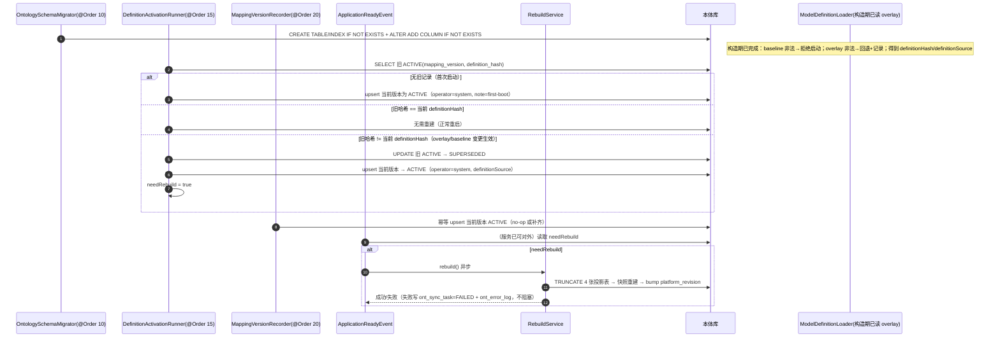

# 07 在线编辑关系类型 · 增量设计

> 角色/作者：架构师 高见远（Gao）｜版本 v1.0｜性质：增量设计（只出设计，不含实现）
> 需求来源：主理人（用户选定「在线编辑」方向）｜前置文档：[`02-架构设计.md`](./02-架构设计.md)、[`03-本体API契约.md`](./03-本体API契约.md)
> 目标：把 `ontology-web` 的「关系类型」从**只读展示**升级为**在线可编辑并可生效**，且不破坏「打包基线非法→拒绝启动」的既有口径。

---

## 0. 结论先行

| 项 | 结论 |
| --- | --- |
| **选定路线** | **路线 A：落盘 + 一键应用（受控自退出重启）**，并**内建降级到路线 B**（未开启自重启时返回「待生效，需手动重启」）。 |
| 为什么不是纯 B | 用户要「页面上改了就能用」。纯 B 只是「待生效」，不满足；但 B 作为 A 的安全降级必须保留（裸 `java -jar` 无 supervisor 时自杀会永久宕机）。 |
| 为什么能绕开「registry 不可变」 | 不热替换 `ModelRegistry`（37 处构造注入保持不动），而是让**进程重启**重新构造 `ModelDefinitionLoader` → 重新产出 `ModelRegistry`。改动只落在 loader 的**构造输入**（多读一个 overlay 文件），注册中心形状与注入方式零变化。 |
| 生效链路 | 保存（写 overlay + 强校验 + 登记 PENDING） → 应用（乐观版本校验 → 可选 `System.exit(0)`） → compose `restart: unless-stopped` 拉起（5–10s） → 启动自愈（检测生效哈希 ≠ 上次 ACTIVE → 登记新 ACTIVE + 触发一次重建投影） → 前端轮询恢复并显示新版本。 |
| 硬边界 | **打包基线（classpath 三份 YAML）非法 → 仍抛 `IllegalStateException` 拒绝启动**；**overlay 非法 → 回退基线 + 告警 + 记录原因，绝不锁死服务**。两者在 `ModelDefinitionLoader` 构造期分流（见 §5）。 |

---

## 1. 现有实现事实基线（本设计的前提，均已核实）

| # | 事实 | 对本设计的影响 |
| --- | --- | --- |
| F1 | `ModelDefinitionLoader` 在**无参构造函数**里读 classpath 三份 YAML；`definitionHash = Resp.sha256(objText + "\n" + relText + "\n" + srcText)`；`mappingVersion = sourceId + ":" + hash[0..12]`。校验失败抛 `IllegalStateException`。 | 需改造 loader 构造：把「读 relText」改为「overlay 优先、baseline 兜底」；hash 必须覆盖**实际生效**的 relText。 |
| F2 | `validate(objectDoc, relationDoc, sourceDoc)` 是 **public 实例方法**，返回 `List<String>` 错误，与启动校验同一套规则（含 fromType/toType 存在性、id 唯一、generation.kind、FOREIGN_KEY 必填等）。 | **保存时直接复用它**，保证「保存校验 == 启动校验」，避免两套规则漂移。 |
| F3 | `ModelRegistry` 为 `@Bean`（`loader.registry()`），运行时不可变；37 处构造注入。 | 不碰注册中心，只靠重启换新实例。 |
| F4 | `MappingVersionRecorder`（`ApplicationRunner`, `@Order(20)`）每次启动把当前 `loader.mappingVersion()` `upsert` 为 **ACTIVE**；已有 `activate(MappingVersion)` 与 `volatile current`。 | 自愈检测必须在它**之前**读 DB 旧 ACTIVE（`@Order(15)`），否则永远「一致」。 |
| F5 | `OntologySchemaMigrator`（`ApplicationRunner`, `@Order(10)`）执行 classpath `ontology/schema.sql`，全部 `CREATE TABLE/INDEX IF NOT EXISTS`。 | 加列用 `ALTER TABLE ... ADD COLUMN IF NOT EXISTS`，放在该脚本与新卷脚本两处。 |
| F6 | `OntologyRepository` 已有 `upsertMappingVersion(sourceId,version,hash,status)`、`upsertModelDef(...)`、`mappingVersions(sourceId)`、`updateDataSource`、`appendSyncTask/updateSyncTask/appendErrorLog`、`hasRunningTask(type)`。 | 扩展重载（加 `operator/note/definitionSource`）与「置 SUPERSEDED」方法，**不破坏既有签名**。 |
| F7 | `RebuildService.rebuild()` 只 TRUNCATE 4 张当前投影表、保留审计历史、内部 try/catch 写 `ont_sync_task`/`ont_error_log`、失败不抛。 | 自愈与 apply 后统一复用它，重建失败不阻塞可用性。 |
| F8 | `docker-compose.yml` 的 `ontology-service` 无 `volumes`、`restart: unless-stopped`、工作目录可写（temurin）。 | 需加绑定挂载 `/app/ontology-data` 与 `ONTOLOGY_SELF_RESTART_ENABLED=true`（建议文本，由主理人/工程师汇编）。 |
| F9 | `ontology-service/src/main/resources/application.yml` 已有 `ontology:` 段（`sync.*`、`business-web-base`）。 | 新增 `ontology.definition-dir` / `self-restart-enabled` / `apply-mode` 落在同一段，风格一致。 |
| F10 | 前端 `api.ts` 仅 `get/post`（`BASE='/ontology-api'`，鉴 `{code,data,message}`）；`ModelAdmin.vue` 关系区用 `fmt(rel)` 只读渲染；`OntologyQueryService.modelRelations()` 返回 `{mappingVersion, relations[]}`。 | 前端加 `put/del`；关系区改为可编辑表格；`/model/relations` 响应**保持不变**，另加 `/model/versions` 提供草稿/版本状态。 |

---

## 2. 方案选型：路线 A（受控自退出重启）+ 内建降级 B

### 2.1 对比

| 维度 | 路线 A：落盘 + 一键应用（自退出重启） | 路线 B：只落盘 + 提示重启 |
| --- | --- | --- |
| 用户「改了就能用」 | ✅ 5–10s 自动生效 | ❌ 需运维手动重启 |
| 绕开 registry 不可变 | ✅ 重启重建 | ✅（但同样靠重启才生效，只是不自动） |
| 裸 `java -jar` 风险 | ⚠️ 自杀后无人拉起 → 永久宕机 | ✅ 无风险 |
| 实现复杂度 | 中（需自愈 runner + apply 端点 + 前端轮询） | 低 |
| 结论 | **主方案**，但必须带「自重启开关 + 降级」 | **作为 A 的降级分支**（开关关闭时走它） |

### 2.2 选定方案：A，且以配置闸门内建降级

- 新增配置 `ontology.self-restart-enabled`（env `ONTOLOGY_SELF_RESTART_ENABLED`），**代码默认 `false`**（裸跑安全），仅在 compose 里显式设 `true`。
- `apply` 端点行为：
  - `selfRestartEnabled=true` 且存在有效草稿 → 先返回 `202 {applying:true, restartScheduled:true, targetMappingVersion}`，**延迟约 800ms** 异步 `System.exit(0)`（先让 HTTP 响应发回前端）。
  - `selfRestartEnabled=false` → 返回 `200 {pendingRestart:true, message:"已校验并保存；未启用自动重启，请手动重启本体服务以生效"}`（即路线 B 语义）。
- **为什么延迟退出**：同步 `System.exit` 可能在响应刷出前杀死进程，前端拿不到 202，误判失败。用 `ScheduledExecutorService` 延迟 800ms 退出，保证响应先落。
- **为什么默认 false**：`System.exit` 在无 restart policy 的裸 `java -jar` 下会让服务永久 down，属不可接受的默认行为；容器编排才是安全场景。

### 2.3 失败处理矩阵

| 场景 | 行为 |
| --- | --- |
| 保存时校验失败 | 400 + 逐条中文 `errors[]`，**不写 overlay、不改版本** |
| 重复点「应用」/并发应用 | 内存 `applying` 标记 → 409 `APPLY_IN_PROGRESS` |
| 草稿哈希 == 当前 ACTIVE 哈希（无改动） | 200 `{noChange:true}`，**不重启**（防重启风暴） |
| 应用后服务未重启（自重启关闭 / 退出失败） | 前端 30s 超时提示「请检查容器日志或手动重启」；草稿仍 PENDING，可再次 apply |
| overlay 保存成功但启动校验失败 | 启动期回退 baseline + 告警 + 记录（§5），**不锁死** |
| 重建失败 | `RebuildService` 内部记 `ont_sync_task=FAILED` + `ont_error_log`，服务仍可用（旧投影可查） |

---

## 3. 文件级改动清单

> 标注：`[NEW]` 新增、`[MOD]` 修改。路径相对 `D:/workbuddy_data/2026-11-14-11-06-37/school-panorama-demo/`。全部只做「新增一个能力」的最小侵入，**不动 37 处 `ModelRegistry` 注入、不动 `docs/API-CONTRACT.md`、不动原业务**。

### 3.1 后端 `ontology-service/`

| 文件 | 类型 | 职责（一句话） |
| --- | --- | --- |
| `src/main/java/com/school/ontology/core/model/DefinitionFileStore.java` | `[NEW]` | Overlay 文件层：路径解析、读取生效 relation 文本、原子写（tmp + ATOMIC_MOVE）、时间戳备份、坏文件隔离（`.invalid.<ts>`）、`ReentrantLock` + `FileChannel.lock()` 串行化。 |
| `src/main/java/com/school/ontology/core/model/RelationTypeValidator.java` | `[NEW]` | Overlay 级校验：字段级规则 + `sourceMappingRef` 存在性 + 删除引用影响分析；内部调用 `loader.validate(...)` 汇总集成级错误，输出统一 `List<String>` 中文错误。 |
| `src/main/java/com/school/ontology/core/model/RelationTypeDefinitionEditor.java` | `[NEW]` | 编辑编排：add/update/delete/reset/listVersions；构造新的 `RelationTypeDocument`、序列化 YAML、调用校验器、计算新 hash/version、写 overlay、登记 PENDING 版本、返回结果。 |
| `src/main/java/com/school/ontology/core/model/DefinitionActivationRunner.java` | `[NEW]` | 启动自愈：`@Order(15)`，读 DB 旧 ACTIVE → 比对 `loader.definitionHash()` → 登记新 ACTIVE/旧 SUPERSEDED（记 operator/note/definitionSource）→ 标记 `needRebuild`；在 `ApplicationReadyEvent` 中异步触发 `RebuildService.rebuild()`（失败不阻塞）。 |
| `src/main/java/com/school/ontology/core/model/DefinitionApplyService.java` | `[NEW]` | 应用：乐观版本校验（`baseMappingVersion == 当前 ACTIVE`）、`applying` 防重、`noChange` 判断、按 `selfRestartEnabled` 返回 202 并延迟 `System.exit(0)` 或返回 200「待手动重启」。 |
| `src/main/java/com/school/ontology/controller/ModelEditController.java` | `[NEW]` | 6 个编辑端点（§6），统一 `OntApiResponse`，异常走既有 `GlobalExceptionHandler`。 |
| `src/main/java/com/school/ontology/core/model/ModelDefinitionLoader.java` | `[MOD]` | 构造改为注入 `DefinitionFileStore`（或 `@Value` 定义目录）：relText 走「overlay 优先 / baseline 兜底」；baseline 非法拒绝启动、overlay 非法回退；hash 覆盖生效三份文本；暴露 `definitionSource()`。 |
| `src/main/java/com/school/ontology/repository/OntologyRepository.java` | `[MOD]` | 新增重载：`upsertMappingVersion(..., operator, note, definitionSource)`、`upsertModelDef(..., operator, note, definitionSource)`、`activeMappingVersion(sourceId)`、`supersedeOtherActive(sourceId, newVersion)`、`modelDefVersions()`。既有方法签名保持不变。 |
| `src/main/java/com/school/ontology/core/model/MappingVersionRecorder.java` | `[MOD]` | 仅在 `upsert` 时透传 `operator="system" / note="startup-baseline" / definitionSource=loader.definitionSource()`；不改其 `@Order(20)` 与幂等语义。 |
| `src/main/resources/application.yml` | `[MOD]` | 新增 `ontology.definition-dir`（默认 `/app/ontology-data`）、`ontology.self-restart-enabled`（默认 false）、`ontology.apply-mode`（`RESTART`/`MANUAL`，默认 `RESTART`）。 |
| `src/main/resources/ontology/schema.sql` | `[MOD]` | 追加幂等 `ALTER TABLE ... ADD COLUMN IF NOT EXISTS`（`ont_mapping_version`、`ont_model_def` 加 `operator/note/definition_source`）。 |
| `db/ontology/01_schema.sql`（仓库根） | `[MOD]` | 与上面**同步**加同样的幂等 ALTER（新卷初始化用），保持两处一致。 |

### 3.2 前端 `ontology-web/`

| 文件 | 类型 | 职责 |
| --- | --- | --- |
| `src/views/ModelAdmin.vue` | `[MOD]` | 关系类型区由只读列表改为「可编辑表格 + 版本/草稿状态条 + 新增/编辑/删除/恢复基线/应用入口」；其余卡片（对象类型、映射、同步任务、Outbox）保持。 |
| `src/components/RelationTypeEditorDialog.vue` | `[NEW]` | 关系类型表单（5 组：基本信息 / 起止对象 / 展示语义 / 生成规则 / 来源映射），按 `kind` 动态显示必填项，逐条中文错误展示。 |
| `src/components/DefinitionVersionPanel.vue` | `[NEW]` | 状态条 + 版本时间线：生效版本 / 草稿版本 / 来源（BASELINE/OVERLAY/OVERLAY_FALLBACK）/ 待生效徽标 / 应用按钮 / 恢复基线二次确认。 |
| `src/composables/useDefinitionApply.ts` | `[NEW]` | 应用后轮询恢复：服务重启期间请求失败自动重试，直到 `/model/versions` 的 `activeMappingVersion` 变化或超时（30s）；返回 `applying/success/timeout` 状态。 |
| `src/types.ts` | `[MOD]` | 新增 `RelationTypeEditRequest`、`SaveRelationResult`、`ApplyResult`、`ModelVersionsData`、`ValidationError` 等类型。 |
| `src/api.ts` | `[MOD]` | 新增 `api.put(path, body)`、`api.del(path, body?)`（复用现有 `request`，鉴 `{code,data,message}`）。 |

### 3.3 编排（**建议文本，由主理人汇编，本设计不改文件**）

`docker-compose.yml` 的 `ontology-service` 增加：

```yaml
  ontology-service:
    # ... 现有内容不变 ...
    environment:
      # ... 现有变量不变 ...
      ONTOLOGY_DEFINITION_DIR: /app/ontology-data
      ONTOLOGY_SELF_RESTART_ENABLED: "true"   # 仅容器编排下开启；裸 java -jar 保持默认 false
    volumes:
      - ./ontology-data:/app/ontology-data    # overlay 持久化到宿主机，容器重建不丢
```

> 说明：`restart: unless-stopped` 已存在，`System.exit(0)` 后由 compose 拉起；`./ontology-data` 需在主理人集成时创建（`mkdir -p ontology-data`）。`AGENTS.md` 建议补一条：「关系类型在线编辑的 overlay 位于 `./ontology-data/relation-types.yaml`，属运行时数据，不进版本库；恢复基线=回退到 `ontology-service/src/main/resources/ontology/model/relation-types.yaml`」。

---

## 4. 持久化与原子性

### 4.1 overlay 位置

```
${ontology.definition-dir:/app/ontology-data}/relation-types.yaml
宿主（compose 绑定挂载）：./ontology-data/relation-types.yaml
```

- **只 overlay 关系类型**（本需求范围）；object-types / source-mapping 仍走打包基线（避免一次改动面过大，也不破坏「新增对象类型」的既有流程）。
- overlay 文件内容 = 一份**完整**的 `relation-types.yaml`（`version` + `relationTypes[]`），不是补丁。这样 loader 读取时可整份替换 baseline 的 relText。

### 4.2 原子写

```
1. 序列化新 RelationTypeDocument 为 YAML 文本 text（固定缩进、UTF-8）
2. 先备份当前 overlay（若存在）：Files.copy(current, current + ".bak." + yyyyMMddHHmmss)
3. 写临时文件：Files.write(target + ".tmp." + uuid, text)
4. 原子替换：Files.move(tmp, target, ATOMIC_MOVE, REPLACE_EXISTING)
   （ATOMIC_MOVE 与 REPLACE_EXISTING 同用；同文件系统内原子，符合 overlay 目录）
5. 清理：保留最近 5 个 .bak.*，其余删除
```

- 备份只保留最近 5 个，避免无限增长；备份用于「应用失败回滚」与「人工审计」。

### 4.3 并发写避免

| 层 | 手段 |
| --- | --- |
| 进程内 | `DefinitionFileStore` 持 `ReentrantLock`，所有写操作串行 |
| 跨进程（多实例，本期单实例） | `FileChannel.open(target, CREATE, WRITE).lock()` 排他锁；拿不到锁 → 409 `DEFINITION_LOCKED` |
| 逻辑冲突（用户 A/B 同时编辑） | **乐观版本**：请求体带 `baseMappingVersion`，必须等于当前 `activeMappingVersion`，否则 409 `VERSION_CONFLICT`（§6） |
| 与导入/重建并发 | 若 `hasRunningTask("FULL_IMPORT") || hasRunningTask("REBUILD")` → 409 `TASK_CONFLICT`（避免「改定义的同时在重建」，语义混乱） |

---

## 5. 哈希、版本与「基线非法 vs overlay 非法」的边界

### 5.1 哈希必须覆盖「实际生效的三份文本」

```
生效 objText  = classpath ontology/model/object-types.yaml   （base）
生效 relText  = overlay 存在 ? overlay 文件文本 : classpath ontology/model/relation-types.yaml
生效 srcText  = classpath ontology/mapping/school-source.yaml （base）
definitionHash = Resp.sha256(objText + "\n" + relText + "\n" + srcText)
mappingVersion = sourceId + ":" + definitionHash[0..12]
```

> 结论：overlay 任何字段改动 → relText 变 → `definitionHash` 必变 → `mappingVersion` 必变 → 详情/关系 `reason` 里的 `mappingVersion` 随之变化（端到端验收点）。overlay 与 baseline 内容相同 → hash 相同 → 视为「无改动」。

### 5.2 版本表状态机

`ont_mapping_version`（加列后）：`(source_id, mapping_version)` 唯一；`status ∈ {PENDING, ACTIVE, SUPERSEDED}`。

```
保存（写 overlay + 校验通过）→ 新行 status=PENDING（operator/note/definition_source=OVERLAY）
应用 + 重启生效 → 启动自愈：新行 → ACTIVE；原 ACTIVE 行 → SUPERSEDED
恢复基线（删 overlay）→ 重启后 hash=baseline → baseline 行 → ACTIVE；原 ACTIVE → SUPERSEDED
overlay 非法回退 → 生效=baseline → baseline 行 → ACTIVE；坏 overlay 行保持 PENDING 并 note 标注回退原因
```

- `operator`：请求体 `operator`（前端默认「演示管理员」，可配置）；启动自愈登记时用 `system`。
- `note`：请求体 `note` 或自动生成（如「编辑 relation session_taught_by」「恢复基线」）。
- `definition_source ∈ {BASELINE, OVERLAY, OVERLAY_FALLBACK}`。

### 5.3 「基线非法拒绝启动」vs「overlay 非法回退」——必须严格区分

`ModelDefinitionLoader` 构造期伪代码（改造后）：

```java
// 1) 读 baseline 三份文本并解析
objDoc  = parse(objText);  relBaselineDoc = parse(relText);  srcDoc = parse(srcText);

// 2) 【基线闸门】baseline 自身非法 → 拒绝启动（保持现有 B1 口径）
List<String> baseErrors = validate(objDoc, relBaselineDoc, srcDoc);
if (!baseErrors.isEmpty()) {
    throw new IllegalStateException("本体模型定义非法，服务拒绝启动：\n - " + join(baseErrors));
}

// 3) overlay 优先：存在则尝试覆盖 relText
String definitionSource = "BASELINE";
String effectiveRelText = relText;
RelationTypeDocument effectiveRelDoc = relBaselineDoc;
if (fileStore.overlayExists()) {
    try {
        String ovText = fileStore.readOverlayText();
        RelationTypeDocument ovDoc = parse(ovText);
        List<String> ovErrors = validate(objDoc, ovDoc, srcDoc);   // 与启动同一套规则
        if (!ovErrors.isEmpty()) throw new OverlayInvalidException(ovErrors);
        effectiveRelText = ovText; effectiveRelDoc = ovDoc; definitionSource = "OVERLAY";
    } catch (Exception e) {
        // 4) 【overlay 闸门】overlay 非法 → 回退基线 + 告警 + 记录，绝不锁死
        fileStore.quarantineInvalidOverlay();          // 改名 .invalid.<ts>，避免下次再踩
        fileStore.recordFallback(e.getMessage());      // 写 ont_error_log(phase=OVERLAY_FALLBACK) + WARN
        definitionSource = "OVERLAY_FALLBACK";         // 生效=baseline
        // effectiveRelText/effectiveRelDoc 保持 baseline
    }
}

// 5) 计算生效 hash（覆盖 effective 三份文本）+ 构造 registry（形状不变）
this.definitionHash = Resp.sha256(objText + "\n" + effectiveRelText + "\n" + srcText);
this.mappingVersion = new MappingVersion(sourceId, sourceId + ":" + hash[0..12], "sha256:" + hash, now, "ACTIVE");
this.registry = new ModelRegistry(...);   // 与现有完全一致
```

> **三条不可动摇的边界**：
> 1. 打包基线（三份 classpath YAML）非法 → `IllegalStateException` 拒绝启动（**与上一轮口径一致，不改**）。
> 2. overlay 解析/校验失败 → **回退 baseline 启动**，写 `ont_error_log(phase=OVERLAY_FALLBACK)` + WARN 日志 + 前端状态条显式显示「草稿非法，已回退基线」。
> 3. 任何情况下**不允许坏配置把服务锁死**。

---

## 6. API 契约（6 个新增端点）

> 前缀 `/api/ontology`（容器内 nginx 反代 `/ontology-api`）；统一 `{code, data, message}`；成功 `code="OK"`。
> 所有写端点 body 必带 `baseMappingVersion`（乐观校验）；`operator` 可选（默认「演示管理员」），`note` 可选。
> **既有 `GET /model/relations`、`/model/types`、`/model/mappings` 响应结构不变**（避免破坏前端只读区与既有验收）。

### 6.0 公共类型

```jsonc
// 关系类型定义（与 RelationTypeDef 字段一一对应）
{
  "id": "session_taught_by",
  "displayName": "授课安排-授课教师",
  "fromType": "lessonSession",
  "toType": "teacher",
  "forwardName": "授课教师",
  "reverseName": "授课安排",
  "direction": "OUT",                 // OUT | IN
  "cardinality": "N:1",               // N:1 | 1:1 | 1:N | N:M
  "businessEffectiveTime": true,
  "generation": {
    "kind": "FOREIGN_KEY",            // FOREIGN_KEY | JOIN_RULE
    "sourceTable": "lesson_sessions", "fkColumn": "teacher_id", "targetTable": "teachers",
    "validFromColumns": ["lesson_date", "start_time"]
    /* JOIN_RULE 时改用：sourceColumn / joinTable / joinFilterColumn / joinSelectColumn / targetTable / distinct / rule */
  },
  "sourceMappingRef": "school-source.yaml#lessonSession"
}
```

### 6.1 `POST /api/ontology/model/relations`（新增一条）

**请求**
```jsonc
{
  "baseMappingVersion": "school-panorama:c159e7192cb5",
  "operator": "演示管理员",
  "note": "新增教室使用关系",
  "relation": { /* 6.0 定义；id 必填且唯一 */ }
}
```
**成功 200**
```jsonc
{ "code":"OK", "data": {
  "saved": true, "applied": false,
  "pendingMappingVersion": "school-panorama:8a1f3c07d9e2",
  "definitionSource": "OVERLAY",
  "message": "已保存草稿，点击『应用到运行时』后生效"
}, "message":"" }
```
**校验失败 400**（逐条中文，`errors[]`；`data` 带 `relationId` 便于定位）
```jsonc
{ "code":"VALIDATION_FAILED", "data": {
  "relationId": "new_relation",
  "errors": [
    "关系类型 id 非法：必须以字母开头，仅含字母、数字、下划线",
    "起点类型不存在：classroom2（可选：school、class、student、teacher、course、lessonSession、classroom）",
    "displayName 不能为空",
    "generation.kind 非法：必须是 FOREIGN_KEY 或 JOIN_RULE",
    "FOREIGN_KEY 缺少 fkColumn",
    "sourceMappingRef 指向不存在的映射：school-source.yaml#notExist"
  ]
}, "message":"关系类型校验未通过" }
```
**冲突 409**：`VERSION_CONFLICT`（`baseMappingVersion` ≠ 当前 ACTIVE）、`TASK_CONFLICT`（有导入/重建任务运行中）、`DEFINITION_LOCKED`（文件锁未获得）。

### 6.2 `PUT /api/ontology/model/relations/{id}`（修改）

- 请求同 6.1，但 `relation.id` 必须等于路径 `{id}`；**id 不可通过本端点改名**（改 id 视为「删+增」，避免引用断裂）。
- 成功/400/409 同 6.1；额外 404 `NOT_FOUND`（`{id}` 不存在）。

### 6.3 `DELETE /api/ontology/model/relations/{id}`（删除）

**请求**
```jsonc
{ "baseMappingVersion":"school-panorama:8a1f3c07d9e2", "operator":"演示管理员",
  "note":"下线旧的派生关系", "force": false }
```
**影响提示 409（默认，未 force）**
```jsonc
{ "code":"DELETE_IMPACT_CONFIRM", "data": {
  "relationId":"student_taught_by",
  "referencedByMappings":[ {"objectType":"student","rule":"joinRelationRules[0].relationType=student_taught_by"} ],
  "impactedObjectTypes":["student","teacher"],
  "hint":"该关系仍被 1 处映射引用，删除后这些映射不再生成该关系；确认请带 force=true 重发"
}, "message":"删除会影响既有映射，需确认" }
```
**成功 200（force=true）**
```jsonc
{ "code":"OK","data":{ "deleted":true, "applied":false,
  "pendingMappingVersion":"school-panorama:55c0e1a7b3d4","definitionSource":"OVERLAY",
  "message":"已删除并保存草稿，点击『应用到运行时』后生效" }, "message":"" }
```
- **允许删除被引用的关系**（主理人倾向），但必须先返回影响清单并要求 `force=true`；删除后该映射在重建时不再产出该关系（这是定义驱动的一致行为，不写死代码）。

### 6.4 `POST /api/ontology/model/relations/reset`（恢复基线）

**请求**
```jsonc
{ "baseMappingVersion":"school-panorama:8a1f3c07d9e2", "confirm": true, "operator":"演示管理员" }
```
**成功 200**
```jsonc
{ "code":"OK","data":{ "reset":true, "applied":false,
  "definitionSource":"BASELINE", "pendingMappingVersion":null,
  "message":"已删除在线改动，将回到打包基线；点击『应用到运行时』后生效" }, "message":"" }
```
- `confirm!=true` → 400（前端二次确认）。
- 删除 overlay 前先备份为 `.bak.<ts>`；若 overlay 不存在 → 200 `{reset:true, noChange:true}`。

### 6.5 `GET /api/ontology/model/versions`（版本列表 + 草稿状态）

```jsonc
{ "code":"OK","data":{
  "sourceId":"school-panorama",
  "activeMappingVersion":"school-panorama:c159e7192cb5",
  "activeDefinitionSource":"BASELINE",
  "draft": { "exists": true, "draftMappingVersion":"school-panorama:8a1f3c07d9e2",
             "draftDefinitionSource":"OVERLAY", "savedAt":"2026-11-15T19:10:00",
             "pendingApply": true },
  "lastFallback": { "occurred": false, "reason": null, "at": null },
  "versions": [
    { "mappingVersion":"school-panorama:8a1f3c07d9e2","definitionHash":"sha256:8a1f...",
      "status":"PENDING","definitionSource":"OVERLAY","operator":"演示管理员",
      "note":"编辑 relation session_taught_by","activatedAt":"2026-11-15T19:10:00" },
    { "mappingVersion":"school-panorama:c159e7192cb5","definitionHash":"sha256:c159...",
      "status":"ACTIVE","definitionSource":"BASELINE","operator":"system",
      "note":"startup-baseline","activatedAt":"2026-11-15T18:40:00" },
    { "mappingVersion":"school-panorama:0000aaaa1111","definitionHash":"sha256:0000...",
      "status":"SUPERSEDED","definitionSource":"OVERLAY","operator":"演示管理员",
      "note":"早期草稿","activatedAt":"2026-11-15T17:20:00" }
  ]
}, "message":"" }
```

### 6.6 `POST /api/ontology/model/relations/apply`（应用）

**请求**
```jsonc
{ "baseMappingVersion":"school-panorama:c159e7192cb5", "operator":"演示管理员" }
```
**成功 202（自重启开启且存在有效草稿）**
```jsonc
{ "code":"OK","data":{ "applying":true, "restartScheduled":true,
  "targetMappingVersion":"school-panorama:8a1f3c07d9e2",
  "message":"正在应用，本体服务将在约 1 秒后重启（5–10 秒恢复）" }, "message":"" }
```
**成功 200（自重启关闭 → 降级路线 B）**
```jsonc
{ "code":"OK","data":{ "applying":false, "pendingRestart":true,
  "targetMappingVersion":"school-panorama:8a1f3c07d9e2",
  "message":"已校验通过；当前未启用自动重启，请手动重启本体服务以生效" }, "message":"" }
```
**成功 200（无改动）**
```jsonc
{ "code":"OK","data":{ "applying":false, "noChange":true,
  "message":"草稿与当前生效版本一致，无需应用" }, "message":"" }
```
**冲突 409**
- `APPLY_IN_PROGRESS`：已有一个应用在途
- `NO_DRAFT`：无草稿（overlay 不存在）→ 实际用 400 更合适，取 400 `BAD_REQUEST`
- `VERSION_CONFLICT`：`baseMappingVersion` ≠ 当前 ACTIVE
- `TASK_CONFLICT`：有导入/重建在跑

---

## 7. 校验规则清单（`RelationTypeValidator`）

> 顺序即报错顺序；全部中文。前 6 组为**字段级**，第 7 组为**集成级**（复用 `loader.validate`），第 8 组为**引用影响**（删除时）。

| # | 规则 | 触发错误文案示例 |
| --- | --- | --- |
| 1 | `id` 非空、格式 `[A-Za-z][A-Za-z0-9_]*` | 「关系类型 id 非法：必须以字母开头，仅含字母、数字、下划线」 |
| 2 | `id` 新增时全局唯一；修改时等于路径 id | 「关系类型 id 已存在：session_taught_by」 |
| 3 | `fromType` / `toType` ∈ 已注册对象类型（来自 `registry`） | 「起点类型不存在：xxx（可选：school、class、student、teacher、course、lessonSession、classroom）」 |
| 4 | `displayName` / `forwardName` / `reverseName` 非空 | 「反向展示名不能为空」 |
| 5 | `direction ∈ {OUT, IN}`；`cardinality ∈ {N:1, 1:1, 1:N, N:M}` | 「基数非法：必须是 N:1、1:1、1:N、N:M 之一」 |
| 6 | `generation.kind ∈ {FOREIGN_KEY, JOIN_RULE}` 且分支必填：<br>· FOREIGN_KEY：`sourceTable`、`fkColumn`（`targetTable` 建议）<br>· JOIN_RULE：`sourceColumn`、`joinTable`、`joinFilterColumn`、`joinSelectColumn`、`targetTable` | 「JOIN_RULE 缺少 joinSelectColumn」 |
| 7 | **集成级**：以「baseline obj 文档 + 新 rel 文档 + baseline src 文档」调用 `loader.validate(...)`，错误合并入 `errors[]` | 「关系类型[x] 的起止类型必须是已注册对象类型（from=..., to=...）」 |
| 8 | `sourceMappingRef` 必须形如 `school-source.yaml#<objectType>` 且 `<objectType>` 存在于 `objectMappings`（**现有 `validate` 未覆盖，本类补齐**） | 「sourceMappingRef 指向不存在的映射：school-source.yaml#xxx」 |
| 9 | 删除时引用影响分析（不阻止，返回清单） | 「该关系仍被 1 处映射引用：student.joinRelationRules[0]」 |

> **为什么不另写一套校验**：直接复用 `loader.validate` 保证「保存通过 = 启动通过」，避免两套规则漂移；`RelationTypeValidator` 只补 loader 未覆盖的 2 条（`sourceMappingRef`、删除影响）与字段级中文提示。

---

## 8. 启动自愈流程（`DefinitionActivationRunner`）



**要点**
1. **顺序**：10（建表/加列）→ 15（自愈检测，必须早于 20）→ 20（既有版本登记，幂等）→ `ApplicationReadyEvent`（此时 Tomcat 已就绪，重建在后台跑，**不阻塞服务可用**）。
2. **首次启动**：DB 无 ACTIVE → 不重建（投影由全量导入负责，不越权）。
3. **正常重启（无定义变更）**：哈希一致 → 不重建，避免「每次重启都重建」。
4. **定义变更生效**：哈希不一致 → 登记新 ACTIVE + 重建当前投影（复用 `RebuildService`，只重建投影、保留审计历史）。
5. **overlay 回退**：`definitionSource=OVERLAY_FALLBACK`，哈希=baseline → 与上次 ACTIVE（overlay 版本）不一致 → 登记 baseline 为 ACTIVE + 重建回基线，并在 `GET /model/versions` 的 `lastFallback` 暴露原因。
6. **重建失败不阻塞**：`RebuildService` 内部已 catch 并写 `ont_sync_task/FAILED` + `ont_error_log`；服务继续以「新定义 + 旧投影」运行，前端在 `/sources/status` 可见 `status=FAILED`，可手动重建。

---

## 9. 前端交互稿

### 9.1 关系类型区（`ModelAdmin.vue` 局部改造）

```
┌ 关系类型定义（10 条）  [新增关系类型]  [应用到运行时]  [恢复基线]
│ 状态条：生效版本 school-panorama:c159e7192cb5（BASELINE）
│        草稿版本 school-panorama:8a1f3c07d9e2（OVERLAY）· 待生效 ●  [应用]
│        ⚠ 上次启动曾回退基线：overlay 非法（见 error log）   ← 仅 lastFallback 时显示
├─────────────────────────────────────────────────────────────
│ id                   显示名        起点→终点                基数  生成规则      操作
│ student_in_class     学生所在班级  student → class          N:1  FOREIGN_KEY   [编辑][删除]
│ session_taught_by    授课安排-…    lessonSession → teacher  N:1  FOREIGN_KEY   [编辑][删除]
│ ...
└─────────────────────────────────────────────────────────────
```

- **新增/编辑** → `RelationTypeEditorDialog`：5 组字段（基本信息 / 起止对象 / 展示语义 / 生成规则 / 来源映射），`fromType`/`toType`/`sourceMappingRef` 为下拉（数据来自 `/model/types` 与 `/model/mappings`）；`generation.kind` 切换时动态显示必填项；保存时逐条展示 400 `errors[]`。
- **删除** → 先调 DELETE（不带 force）→ 若返回 `DELETE_IMPACT_CONFIRM`，弹二次确认列出 `impactedObjectTypes` + `referencedByMappings`，确认后带 `force=true` 重发。
- **恢复基线** → 二次确认对话框：「将删除全部在线改动（N 条关系回到打包基线），并需应用后生效」，确认后 `POST /relations/reset {confirm:true}`。
- **应用** → `useDefinitionApply`：
  - 调 `POST /relations/apply`；收到 202 → 显示「正在应用，服务重启中…（预计 5–10 秒）」，进入轮询；
  - 轮询 `GET /model/versions`，**任何请求失败都重试**（服务重启期 502/连不上），直到 `activeMappingVersion` 变为 `targetMappingVersion` → 显示「已生效」并刷新列表；
  - 30s 未恢复 → 显示「应用超时：请检查容器日志或手动重启」（草稿仍 PENDING，可重试）；
  - 收到 200 `pendingRestart` → 显示「已保存；未启用自动重启，请手动重启本体服务」。
- **版本时间线**（`DefinitionVersionPanel`）：PENDING/ACTIVE/SUPERSEDED + operator/note/definitionSource/activatedAt（数据来自 `/model/versions`）。

### 9.2 刷新与一致性
- 现有 `useRevisionPolling`（成功后才 ack 版本号）**保持不变**；本功能只在 `ModelAdmin` 内额外挂 `useDefinitionApply` 的轮询，不改变全局刷新协议。

---

## 10. 测试要点

### 10.1 后端单测
| 目标 | 用例 |
| --- | --- |
| `RelationTypeValidator` | id 非法/重复、fromType/toType 不存在、必填为空、direction/cardinality 非法、FOREIGN_KEY/JOIN_RULE 分支必填缺失、`sourceMappingRef` 不存在、删除引用影响清单 |
| `DefinitionFileStore` | 原子写（中途异常不留半文件）、备份生成与保留数、`.invalid.<ts>` 隔离、并发写串行（多线程） |
| 哈希/版本 | 改 `displayName` → hash 变、version 变；改回 → hash 回到原值；overlay 内容 == baseline → 视为 noChange |
| loader 分流 | **baseline 非法 → `IllegalStateException`**；**overlay 非法 → 回退 baseline + `OVERLAY_FALLBACK`**；两种互不串 |
| `DefinitionActivationRunner` | 无旧记录不重建；哈希一致不重建；哈希不一致登记 ACTIVE/SUPERSEDED 且置 needRebuild；重建失败不抛 |
| 既有回归 | `ModelDefinitionValidationTest` 必须继续通过（validate 行为不变） |

### 10.2 接口用例
- 6 端点 happy path；400（逐条 errors）；409（VERSION_CONFLICT / TASK_CONFLICT / APPLY_IN_PROGRESS / DELETE_IMPACT_CONFIRM / DEFINITION_LOCKED）；404（PUT/DELETE 不存在的 id）；apply 的 noChange 与 pendingRestart 两分支。

### 10.3 端到端（可照做）
1. `/admin` 改 `session_taught_by.displayName` 为「授课教师（在线）」→ 保存（PENDING）→ 应用 → 服务重启 → `/model/relations` 与对象详情 `reason` 的 `mappingVersion` 变化、显示名变化、投影重建成功。
2. 恢复基线 → 应用 → 重启 → 定义回到 `school-panorama:c159e7192cb5`，显示名还原。
3. 构造非法 overlay（手写坏 YAML）→ 重启 → 服务正常启动（回退 baseline）、`/model/versions.lastFallback` 显示原因、`ont_error_log` 有 `OVERLAY_FALLBACK`。

### 10.4 回归风险点（对既有 45 单测 / 22 验收）
| 风险 | 说明 | 缓解 |
| --- | --- | --- |
| loader 构造签名变化 | 若注入 `DefinitionFileStore`，需保证 Spring 能构造（`@Component`） | `DefinitionFileStore` 为 `@Component`，loader 构造注入；或 `@Value` 目录 + 内部 new store |
| `validate` 语义被改 | 会影响 B1 负例单测 | **不改 `validate` 方法体**，只在外部追加 overlay 规则 |
| `onto_model_def` content 变化 | 若保存即覆盖生效内容，会污染「生效定义可查」 | 保存只写 overlay + `ont_mapping_version`(PENDING)；`ont_model_def` 仍由启动登记生效内容 |
| 重启期间 502 | 前端既有轮询会报错 | `useDefinitionApply` 与 `useRevisionPolling` 均已具「失败重试」，不受影响 |
| 教室关系（批次④） | overlay 必须以「当前完整 relation-types.yaml」为基，否则会丢教室关系 | 保存时基于 `loader.relationDocument()`（含 classroom 关系）编辑，不手写残缺文件 |

---

## 11. 风险与取舍（≥5）

1. **自退出重启在生产环境的适用性**：`System.exit(0)` 依赖编排层 `restart: unless-stopped` 自动拉起；K8s/多实例/无 supervisor 场景不适用（会造成实例滚动或宕机）。**取舍**：默认关闭（`SELF_RESTART_ENABLED=false`），仅在单实例容器演示环境开启；生产建议演进为「运行期可变 `ModelRegistry`（原子替换引用）+ 版本广播」，属未来项，不在本轮。
2. **overlay 与 git 中 YAML 漂移**：overlay 是运行时数据，不在版本控制；容器重建/换机可能丢失（若未挂载）或与 git 基线分叉。**取舍**：绑定挂载 `./ontology-data` 持久化到宿主；提供「恢复基线」一键回到 git 版本；`AGENTS.md` 注明 overlay 属运行时数据、不进版本库。
3. **重启期间同步中断窗口（5–10s）**：本体服务不可用 → 业务侧投递器失败退避、Outbox 事件留 `PENDING`、恢复后 `catchUp` 追赶。**为什么事件不丢**：Outbox 事件写在**业务库本地事务**内、与本体服务可用性无关；投递器失败只是延迟，不会丢事件（对应 02 §4.3、03 §3）。
4. **启动重建耗时**：当前 24 节课规模可忽略；大数据量时重建可能数十秒。**取舍**：重建放 `ApplicationReadyEvent` 后台异步，不阻塞端口可用；期间展示旧投影 + `mappingVersion` 过渡，前端可见「重建中」。
5. **保存 ≠ 生效，草稿可能长期挂起**：用户保存后忘记应用。**取舍**：`/model/versions` 的 `draft.pendingApply=true` + 前端状态条显著「待生效」徽标；管理页进入即提示。
6. **overlay 非法回退的「静默」风险**：用户以为改动生效、实际回退了。**取舍**：`lastFallback` + `ont_error_log(OVERLAY_FALLBACK)` + 前端红色告警条三处显式暴露，绝不当无事发生。
7. **删除被引用关系的连锁影响**：删除后映射不再生成该关系，图/详情少一条边。**取舍**：允许删除但强制影响确认（`force`），并在删除结果里回传 `impactedObjectTypes`，不静默删。
8. **多实例并发写**：本期单实例；文件锁 + 乐观版本够用。**取舍**：多实例需共享卷或「定义存 DB + 广播」，列为未来项。

---

## 12. 实施顺序（给工程师）

| 步 | 内容 | 依赖 |
| --- | --- | --- |
| S1 | DDL：两处 `schema.sql` 加幂等 `ALTER ... ADD COLUMN IF NOT EXISTS`（operator/note/definition_source）；`OntologyRepository` 加重载与 `supersedeOtherActive/activeMappingVersion/modelDefVersions` | — |
| S2 | `DefinitionFileStore`（路径/原子写/备份/锁/隔离/fallback 记录）+ 单测 | S1 |
| S3 | `ModelDefinitionLoader` 改造（overlay 优先/baseline 兜底/双闸门/hash 覆盖生效三份/`definitionSource()`）+ 单测 | S2 |
| S4 | `RelationTypeValidator`（复用车 loader.validate + 补 2 条）+ 单测 | S3 |
| S5 | `RelationTypeDefinitionEditor`（add/update/delete/reset/listVersions） | S3、S4 |
| S6 | `DefinitionActivationRunner`（@Order 15 + ApplicationReady 重建） | S3 |
| S7 | `DefinitionApplyService` + `ModelEditController`（6 端点） | S5、S6 |
| S8 | `application.yml` 配置项；compose 挂载与开关（主理人汇编） | S7 |
| S9 | 前端 `api.ts(put/del)` / `types.ts` / `RelationTypeEditorDialog` / `DefinitionVersionPanel` / `useDefinitionApply` / `ModelAdmin` 改造 | S7 |
| S10 | 端到端自测（§10.3）+ 既有 45 单测/22 验收回归 | S8、S9 |

---

## 13. 需主理人确认（均给默认值，不阻塞）

| # | 问题 | 默认建议 |
| --- | --- | --- |
| Q1 | 是否接受「默认关闭自重启、compose 内显式开启」的安全闸门 | **接受**（裸 `java -jar` 安全，容器内 5–10s 生效） |
| Q2 | `operator` 取值 | 默认「演示管理员」（与原业务 `change_records.operator` 一致），不做鉴权 |
| Q3 | 是否允许「删除被引用的关系」 | **允许**，但强制影响确认（`force`），不静默 |
| Q4 | overlay 是否纳入 git | **否**，属运行时数据；`AGENTS.md` 注明，`./ontology-data` 挂载持久化 |
| Q5 | 是否把 overlay 扩展到 object-types / source-mapping | **本轮不扩展**（只关系类型，控制改动面）；未来按同一机制演进 |

---

> **诚实边界**：本文件为**增量设计**，不含实现代码；`docker-compose.yml` / `AGENTS.md` / 既有源码与文档的改动以「建议文本 + 文件清单」给出，由主理人/工程师汇编。选定的运行时生效方式为「受控重启」，**不宣称**已实现运行期热替换（`ModelRegistry` 仍不可变）。
